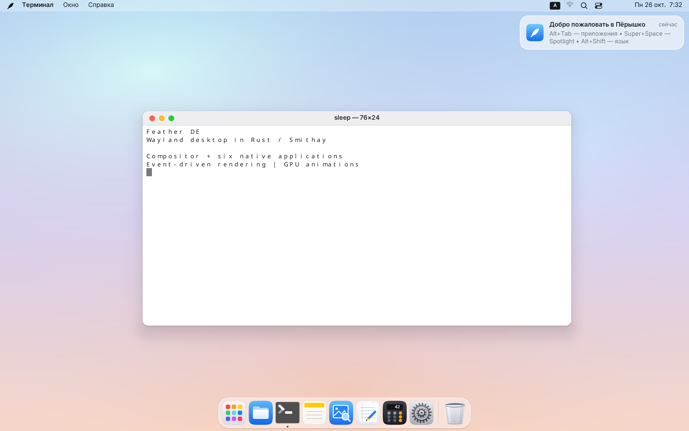
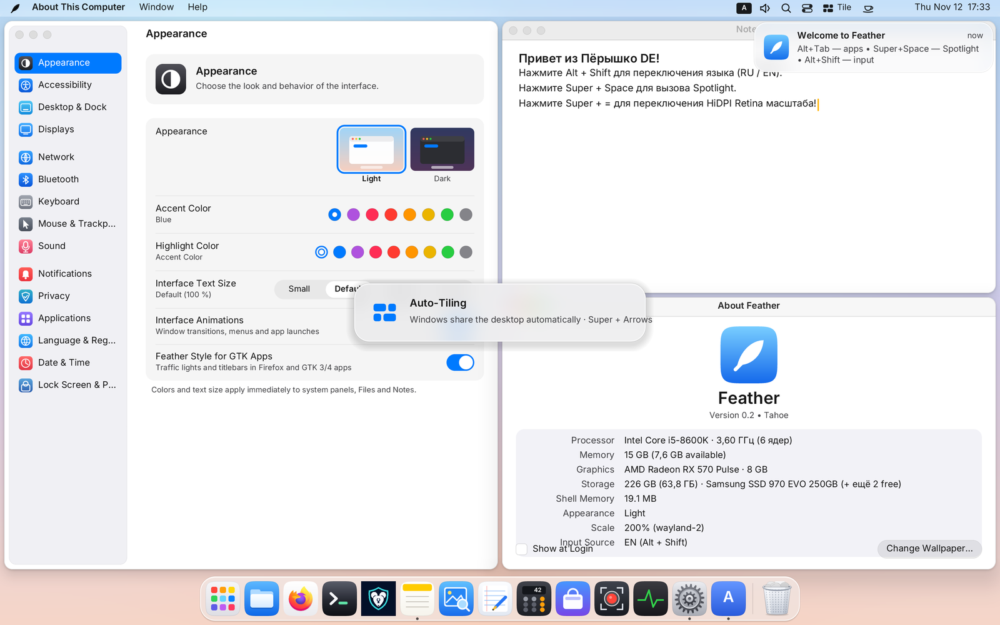
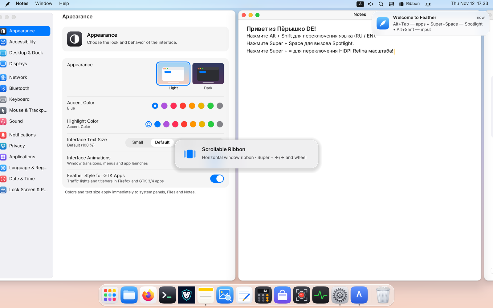
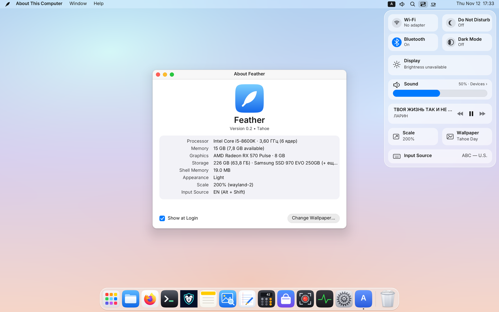
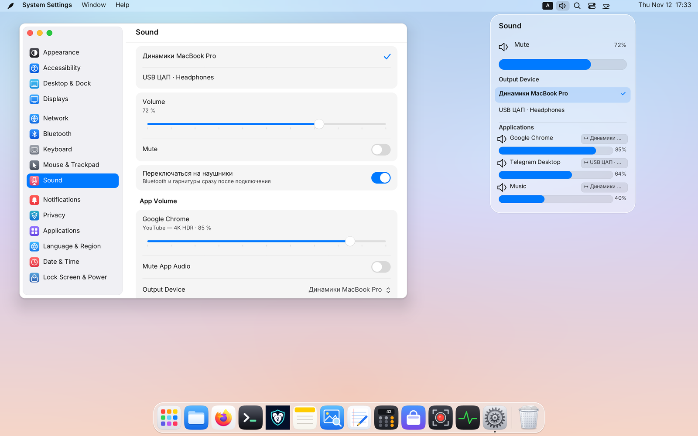
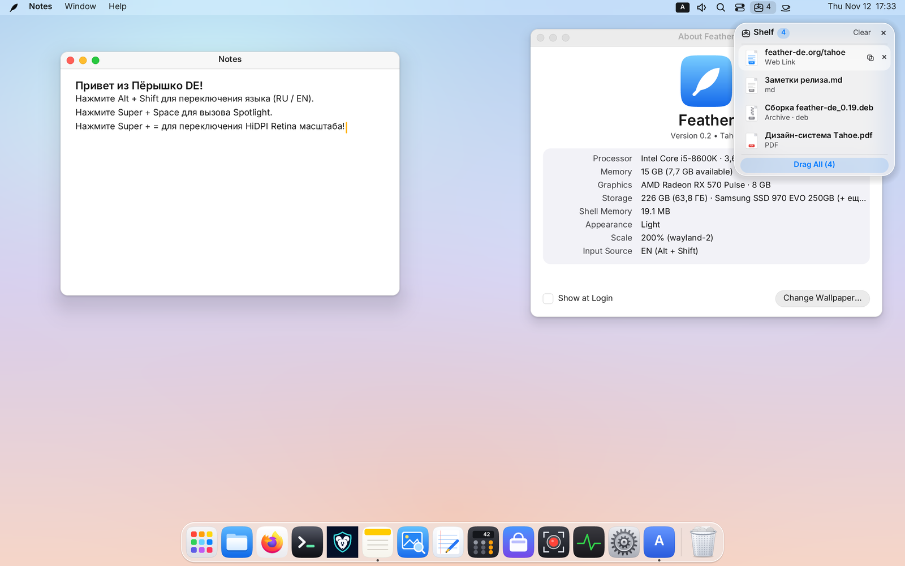
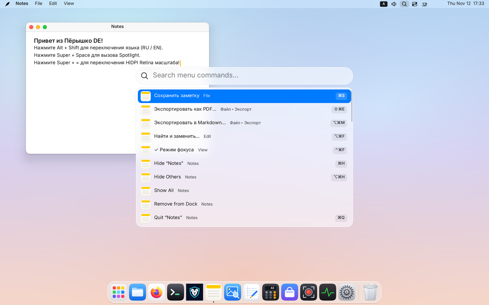

# Feather DE · Пёрышко

**A lightweight Linux desktop with its own Wayland compositor, real-time GPU `Liquid Glass`, three workspace layout modes (floating windows, automatic BSP tiling, and a scrollable horizontal ribbon), and eight native applications in Rust.**

[🇷🇺 Русский](README.md) · **[📖 User Guide (EN)](docs/USER_GUIDE.en.md)** · **[📖 Руководство (RU)](docs/USER_GUIDE.md)** · [Shell features](#shell-features) · [Build and install](#build-and-install) · [Keyboard shortcuts](#keyboard-shortcuts) · [Roadmap](docs/ROADMAP.md)



> ### 📖 Illustrated User Guide
> Complete step-by-step manual covering every feature of Feather DE with live screenshots — including the Control Center & Notification drawers, Scratchpad (`Super+S`), Glass Drop Shelf (`Super+D`), Auto-Tiling, Scrollable Ribbon (`Tape`), Ghost PiP, Per-App Audio Mixer, native apps, and all keyboard shortcuts:
> - 🇬🇧 **[Open the Illustrated User Guide in English (`docs/USER_GUIDE.en.md`)](docs/USER_GUIDE.en.md)**
> - 🇷🇺 **[Открыть Руководство пользователя на русском (`docs/USER_GUIDE.md`)](docs/USER_GUIDE.md)**
>
> Quick jump: [Menu Bar & Menu HUD](docs/USER_GUIDE.en.md#2-top-menu-bar-global-menus--menu-hud-super--) · [Windows & Ghost PiP](docs/USER_GUIDE.en.md#4-windows-edge-snapping--ghost-pip-super--p) · [Auto-Tiling & Scrollable Ribbon](docs/USER_GUIDE.en.md#5-workspaces-auto-tiling-tile--scrollable-ribbon-tape) · [Scratchpad & Drop Shelf](docs/USER_GUIDE.en.md#6-scratchpad-drawer-super--s--drop-shelf-super--d) · [Control Center & Per-App Audio Mixer](docs/USER_GUIDE.en.md#7-top-drawers-control-center-per-app-audio-mixer--notifications) · [Shortcut Cheat Sheet](docs/USER_GUIDE.en.md#12-cli-automation-featherctl--complete-keyboard-shortcut-reference)

Feather brings together a global menu bar, Dock, application search and launcher,
window overview, workspaces with three layout modes, quick control/notification drawers,
and System Settings. Its visual language is inspired by macOS Tahoe: light and dark surfaces,
real-time GPU **Liquid Glass**, rounded corners, soft shadows, and spring animations.
The desktop runs on its own **Rust / Smithay 0.7** compositor with event-driven processing
and an OpenGL/EGL rendering pipeline.

The project prioritizes responsiveness and low resource use (`0%` idle CPU, `≤ 1 ms` compositor
work per frame, `≤ 60 MB` steady `RssAnon`). Rendering follows changes to the scene; expensive
asset preparation and system-service operations run outside the input and rendering loop.
Files, Terminal, Notes, Preview, Text Editor, Calculator, Activity Monitor, and App Store
are developed alongside the compositor.

**Early testing stage.** Ready packages with updates exist for Ubuntu (APT) and Arch Linux
(pacman). Validation across GPUs, laptops, and physical displays is ongoing. Feather
currently ships as a desktop environment; this repository does not yet provide an
installation image for a separate operating system.

## Project components

| Component | Purpose |
|---|---|
| `feather-de` | Wayland compositor, window management, desktop shell, settings, and Linux integration |
| `feather-files` | File manager and file opening/saving dialogs |
| `feather-terminal` | Terminal with a custom DEC/ANSI/VT engine, tabs, and search |
| `feather-notes` | Plain-text notes with search and autosave |
| `feather-preview` | Raster image, SVG, and multipage PDF viewer |
| `feather-textedit` | Tabbed text editor with syntax highlighting and find/replace |
| `feather-calc` | Basic, scientific, and programmer calculator |
| `feather-monitor` | Activity Monitor (`Ctrl+Alt+Del`): processes, End Task, CPU, memory, disk and network graphs |
| `feather-store` | App Store: AppStream software catalog with install/remove via PackageKit |
| `featherctl` / `feather-api` | CLI tool and D-Bus API (`org.feather.Shell1`) for controlling windows, workspaces, audio, and screenshots |
| `feather-ui` | Shared drawing, text, scaling, localization, and UI primitives |

The components share a Cargo workspace. Applications are separate Wayland clients
built with `smithay-client-toolkit` and `tiny-skia`; the desktop shell is integrated
into the compositor. System integrations become available when their services exist.

| Auto-Tiling (`Tile`, BSP) | Scrollable Ribbon (`Tape`, Niri-style) |
|---|---|
|  |  |
| **Control Center Drawer & `Liquid Glass`** | **Per-App Audio Mixer** |
|  |  |
| **Glass Drop Shelf (`Super+D`)** | **Menu HUD Command Search (`Super+/`)** |
|  |  |

## Shell features

### Desktop and real-time GPU `Liquid Glass`

- Light and dark appearances, accent and selection colors, adjustable UI text size, and GTK 3/4 styling sync.
- GPU-rounded client windows, shadows, and traffic-light window controls.
- **Real-time GPU `Liquid Glass`**: panels, Control Center, Notification Center, the Dock, menus, Spotlight, HUD cards, and the Drop Shelf refract and blur live windows and wallpaper beneath them (Dual-Kawase + SDF bevel with dispersion and caustics) while skipping work on static frames (`0%` idle CPU).
- Spring animations for windows and panels, minimizing into the Dock, and restoration.
- Animation controls, reduced transparency, increased contrast, and large text.
- Desktop files, folders, and `.desktop` launchers, rubber-band selection,
  drag-and-drop, context menus, and integration with the file manager.
- Original Dawn, Aurora, and Mountain Lake wallpapers, plus custom PNG/JPEG/WebP
  images with scheduled rotation. Wallpaper preparation happens outside the main event loop.
- Fractional UI scaling and HiDPI support.

### Menu bar, global menus, and `Menu HUD`

- Active application, Window, and Help menus, workspace mode pill, clock, and input-source switching.
- **Instant Menu Command Search — `Menu HUD` (`Super+/`)**: flattens the active window's global menu tree and Feather's shell menus into a fast searchable command palette with breadcrumbs (`File ▸ Export ▸ …`), checkmarks, shortcut badges, and automatic cross-layout typo matching (`QWERTY ↔ ЙЦУКЕН`).
- Caffeine: a cup next to the clock prevents sleep and screen blanking in one click. Battery with percentage on laptops.
- Qt/KDE global menus through KDE Wayland AppMenu and DBusMenu.
- GTK global menus through `gtk_shell1`, `org.gtk.Menus`, and `org.gtk.Actions`.
- Nested menus, checkboxes, radio items, disabled actions, and keyboard navigation.
- Shell-provided fallback menus for applications that do not export their own.
- StatusNotifierItem tray icons, primary and secondary actions, context menus,
  scrolling, attention indicators, and an overflow list.

Global menus depend on the application's export support. An application using Qt,
GTK, or Electron is not automatically guaranteed to provide a menu. Client-side
window decoration requests are respected, avoiding an extra compositor title bar
on top of an application's own decorations.

### Dock, Launchpad, Spotlight, and the App Ring (`Cmd`)

- Pinned and running applications, running indicators, and grouped windows.
- Hover magnification, launch bounce, adjustable icon size, auto-hide, and bottom,
  left, or right placement.
- Dragging to reorder and pin, context menus, and a persistent drag lock.
- Clicking the active application minimizes its window; clicking a minimized one
  restores it, while a background application is brought forward.
- Trash with empty/full states, file drops, and confirmation before emptying.
- **Radial App Ring (short tap of `Super` / `Cmd`)**: opens a quick ring around the pointer selectable by flicking the mouse, arrows, `Tab`, or first letter; double-tapping “Cmd, Cmd” bounces straight back to the previous window.
- Launchpad application grid (`Super+A`) with search, pages, scrolling, and dragging into the Dock.
- Spotlight search (`Super+Space`): programs, open windows, settings sections, notes, files in the home folder, and
  live math expressions, with no index and no background work.
- In-memory clipboard history (`Super+Shift+V`) and an emoji panel (`Super+.`).
- `.desktop` discovery, window matching through `app_id`, `StartupWMClass`, and known
  identifiers, with icons loaded from system themes.

### Windows, three workspace modes (`Free` / `Tile` / `Tape`), Scratchpad, and Drop Shelf

- **Three independent per-workspace layout modes (`Ctrl+Alt+M`)**, persisted across sessions:
  1. **Free Windows (`Free`)** — classic macOS Tahoe floating windows with half/quarter snapping at screen edges, in the green button's menu, and via `Ctrl+Super+arrows`.
  2. **Auto-Tiling (`Tile`)** — per-desktop BSP grid (Hyprland / COSMIC style): windows automatically divide the work area with live divider dragging, swapping, split-axis rotation, and single-tile zoom (`Super+arrows`, `Super+Shift+arrows`, `Ctrl+Super+arrows`, `Super+0`, `Super+F`).
  3. **Scrollable Ribbon (`Tape`)** — infinite horizontal strip of full-height columns (Niri / PaperWM style): smooth analytic GPU-spring scrolling via **`Super+Mouse Wheel`** or **`Super+trackpad scroll`**, `28 px` peeking neighbor columns, width preset cycling on **`Super+R`** (`50% → 67% → 100% → 33%`), and `Super+←/→` / `Super+Home/End` navigation.
- **Up to 16 workspaces (`Super+1…9` and `Ctrl+Alt+←/→`)**: direct jump by number `Cmd+1…9` (creating desktops on the fly and auto-pruning empty trailing ones), instant window carry on `Cmd+Shift+1…9`, and a **centered Liquid Glass HUD card** showing the desktop number and layout mode on every switch.
- **Scratchpad Drawer (`Super+S` / `Super+Shift+S`)**: pull-down overlay layer above all workspaces — one window fills the screen, while multiple windows form a live tiled grid.
- **Glass Drop Shelf (`Super+D` or shake pointer while dragging)**: floating Liquid Glass shelf for stashing files, folders, browser images, URLs, and text snippets across windows and workspaces.
- **Picture-in-Picture & Ghost Mode (`Super+P` / `Super+Alt+P`)**: pins any window to a screen corner above all workspaces, with an optional *Click-Through* Ghost mode that passes clicks and scroll events straight through to the window underneath (hold `Super` to drag/resize).
- Window memory: programs reopen where they were, and the previous session returns at login.
- `Alt+Tab` / `Super+Tab` MRU switcher and `` Alt+` `` / `` Super+` `` same-app window cycling.
- **Mission Control (`Ctrl+Alt+↑`)**: window overview, workspace strip with live thumbnails and per-desktop mode pills, workspace creation/removal, and drag-to-move.
- **Built-in Screenshots (`Print` / `Shift+Print` / `Alt+Print`) and Screen Recorder (`Super+Alt+5` / `Ctrl+Shift+Print`)** in MP4/WebM with audio.
- Configurable hot corners and 3/4-finger libinput trackpad gestures.

See the **[Illustrated User Guide](docs/USER_GUIDE.en.md)** for complete walkthroughs.

### Top drawers: Control Center, Per-App Audio Mixer, and Notifications

- **Control Center Drawer (`Super+N`)**: quick tiles for Wi-Fi (with network & VPN picker), Bluetooth, Do Not Disturb, Night Shift, display brightness, and master audio.
- **Per-App Audio Mixer** (in the menu-bar speaker popup, Control Center, and *System Settings → Sound*): independent volume slider, Mute, and output device routing (`↦` speakers / headphones / HDMI) for each playing application.
- **Notification Center Drawer** (click the clock): `org.freedesktop.Notifications` server with banners, app grouping, action buttons, session history, and scheduled Do Not Disturb.
- Shared sound worker for notifications, alerts/BEL, screenshots, and volume feedback.

An ordinary nested instance does not claim the host session's notification service.
See [notifications](docs/NOTIFICATIONS.md) and [system sounds](docs/SYSTEM_SOUNDS.md).

## System Settings

A single window contains **15 settings sections**. Preferences are stored in
`$XDG_CONFIG_HOME/feather-de/settings.conf`, normally
`~/.config/feather-de/settings.conf`.

| Section | Controls |
|---|---|
| Appearance | Light/dark mode, accent, selection, text size, and animations |
| Accessibility | Large text, contrast, transparency, and sticky keys |
| Language & Region | Russian, English, Spanish, German, French, Simplified Chinese, and regional formats |
| Network | Wi-Fi, saved connections, Ethernet, VPN, and WireGuard through NetworkManager |
| Bluetooth | Adapter power, discovery, pairing/connection, disconnection, and device removal through BlueZ |
| Keyboard | Layouts, language switching, Caps Lock, repeat delay/rate, and custom action bindings |
| Mouse & Trackpad | Speed, scrolling, clicking, and cursor settings; availability depends on the backend |
| Displays | Scale, primary output mode/refresh rate, display arrangement/primary display, and night color |
| Desktop & Dock | Wallpaper, Dock size/position/auto-hide, magnification, and hot corners |
| Applications | Default browser and terminal, plus login startup applications |
| Privacy | Stored portal capture policies; current limitations are described below |
| Date & Time | Time zone, NTP, time format, and manual changes through systemd-timedated |
| Lock Screen & Power | Idle locking, display power-off, and suspend |
| Notifications | Application policies, banners, sounds, and Do Not Disturb schedules |
| Sound | Outputs, microphones, levels, mute, and system alerts |

About This Computer shows CPU, memory, GPU, storage, and current session information.
Activity Monitor (`Ctrl+Alt+Del`) shows processes, CPU/memory/disk/network graphs, and lets
you end unresponsive tasks. Screenshot output folder and format are configurable.

### Network, Bluetooth, and audio

**Network:** Wi-Fi power and scans, open and saved networks, WPA2/WPA3 password
entry, autoconnect, and forgetting profiles. Ethernet shows link state and speed,
with connection/disconnection actions. Existing VPN/WireGuard profiles can be
activated through NetworkManager. Advanced cases, including 802.1X, can be opened
in an external connection editor.

**Bluetooth:** discovery, pairing, trust, connection/disconnection, forgetting,
and device state or battery level where provided by the accessory. An external
Bluetooth manager is available for advanced operations. PIN/confirmation flows
and individual accessories still require hardware validation.

**Audio:** control through a PulseAudio-compatible interface (`pactl`), including
PipeWire Pulse. Select default output/input devices, adjust volume and recording
gain, mute, and move the corresponding streams when switching devices. The
microphone level adjusts gain; the settings UI does not continuously record audio.
Media keys change volume or mute and display feedback.

Control Center provides quick access to the main controls. Unavailable services
are shown as unavailable. D-Bus calls, process execution, and waits run on workers.
See [network](docs/NETWORK.md), [Bluetooth](docs/BLUETOOTH.md),
[microphone/audio](docs/MICROPHONE.md), and [Control Center](docs/CONTROL_CENTER.md).

## Native applications

### Files — `feather-files`

A file manager with favorites, standard user directories, mounted volumes, and
Trash in the sidebar. It offers icon/list views, navigation history, path entry,
filtering, hidden files, and multiple selection.

- Open files through system associations, create folders, rename, and inspect properties.
- Copy/cut/paste files, Wayland drag-and-drop, and exchange files with the desktop.
- Move to Trash, restore, and empty with confirmation.
- Space opens Quick Look for images, text, or file information; arrow keys switch
  between neighboring files.
- File chooser mode supports open/save/folder selection, multiple files,
  MIME/glob filters, and overwrite confirmation.
- Light/dark appearance, fractional scale, and inotify updates for the open folder.

A complete thumbnail grid and progress UI for long copy operations remain areas
for improvement. [Details](docs/FILES.md) · [Quick Look](docs/QUICK_LOOK.md) · [Trash](docs/TRASH.md).

### Terminal — `feather-terminal`

A terminal with a custom DEC/ANSI/VT engine, PTY handling, and tabs. It supports
16/256 colors and TrueColor, the alternate screen, TUI applications, bracketed
paste, mouse reporting, and synchronized output.

- Up to 10,000 scrollback lines, with screen/history search and match navigation.
- Mouse, word, and line selection, plus native Wayland clipboard integration.
- Shift-selection to copy when a TUI application owns mouse input.
- OSC52 clipboard writes and dropped files inserted as quoted paths.
- Unicode, wide and combining characters, and procedural TUI box drawing.
- New windows/tabs, font-size controls, and light/dark palettes.
- Changed-row rendering rather than repainting the entire window for each character.

Scrollback reflow on width changes and several advanced terminal features are not
implemented yet. [Details and shortcuts](docs/TERMINAL.md).

### Notes — `feather-notes`

Plain-text notes with a sidebar, search, modification dates, and autosave after a
pause in typing. The first line becomes the title.

Selection, wrapping, clipboard operations, undo/redo, and deletion to Trash are
supported. Notes are ordinary text files under `$XDG_DATA_HOME/feather-notes/`,
normally `~/.local/share/feather-notes/`. Folders, attachments, and rich text are
outside the current scope. [Details](docs/NOTES.md).

### Preview — `feather-preview`

A PNG, JPEG, WebP, SVG, and multipage PDF viewer with page thumbnails, page
navigation, fit-to-window and actual-size modes, manual zoom, panning, rotation,
document information, and drag-and-drop opening.

Full PDF rendering uses Poppler's `pdftoppm` when installed. A limited built-in
Rust PDF renderer supports a subset of text and vector operations. Current loader
limits are 48 MiB for images, and 64 MiB / up to 64 pages for PDFs. PDF editing
is not provided.

### Text Editor — `feather-textedit`

A tabbed text and source editor with open/save, modification indicators, line
numbers, wrapping, font zoom, selection, clipboard support, undo/redo, and
find/replace.

Lightweight highlighting is selected by file type: Markdown, Rust, TOML/INI,
JSON/YAML, shell/Python scripts, C-like languages, and HTML/XML. LSP integration,
debugging, and full IDE functionality are not implemented.

### Calculator — `feather-calc`

- Basic mode: arithmetic, percentages, sign changes, and memory.
- Scientific mode: parentheses, powers, roots, logarithms, trigonometric and
  hyperbolic functions, constants, and radians/degrees.
- Programmer mode: binary, octal, decimal, hexadecimal, bitwise operations,
  and 8/16/32/64-bit word sizes.
- Calculation history, keyboard input, and clipboard support.

### Activity Monitor — `feather-monitor`

- Opens with `Ctrl+Alt+Del` (pressing again brings the existing window forward).
- *Processes*: per-process CPU, memory, and PID, sortable columns, search, and **End Task** (`Delete` sends graceful close then force-kills after 3 s; `Shift+Delete` terminates immediately).
- *Performance*: live 60-second CPU, memory, disk, and network graphs.

### App Store — `feather-store`

- Browses and searches the Linux AppStream software catalog by category, with one-click install and removal via `PackageKit`.

## Sessions and Linux integration

### Startup and locking

Two primary backends are available: a **nested window** inside an existing graphical
session, and **direct DRM/KMS** with libinput and libseat/logind seat management.
System installation provides a Wayland session entry for a display manager.

Built-in locking uses PAM, supports `ext-session-lock-v1`, and integrates idle
locking, display power-off, and suspend through logind. An external lock client
can supply its own surfaces. Visible applications may inhibit idle actions.
Nested mode does not power off the host monitor or suspend the computer.

There is a `--boot-splash` animation and an initial lock screen enabled by
`--login` / `--greeter`. Authentication applies to the account already running the
compositor. These flags and the greetd example do not provide a general-purpose
user selector and new-session manager. Adapt greetd configuration to your system;
the installer does not automatically replace your existing display manager.

The first-run wizard covers language/region, appearance, keyboard layouts, and a
shortcut summary. It can be reopened from the shell menu. A native Polkit agent
presents administrative authorization requests in the desktop's own style.

See [locking and power](docs/LOCK_POWER.md) and [Polkit](docs/POLKIT.md).

### Displays and graphics

- Multiple outputs on one GPU, hotplug handling, and primary display selection.
- Display arrangement, recovery of windows from disconnected outputs, and
  separate damage tracking for each output.
- Primary output resolution/refresh selection and a shared UI scale.
- Manual/scheduled night color through DRM gamma tables.
- Laptop brightness through logind/backlight; external brightness through DDC/CI
  and `ddcutil`.
- VRR on supported outputs, direct scanout for eligible surfaces, and
  `wp_linux_drm_syncobj_v1` explicit sync when supported by the DRM device.

Physical hotplug/KMS/VT and mixed-refresh behavior still need hardware validation.
Per-output scale, rotation, mirroring, and multi-GPU operation are not currently
supported. [Displays](docs/MONITORS.md) · [Brightness/night color](docs/DISPLAY_COLOR.md).

### Applications and protocols

Implemented Wayland support includes `xdg-shell`, `xdg-decoration`,
`xdg-activation`, SHM, linux-dmabuf with feedback, selection/clipboard, primary
selection, viewporter, fractional scale, cursor shape, and xdg-output. Session
lock, idle notifications, idle inhibit, and system bell are also implemented.
X11 applications are supported through on-demand **xwayland-satellite**.

Session GTK styling helps align GTK 3/4 and some client-decorated applications.
Menu and theme integration depend on the application. Protocol coverage is still
growing. Layer-shell, foreign-toplevel, text-input, input-method and virtual-keyboard exist for third-party
panels and input methods, but waybar, rofi, fcitx5 and ibus are still untested, and `security-context` for
sandboxes is not implemented: [protocols (in Russian)](docs/PROTOCOLS.md).

**Portals:** `FileChooser` uses real Files dialogs for OpenFile/SaveFile/SaveFiles.
`ScreenCast` provides a real PipeWire stream of the monitor under the pointer for OBS,
browsers, and calls: frames are captured only when the screen changes, at most 60 per
second, with the cursor as the application asks; while locked, the stream shows the lock
screen. Single-window capture and a monitor picker are not implemented yet. `Screenshot`
and `Access` are experimental: Screenshot returns a 1×1 placeholder, and the “ask” policy
does not yet show a complete permission prompt.
**Built-in Print / Shift+Print / Alt+Print capture works separately:** screen,
region, or window, with clipboard/file output and PNG/JPEG/WebP formats.

[Global menus](docs/APPMENU.md) · [XWayland](docs/XWAYLAND.md) · [GTK styling](docs/GTK_THEME.md).

## Performance

The project uses explicit, measured development budgets:

| Compositor metric | Target |
|---|---|
| Idle CPU | 0 CPU ticks over 5 seconds |
| Scene + GL work per frame | ≤ 1 ms |
| CPU UI repaint | ≤ 4 ms |
| Steady private memory, `RssAnon` | ≤ 60 MB |
| Cold start to first frame | ≤ 300 ms |
| Client animation rate | Display refresh rate |

Testing the packaged nested demo on October 26, 2026 at 2880×1800, scale ×2,
produced **0 CPU ticks / 5 seconds**, **34.03 MiB RssAnon** while idle, and
**48.50 MiB** with Launchpad open. Host input was disabled; screenshot memory was
excluded from those steady-state readings. These describe one scenario on
specific hardware, rather than a guarantee for every machine. Total RSS includes
mapped libraries and drivers and differs from private memory. Separate client
applications are outside the compositor's memory budget.

Screenshot peaks and first-frame costs are evaluated separately. Final validation
of every budget in a real DRM session remains open. See the [specification](docs/SPEC.md),
[memory report](docs/MEMORY_CHECKS.md), [raster report](docs/RASTER_CHECKS.md),
[UI report](docs/UI_CHECKS.md), and [changelog](CHANGELOG.md).

## Build and install

### Arch Linux

Feather installs as **one more session** next to your current desktop (KDE, GNOME, Hyprland,
anything else): your desktop, its settings and your login screen stay as they are, and you
pick between them at every login.

**One command** (x86_64, run as a regular user — the script asks for sudo itself):

```bash
curl -fsSL https://zumka1991.github.io/feather-de/arch/install.sh | bash
```

The script ([packaging/get-arch.sh](packaging/get-arch.sh)) adds the `[feather-de]` repository
and its signing key, installs `feather-de` plus what Control Center needs (PipeWire,
NetworkManager, BlueZ, emoji, xdg-desktop-portal, Poppler). NetworkManager is enabled only if
nothing else manages the network yet. `| bash -s -- --minimal` installs Feather alone.

**Manual setup.** Packages are signed with the same key as the APT repository
(`D5E6 C262 8719 EF1D 6068 5758 C7F9 44C1 485C 5FC4`):

```bash
curl -fsSL https://zumka1991.github.io/feather-de/feather-de.asc | sudo pacman-key --add -
sudo pacman-key --lsign-key D5E6C2628719EF1D60685758C7F944C1485C5FC4
```

Append to `/etc/pacman.conf`:

```ini
[feather-de]
SigLevel = Required
Server = https://zumka1991.github.io/feather-de/arch/$arch
```

```bash
sudo pacman -Syu feather-de
```

**Updates** arrive with the system: `sudo pacman -Syu`; log out of Feather and back in to run
the new version. CI rebuilds the repository on every release (job `arch` in
`.github/workflows/release.yml`, built in an Arch container).

#### Running Feather as a second desktop

1. Log out of your current session (or reboot).
2. On the login screen pick the session **“Пёрышко (прямой вывод DRM/KMS)”** — SDDM: session
   list bottom-left; GDM: select your user, then the gear bottom-right; LightDM: the session
   menu; ly: the session line, ←/→; tuigreet: F3.
3. Log in as usual. To go back, choose “Выйти из Пёрышка…” in the top-left menu and pick your
   previous session.

Without a display manager: log in on a free console (Ctrl+Alt+F3) and run `feather-session`.
To try it inside your current desktop: `feather-de --windowed`. Never run it with sudo.
Emergency exit: Ctrl+Alt+Backspace; log: `~/.local/state/feather-de/drm.log`. NVIDIA needs
KMS (`nvidia-drm.modeset=1`, default since driver 560).

**Removal:** `sudo pacman -Rns feather-de`, then delete the `[feather-de]` section from
`/etc/pacman.conf`.

**Building the package from source:**

```bash
sudo pacman -S --needed base-devel git rust clang
git clone https://github.com/Zumka1991/feather-de.git
cd feather-de/packaging
makepkg -si
```

### Ubuntu

The script installs dependencies with apt and Rust with rustup, then builds Feather from
source (a ready package is in the APT repository, see below). It works on regular Ubuntu and on Ubuntu Server / a
minimal install without a desktop:

```bash
git clone https://github.com/Zumka1991/feather-de.git
cd feather-de
./packaging/install-ubuntu.sh
```

Run it as a regular user; it asks for sudo itself.

- **No desktop** (no login screen): installs greetd, which opens Feather's own login
  screen right away (splash, password; logging out returns to it), and enables graphical
  boot. Networking is handed to NetworkManager so Wi-Fi works from Control Center; this
  takes effect after a reboot. A previous greetd config is kept as
  `config.toml.before-feather`. After `sudo reboot`, enter your password. For several users
  there is the tuigreet text login: `--tuigreet`.
- Feather ships its own fonts (Inter, JetBrains Mono) and app icons; the script adds the
  system Noto fonts for other apps, home folders (Documents, Downloads…) and the locales of
  the interface languages. Snap and Flatpak apps show up in Launchpad.
- **With GNOME/GDM**: GDM is left alone. Log out and pick “Пёрышко (прямой вывод DRM/KMS)”
  under the gear; GNOME stays available as a fallback.

Flags: `--no-optional` skips sound, Wi-Fi, Bluetooth, portals and X11; `--greetd` /
`--no-greetd` force or skip the login screen. Running it again updates an installed Feather. When xwayland-satellite (X11 apps) is
missing from the repositories (Ubuntu 26.04), it is built from source.
Uninstall with `sudo ./packaging/uninstall.sh`.

### APT repository and releases

The `feather-de` package is published to its own APT repository on GitHub Pages
(`https://zumka1991.github.io/feather-de`, GPG-signed), so an installed Feather updates with
the system (`sudo apt upgrade`). On Ubuntu 24.04 or newer (after the first release):

```bash
sudo install -d -m 755 /etc/apt/keyrings
curl -fsSL https://zumka1991.github.io/feather-de/feather-de.asc | sudo tee /etc/apt/keyrings/feather-de.asc >/dev/null
echo 'deb [signed-by=/etc/apt/keyrings/feather-de.asc] https://zumka1991.github.io/feather-de stable main' | sudo tee /etc/apt/sources.list.d/feather-de.list
sudo apt-get update && sudo apt-get install feather-de
```

To release: bump `version` in `Cargo.toml`, commit and push the tag `v<version>`. GitHub
Actions (`.github/workflows/release.yml`) builds the package, checks the tag against
`Cargo.toml`, publishes it to the repository (the last three versions are kept) and to a
GitHub Release:

```bash
git tag v0.2.0 && git push origin v0.2.0
```

Locally, `packaging/build-deb.sh` builds `dist/feather-de_<version>_amd64.deb` (untagged:
`+git<date>.<commit>`) and `packaging/publish-apt.sh` lays out and signs the repository.

### Source build

```bash
cargo build --release --locked --workspace
# Project shortcut:
make build
```

Install the development libraries/headers for the graphics stack, libinput,
libudev, libxkbcommon, libseat, Wayland, PipeWire (`libpipewire-0.3-dev`), clang, and `pkg-config`, plus runtime fontconfig
and fonts. Use a Rust toolchain compatible with the dependencies in Cargo.lock.

```bash
# Install existing release binaries system-wide:
sudo ./packaging/install.sh --no-build

# Install in ~/.local, without a system session entry or PAM configuration:
./packaging/install.sh --user --no-build

# Build an archive in dist/:
make release
```

The installer supports `PREFIX`, `DESTDIR`, `SYSCONFDIR`, and an alternate binary
directory. Remove a pacman package with `sudo pacman -R feather-de`. For manual
installation, use the matching `packaging/uninstall.sh`, adding `--user` for a
user-local installation.

### Demo archive without installation

If you have built or received `feather-de-0.1.0-arch-linux-x86_64.tar.gz`, extract
it and run these commands inside the extracted directory:

```bash
./run-demo.sh --check
./run-demo.sh
```

The demo uses the existing Wayland/X11 session with separate settings/data
directories and a private D-Bus session. Your ordinary files remain accessible;
this is not a sandbox. System libraries are not bundled. The
[tester guide](packaging/README-TEST.md), currently in Russian, covers dependencies
and SHA-256 verification. Binary archives are generated in local `dist/` and are
not stored in Git.

### Optional integrations

| Feature | Dependency |
|---|---|
| Network | NetworkManager; `nm-connection-editor` / `nmtui` for advanced cases |
| Bluetooth | BlueZ; optionally `blueman-manager` |
| Audio | A PulseAudio-compatible server, such as PipeWire + pipewire-pulse, and libpulse's `pactl` |
| Sound playback | `pw-play`, `paplay`, or `canberra-gtk-play` |
| X11 applications | xwayland-satellite |
| Full PDF rendering | Poppler (`pdftoppm`) |
| External display brightness | ddcutil and I²C permissions |
| Portal file dialogs | xdg-desktop-portal |

## Running Feather

**Nested window**, after building:

```bash
target/release/feather-de --windowed

# With the native terminal:
target/release/feather-de --windowed --autostart 'target/release/feather-terminal'
```

**Full session**, after system installation: choose the Feather direct DRM/KMS
session in your display manager, or log in on a free TTY and run `feather-session`
as your regular user. Do not run the compositor through sudo.

From a source checkout, `session/start-feather-drm.sh` supports manual DRM testing.
Ctrl+Alt+F1…F12 switches virtual consoles; Ctrl+Alt+Backspace is the emergency exit.
The installed DRM session logs to `~/.local/state/feather-de/drm.log`.

In nested mode, the host can intercept keyboard shortcuts. Single-instance
applications such as Firefox or Telegram may forward a launch to their existing
instance in the outer session; account for this during testing.

## Keyboard shortcuts

`Super` (`Cmd`) usually means the Windows / Command key. Letter and digit shortcuts work regardless of active keyboard layout; most shell actions can be reassigned in *System Settings → Keyboard*. See the **[Illustrated User Guide](docs/USER_GUIDE.en.md#12-cli-automation-featherctl--complete-keyboard-shortcut-reference)** for the complete cheat sheet.

| Shortcut | Action |
|---|---|
| `Super` *(short tap)* | Radial App Ring (`Super, Super` bounces back to previous window) |
| `Super+Space` | Spotlight search (apps, windows, files, settings, live math) |
| `Super+/` | **Menu HUD** — instant search across active window menu commands |
| `Super+A` | Launchpad application grid |
| `Super+Enter` / `Super+T` | Terminal |
| `Super+E` | Files |
| `Super+N` | Control Center top drawer |
| `Super+D` *(or shake pointer while dragging)* | Glass Drop Shelf |
| `Alt+Tab` / `Super+Tab` | Application switcher |
| <kbd>Alt+&#96;</kbd> / <kbd>Super+&#96;</kbd> | Cycle windows of the active application |
| `Super+W` / `Super+Q` | Close window / quit application |
| `Super+M` / `Super+F` | Minimize / maximize (or zoom tile/column) |
| `Ctrl+Super+arrows` | Snap window to a half or quarter (in `Tile`/`Tape` — resize split/column) |
| `Super+P` / `Super+Alt+P` | Picture-in-Picture (PiP) / Ghost *Click-Through* mode |
| `Super+S` / `Super+Shift+S` | Scratchpad drawer / move window there and back |
| `Super+Shift+V` | Clipboard history |
| `Super+.` | Emoji panel |
| `Super+H` / `Super+Alt+H` | Hide application / hide other applications |
| **`Super+1…9`** / **`Super+Shift+1…9`** | Jump directly to Desktop `1…9` / carry active window to Desktop `1…9` |
| `Ctrl+Alt+← / →` | Previous / next workspace |
| `Ctrl+Alt+Shift+← / →` | Move window to the adjacent workspace |
| `Ctrl+Alt+↑ / ↓` | Mission Control window overview / close overview |
| **`Ctrl+Alt+M`** | Cycle workspace layout mode: **Free Windows → Auto-Tiling → Scrollable Ribbon** |
| **`Super+Mouse Wheel / Trackpad`** *(in `Tape`)* | Smooth horizontal scrolling of the Scrollable Ribbon |
| **`Super+R`** *(in `Tape`)* | Cycle ribbon column width preset: `50% → 67% → 100% → 33%` |
| `Ctrl+Alt+Del` | Activity Monitor |
| `Super+L` | Lock Screen |
| `Print` / `Shift+Print` / `Alt+Print` | Capture screen / region / window |
| **`Super+Alt+5`** (`⌥⌘5`) / `Ctrl+Shift+Print` | Screen Recorder HUD (MP4/WebM with audio) |

### Managing Auto-Tiling (`Tile`), Scrollable Ribbon (`Tape`), and Scratchpad (`Super+S`)

| Action | Keys / Scrolling / Mouse |
|---|---|
| Focus an adjacent tile or ribbon column | `Super+← / → / ↑ / ↓` (`Super+Home / End` jumps to ribbon ends) |
| Swap windows (or rotate split axis horizontal ↔ vertical at outer edge in `Tile` & Scratchpad) | `Super+Shift+← / → / ↑ / ↓` or drag titlebar / `Super+LMB` |
| Scroll the Ribbon (`Tape`) horizontally | `Super+Mouse Wheel`, `Super+trackpad scroll`, or click a peeking neighbor column edge |
| Cycle column width preset in `Tape` (`50% → 67% → 100% → 33%`) | `Super+R` |
| Smoothly resize tile split or column width | `Ctrl+Super+← / → / ↑ / ↓`, `Alt+Super+← / → / ↑ / ↓`, drag inner border with LMB, or `Super+RMB` |
| Reset splits / column widths back to `50 / 50` | `Super+0` (`Ctrl+Super+0`) or double-click an inner divider |
| Temporarily zoom active tile/column to fill the workspace and restore | `Super+F` or the green window button |
| Dismiss the Scratchpad | `Super+S` or click the frosted margin around the tiles |

In Files: Space for Quick Look, Ctrl+L for path entry, Ctrl+H for hidden files,
F2 to rename, and Ctrl+Shift+N for a new folder. In Terminal: Ctrl+Shift+C/V for
clipboard, Ctrl+Shift+T for a tab, and Ctrl+Shift+F for search. In Notes: Ctrl+N
for a new note, Ctrl+F for search, and Ctrl+Z to undo.

## Architecture and repository layout

```text
src/                 Compositor, shell, settings, and system workers
crates/feather-ui/    Shared text, drawing, theme, input, scaling, and localization
files/               Files application
terminal/            Terminal and its VT engine
notes/               Notes application
preview/             Image and PDF viewer
textedit/            Text editor
calc/                Calculator
protocols/           Additional protocol descriptions
assets/              Wallpapers and GTK CSS
session/             Session wrappers, PAM, and greetd example
packaging/           Install scripts, archive, PKGBUILD, desktop and portal files
bench/               Functional scenarios and measurement tools
docs/                Specification, reports, and roadmap
```

The main `calloop` handles Wayland, input, completed frames, and worker messages.
D-Bus, file I/O, icon discovery/decoding, wallpapers, and panel rasterization stay
outside the critical path. Queues are bounded and stale results are discarded.
GPU and Wayland objects remain on the main thread.

Animations transform existing buffers. Damage tracking limits drawing to changed
regions. Font tables are mmap-backed, glyphs are rasterized on demand, and caches
have explicit limits. See [SPEC](docs/SPEC.md) and [AGENTS.md](AGENTS.md) for the
architecture and development rules.

## Testing and contributing

```bash
# Build:
cargo build --release --locked --workspace

# Run tests on a private session bus:
dbus-run-session -- cargo test --release --locked --workspace -- --include-ignored

# Profile your own nested instance:
FEATHER_PROFILE=1 target/release/feather-de --windowed
```

`bench/` contains scenarios for windows, keyboard input, locking, monitors, audio,
network, Bluetooth, and portals. They use owned instances and temporary
configurations; physical DRM testing is performed by the user. Never terminate
all compositor processes by name: your live desktop windows may belong to one.

For a bug report, include reproduction steps, backend, distribution, GPU/driver,
scale, version/commit, and relevant logs. Only include screenshots containing data
you intend to publish. Hardware testing, compatibility fixes, translations, and
measurements with reproducible conditions are particularly useful.

## Project status and limitations

The core shell, applications, and substantial system integration are implemented.
Roadmap checkmarks describe completed, tested stages rather than universal support
for every device or application. Current open areas include:

- Physical displays, KMS/hotplug, VT, mixed refresh rates, VRR, and synchronization
  across different GPU drivers.
- Real PAM authentication, suspend/resume, Fn keys, Bluetooth accessories, and
  audible sound behavior.
- Final frame-time, startup, and memory acceptance testing in a full DRM session.
- Real portal/PipeWire capture and interactive permission dialogs.
- Further Wayland protocol coverage, IME, and application compatibility.
- Additional native application features and packaging for other distributions.

See [ROADMAP](docs/ROADMAP.md) and [CHANGELOG](CHANGELOG.md). Detailed reports in
`docs/` are dated; later changes may supersede earlier limitations. Consult the
current code and recent changelog entries when assessing the present state.
Most detailed development documents are currently in Russian; this English README
covers the same main feature and setup information as the Russian version.

## Support the project

Feather DE is free and open source. If you enjoy it, you can support its development:

- [Boosty subscription](https://boosty.to/featheros) — monthly support and development news;
- [One-time donation via CloudTips](https://pay.cloudtips.ru/p/235b60f7) — any amount, by bank card.

## License

Feather DE is free software: you can use, study, modify and redistribute it under the terms
of the [GNU General Public License version 3](LICENSE) or (at your option) any later version
(`GPL-3.0-or-later`). Modified versions you distribute must stay open under the same license.
It comes with no warranty of any kind.

The license covers the code of every component in this repository and the project's own
assets (wallpapers, icons). The fonts in `assets/fonts` keep their own licenses (OFL-1.1 or
Apache-2.0, see the `*.copyright` files), as do xwayland-satellite in the package (MPL-2.0)
and the library dependencies (MIT, Apache-2.0, BSD, Zlib and other permissive licenses
compatible with GPL-3.0).
