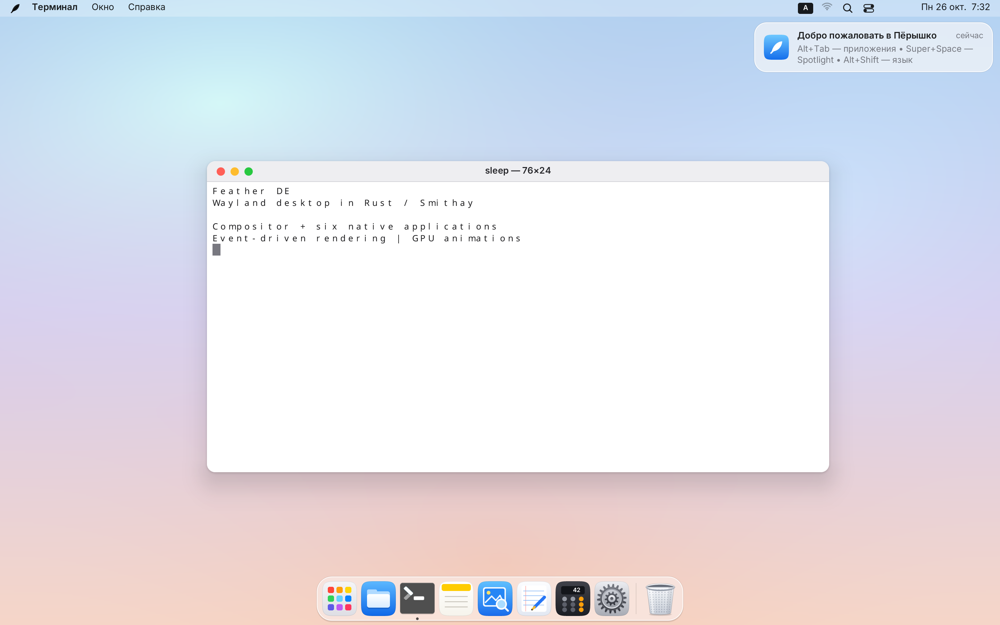

# Feather DE · Пёрышко

**A lightweight Linux desktop with its own Wayland compositor, integrated shell, and six native applications, written in Rust.**

[Русский](README.md) · [Shell features](#shell-features) · [Build and install](#build-and-install) · [Keyboard shortcuts](#keyboard-shortcuts) · [Project status](#project-status-and-limitations) · [Roadmap](docs/ROADMAP.md)



Feather brings together a global menu bar, Dock, application search and launcher,
window overview, workspaces, notifications, and System Settings. Its visual language
is inspired by macOS Tahoe: light surfaces, frosted glass, rounded corners, soft
shadows, and spring animations. The desktop runs on its own **Rust / Smithay 0.7**
compositor with event-driven processing and an OpenGL/EGL rendering pipeline.

The project prioritizes responsiveness and low resource use. Rendering follows
changes to the scene; expensive asset preparation and system-service operations run
outside the input and rendering loop. Files, Terminal, Notes, Preview, Text Editor,
and Calculator are developed alongside the compositor.

**Current version: 0.1.0, early testing stage.** Packaging is available for Arch Linux
x86_64. Validation across GPUs, laptops, and physical displays is ongoing. Feather
currently ships as a desktop environment; this repository does not yet provide an
installation image for a separate operating system.

## Project components

| Component | Purpose |
|---|---|
| `feather-de` | Wayland compositor, window management, desktop shell, settings, and Linux integration |
| `feather-files` | File manager and file opening/saving dialogs |
| `feather-terminal` | Terminal with a custom DEC/ANSI/VT engine, tabs, and search |
| `feather-notes` | Plain-text notes with search and autosave |
| `feather-preview` | Raster image, SVG, and multipage PDF viewer |
| `feather-textedit` | Tabbed text editor with syntax highlighting and find/replace |
| `feather-calc` | Basic, scientific, and programmer calculator |
| `feather-ui` | Shared drawing, text, scaling, localization, and UI primitives |

The components share a Cargo workspace. Applications are separate Wayland clients
built with `smithay-client-toolkit` and `tiny-skia`; the desktop shell is integrated
into the compositor. System integrations become available when their services exist.

## Shell features

### Desktop and appearance

- Light and dark appearances, accent and selection colors, and adjustable UI text size.
- GPU-rounded client windows, shadows, and traffic-light window controls.
- Frosted surfaces for panels, the Dock, menus, and the application switcher.
  The current effect samples blurred wallpaper; live blur of windows beneath
  panels is not implemented.
- Spring animations for windows and panels, minimizing into the Dock, and restoration.
- Animation controls, reduced transparency, increased contrast, and large text.
- Desktop files, folders, and `.desktop` launchers, rubber-band selection,
  drag-and-drop, context menus, and integration with the file manager.
- Original Dawn, Aurora, and Mountain Lake wallpapers, plus custom PNG/JPEG/WebP
  images. Wallpaper preparation happens outside the main event loop.
- Fractional UI scaling and HiDPI support.

### Menu bar and global menus

- Active application, Window, and Help menus, a clock, and input-source switching.
- Qt/KDE global menus through KDE Wayland AppMenu and DBusMenu.
- GTK global menus through `gtk_shell1`, `org.gtk.Menus`, and `org.gtk.Actions`.
- Nested menus, checkboxes, radio items, disabled actions, and keyboard navigation.
- Shell-provided fallback menus for applications that do not export their own.
- StatusNotifierItem tray icons, primary and secondary actions, context menus,
  scrolling, attention indicators, and an overflow list.

Global menus depend on the application's export support. An application using Qt,
GTK, or Electron is not automatically guaranteed to provide a menu. Client-side
window decoration requests are respected, avoiding an extra compositor title bar
on top of an application's own decorations.

### Dock, launcher, and search

- Pinned and running applications, running indicators, and grouped windows.
- Hover magnification, launch bounce, adjustable icon size, auto-hide, and bottom,
  left, or right placement.
- Dragging to reorder and pin, context menus, and a persistent drag lock.
- Clicking the active application minimizes its window; clicking a minimized one
  restores it, while a background application is brought forward.
- Trash with empty/full states, file drops, and confirmation before emptying.
- Launchpad application grid with search, pages, scrolling, and dragging into the Dock.
- Spotlight search for launching applications and evaluating simple expressions.
- `.desktop` discovery, window matching through `app_id`, `StartupWMClass`, and known
  identifiers, with icons loaded from system themes.

### Windows, workspaces, and gestures

- Move, resize, minimize, maximize, and fullscreen operations.
- Alt+Tab / Super+Tab with most-recently-used ordering, mouse selection, and cancellation.
- Cycling windows of the active application with Alt+` / Super+`.
- Up to 16 workspaces, created as needed, with window moves and animated transitions.
  Activating an application can switch to the workspace containing its window.
- Mission Control: window overview, workspace strip, workspace creation/removal,
  and dragging windows to another workspace.
- Configurable hot corners for applications, search, overview, desktop,
  Notification Center, or locking.
- Three/four-finger swipes for workspaces, window overview, and Launchpad pages;
  pinch gestures to open and close Launchpad.

Gesture handling is implemented through libinput. Physical trackpad behavior in
DRM remains part of hardware validation. See [windows and workspaces](docs/WINDOWS.md),
[application switching](docs/SWITCHER.md), and [key bindings](docs/KEYBOARD.md).

### Notifications and sounds

- An `org.freedesktop.Notifications` server with banners, icons, replacement,
  and application actions.
- Notification Center with grouping, current-session history, and clearing.
- Manual and scheduled Do Not Disturb, plus per-application banner and sound settings.
- Critical notifications and `resident`, `transient`, and `suppress-sound` hints.
- A shared sound worker for notifications, alerts/BEL, screenshots, and volume feedback,
  using an available system audio player.

An ordinary nested instance does not claim the host session's notification service.
See [notifications](docs/NOTIFICATIONS.md) and [system sounds](docs/SYSTEM_SOUNDS.md).

## System Settings

A single window contains **15 settings sections**. Preferences are stored in
`$XDG_CONFIG_HOME/feather-de/settings.conf`, normally
`~/.config/feather-de/settings.conf`.

| Section | Controls |
|---|---|
| Appearance | Light/dark mode, accent, selection, text size, and animations |
| Accessibility | Large text, contrast, transparency, and sticky keys |
| Language & Region | Russian, English, Spanish, German, French, Simplified Chinese, and regional formats |
| Network | Wi-Fi, saved connections, Ethernet, VPN, and WireGuard through NetworkManager |
| Bluetooth | Adapter power, discovery, pairing/connection, disconnection, and device removal through BlueZ |
| Keyboard | Layouts, language switching, Caps Lock, repeat delay/rate, and custom action bindings |
| Mouse & Trackpad | Speed, scrolling, clicking, and cursor settings; availability depends on the backend |
| Displays | Scale, primary output mode/refresh rate, display arrangement/primary display, and night color |
| Desktop & Dock | Wallpaper, Dock size/position/auto-hide, magnification, and hot corners |
| Applications | Default browser and terminal, plus login startup applications |
| Privacy | Stored portal capture policies; current limitations are described below |
| Date & Time | Time zone, NTP, time format, and manual changes through systemd-timedated |
| Lock Screen & Power | Idle locking, display power-off, and suspend |
| Notifications | Application policies, banners, sounds, and Do Not Disturb schedules |
| Sound | Outputs, microphones, levels, mute, and system alerts |

About This Computer shows CPU, memory, GPU, storage, and current session information.
The built-in Activity Monitor shows shell memory, window count, and scale; it does
not yet provide a process list. Screenshot output folder and format are configurable.

### Network, Bluetooth, and audio

**Network:** Wi-Fi power and scans, open and saved networks, WPA2/WPA3 password
entry, autoconnect, and forgetting profiles. Ethernet shows link state and speed,
with connection/disconnection actions. Existing VPN/WireGuard profiles can be
activated through NetworkManager. Advanced cases, including 802.1X, can be opened
in an external connection editor.

**Bluetooth:** discovery, pairing, trust, connection/disconnection, forgetting,
and device state or battery level where provided by the accessory. An external
Bluetooth manager is available for advanced operations. PIN/confirmation flows
and individual accessories still require hardware validation.

**Audio:** control through a PulseAudio-compatible interface (`pactl`), including
PipeWire Pulse. Select default output/input devices, adjust volume and recording
gain, mute, and move the corresponding streams when switching devices. The
microphone level adjusts gain; the settings UI does not continuously record audio.
Media keys change volume or mute and display feedback.

Control Center provides quick access to the main controls. Unavailable services
are shown as unavailable. D-Bus calls, process execution, and waits run on workers.
See [network](docs/NETWORK.md), [Bluetooth](docs/BLUETOOTH.md),
[microphone/audio](docs/MICROPHONE.md), and [Control Center](docs/CONTROL_CENTER.md).

## Native applications

### Files — `feather-files`

A file manager with favorites, standard user directories, mounted volumes, and
Trash in the sidebar. It offers icon/list views, navigation history, path entry,
filtering, hidden files, and multiple selection.

- Open files through system associations, create folders, rename, and inspect properties.
- Copy/cut/paste files, Wayland drag-and-drop, and exchange files with the desktop.
- Move to Trash, restore, and empty with confirmation.
- Space opens Quick Look for images, text, or file information; arrow keys switch
  between neighboring files.
- File chooser mode supports open/save/folder selection, multiple files,
  MIME/glob filters, and overwrite confirmation.
- Light/dark appearance, fractional scale, and inotify updates for the open folder.

A complete thumbnail grid and progress UI for long copy operations remain areas
for improvement. [Details](docs/FILES.md) · [Quick Look](docs/QUICK_LOOK.md) · [Trash](docs/TRASH.md).

### Terminal — `feather-terminal`

A terminal with a custom DEC/ANSI/VT engine, PTY handling, and tabs. It supports
16/256 colors and TrueColor, the alternate screen, TUI applications, bracketed
paste, mouse reporting, and synchronized output.

- Up to 10,000 scrollback lines, with screen/history search and match navigation.
- Mouse, word, and line selection, plus native Wayland clipboard integration.
- Shift-selection to copy when a TUI application owns mouse input.
- OSC52 clipboard writes and dropped files inserted as quoted paths.
- Unicode, wide and combining characters, and procedural TUI box drawing.
- New windows/tabs, font-size controls, and light/dark palettes.
- Changed-row rendering rather than repainting the entire window for each character.

Scrollback reflow on width changes and several advanced terminal features are not
implemented yet. [Details and shortcuts](docs/TERMINAL.md).

### Notes — `feather-notes`

Plain-text notes with a sidebar, search, modification dates, and autosave after a
pause in typing. The first line becomes the title.

Selection, wrapping, clipboard operations, undo/redo, and deletion to Trash are
supported. Notes are ordinary text files under `$XDG_DATA_HOME/feather-notes/`,
normally `~/.local/share/feather-notes/`. Folders, attachments, and rich text are
outside the current scope. [Details](docs/NOTES.md).

### Preview — `feather-preview`

A PNG, JPEG, WebP, SVG, and multipage PDF viewer with page thumbnails, page
navigation, fit-to-window and actual-size modes, manual zoom, panning, rotation,
document information, and drag-and-drop opening.

Full PDF rendering uses Poppler's `pdftoppm` when installed. A limited built-in
Rust PDF renderer supports a subset of text and vector operations. Current loader
limits are 48 MiB for images, and 64 MiB / up to 64 pages for PDFs. PDF editing
is not provided.

### Text Editor — `feather-textedit`

A tabbed text and source editor with open/save, modification indicators, line
numbers, wrapping, font zoom, selection, clipboard support, undo/redo, and
find/replace.

Lightweight highlighting is selected by file type: Markdown, Rust, TOML/INI,
JSON/YAML, shell/Python scripts, C-like languages, and HTML/XML. LSP integration,
debugging, and full IDE functionality are not implemented.

### Calculator — `feather-calc`

- Basic mode: arithmetic, percentages, sign changes, and memory.
- Scientific mode: parentheses, powers, roots, logarithms, trigonometric and
  hyperbolic functions, constants, and radians/degrees.
- Programmer mode: binary, octal, decimal, hexadecimal, bitwise operations,
  and 8/16/32/64-bit word sizes.
- Calculation history, keyboard input, and clipboard support.

## Sessions and Linux integration

### Startup and locking

Two primary backends are available: a **nested window** inside an existing graphical
session, and **direct DRM/KMS** with libinput and libseat/logind seat management.
System installation provides a Wayland session entry for a display manager.

Built-in locking uses PAM, supports `ext-session-lock-v1`, and integrates idle
locking, display power-off, and suspend through logind. An external lock client
can supply its own surfaces. Visible applications may inhibit idle actions.
Nested mode does not power off the host monitor or suspend the computer.

There is a `--boot-splash` animation and an initial lock screen enabled by
`--login` / `--greeter`. Authentication applies to the account already running the
compositor. These flags and the greetd example do not provide a general-purpose
user selector and new-session manager. Adapt greetd configuration to your system;
the installer does not automatically replace your existing display manager.

The first-run wizard covers language/region, appearance, keyboard layouts, and a
shortcut summary. It can be reopened from the shell menu. A native Polkit agent
presents administrative authorization requests in the desktop's own style.

See [locking and power](docs/LOCK_POWER.md) and [Polkit](docs/POLKIT.md).

### Displays and graphics

- Multiple outputs on one GPU, hotplug handling, and primary display selection.
- Display arrangement, recovery of windows from disconnected outputs, and
  separate damage tracking for each output.
- Primary output resolution/refresh selection and a shared UI scale.
- Manual/scheduled night color through DRM gamma tables.
- Laptop brightness through logind/backlight; external brightness through DDC/CI
  and `ddcutil`.
- VRR on supported outputs, direct scanout for eligible surfaces, and
  `wp_linux_drm_syncobj_v1` explicit sync when supported by the DRM device.

Physical hotplug/KMS/VT and mixed-refresh behavior still need hardware validation.
Per-output scale, rotation, mirroring, and multi-GPU operation are not currently
supported. [Displays](docs/MONITORS.md) · [Brightness/night color](docs/DISPLAY_COLOR.md).

### Applications and protocols

Implemented Wayland support includes `xdg-shell`, `xdg-decoration`,
`xdg-activation`, SHM, linux-dmabuf with feedback, selection/clipboard, primary
selection, viewporter, fractional scale, cursor shape, and xdg-output. Session
lock, idle notifications, idle inhibit, and system bell are also implemented.
X11 applications are supported through on-demand **xwayland-satellite**.

Session GTK styling helps align GTK 3/4 and some client-decorated applications.
Menu and theme integration depend on the application. Protocol coverage is still
growing: text-input/IME, layer-shell, presentation-time, and other extensions
remain separate development work.

**Portals:** `FileChooser` uses real Files dialogs for OpenFile/SaveFile/SaveFiles.
`Screenshot`, `ScreenCast`, and `Access` interfaces exist but are experimental:
Screenshot currently returns a 1×1 placeholder, while ScreenCast returns metadata
without a real PipeWire stream. The “ask” policy does not yet show a complete
permission prompt. Browser/OBS screen sharing should not be treated as ready.
**Built-in Print / Shift+Print / Alt+Print capture works separately:** screen,
region, or window, with clipboard/file output and PNG/JPEG/WebP formats.

[Global menus](docs/APPMENU.md) · [XWayland](docs/XWAYLAND.md) · [GTK styling](docs/GTK_THEME.md).

## Performance

The project uses explicit, measured development budgets:

| Compositor metric | Target |
|---|---|
| Idle CPU | 0 CPU ticks over 5 seconds |
| Scene + GL work per frame | ≤ 1 ms |
| CPU UI repaint | ≤ 4 ms |
| Steady private memory, `RssAnon` | ≤ 60 MB |
| Cold start to first frame | ≤ 300 ms |
| Client animation rate | Display refresh rate |

Testing the packaged nested demo on October 26, 2026 at 2880×1800, scale ×2,
produced **0 CPU ticks / 5 seconds**, **34.03 MiB RssAnon** while idle, and
**48.50 MiB** with Launchpad open. Host input was disabled; screenshot memory was
excluded from those steady-state readings. These describe one scenario on
specific hardware, rather than a guarantee for every machine. Total RSS includes
mapped libraries and drivers and differs from private memory. Separate client
applications are outside the compositor's memory budget.

Screenshot peaks and first-frame costs are evaluated separately. Final validation
of every budget in a real DRM session remains open. See the [specification](docs/SPEC.md),
[memory report](docs/MEMORY_CHECKS.md), [raster report](docs/RASTER_CHECKS.md),
[UI report](docs/UI_CHECKS.md), and [changelog](CHANGELOG.md).

## Build and install

### Arch Linux

Clone the repository and build an installable package with `makepkg`:

```bash
git clone https://github.com/Zumka1991/feather-de.git
cd feather-de/packaging
makepkg -si
```

You need `base-devel` and a current Rust/Cargo toolchain. The
[PKGBUILD](packaging/PKGBUILD) declares glibc, gcc-libs, libinput, libxkbcommon,
seatd, Mesa/EGL, PAM, systemd-libs, Wayland, fontconfig, Noto, and D-Bus dependencies.
Current packaging specifies **glibc ≥ 2.44**.

### Ubuntu

There is no `.deb` yet. The script installs dependencies with apt and Rust with rustup,
then builds Feather from source. It works on regular Ubuntu and on Ubuntu Server / a
minimal install without a desktop:

```bash
git clone https://github.com/Zumka1991/feather-de.git
cd feather-de
./packaging/install-ubuntu.sh
```

Run it as a regular user; it asks for sudo itself.

- **No desktop** (no login screen): installs greetd with the tuigreet text login that
  starts Feather, and enables graphical boot. Networking is handed to NetworkManager so
  Wi-Fi works from Control Center; this takes effect after a reboot. A previous greetd
  config is kept as `config.toml.before-feather`. After `sudo reboot`, enter your name and
  password.
- **With GNOME/GDM**: GDM is left alone. Log out and pick “Пёрышко (прямой вывод DRM/KMS)”
  under the gear; GNOME stays available as a fallback.

Flags: `--no-optional` skips sound, Wi-Fi, Bluetooth, portals and X11; `--greetd` /
`--no-greetd` force or skip the login screen. When xwayland-satellite (X11 apps) is
missing from the repositories (Ubuntu 26.04), it is built from source.
Uninstall with `sudo ./packaging/uninstall.sh`.

### Source build

```bash
cargo build --release --locked --workspace
# Project shortcut:
make build
```

Install the development libraries/headers for the graphics stack, libinput,
libudev, libxkbcommon, libseat, Wayland, and `pkg-config`, plus runtime fontconfig
and fonts. Use a Rust toolchain compatible with the dependencies in Cargo.lock.

```bash
# Install existing release binaries system-wide:
sudo ./packaging/install.sh --no-build

# Install in ~/.local, without a system session entry or PAM configuration:
./packaging/install.sh --user --no-build

# Build an archive in dist/:
make release
```

The installer supports `PREFIX`, `DESTDIR`, `SYSCONFDIR`, and an alternate binary
directory. Remove a pacman package with `sudo pacman -R feather-de`. For manual
installation, use the matching `packaging/uninstall.sh`, adding `--user` for a
user-local installation.

### Demo archive without installation

If you have built or received `feather-de-0.1.0-arch-linux-x86_64.tar.gz`, extract
it and run these commands inside the extracted directory:

```bash
./run-demo.sh --check
./run-demo.sh
```

The demo uses the existing Wayland/X11 session with separate settings/data
directories and a private D-Bus session. Your ordinary files remain accessible;
this is not a sandbox. System libraries are not bundled. The
[tester guide](packaging/README-TEST.md), currently in Russian, covers dependencies
and SHA-256 verification. Binary archives are generated in local `dist/` and are
not stored in Git.

### Optional integrations

| Feature | Dependency |
|---|---|
| Network | NetworkManager; `nm-connection-editor` / `nmtui` for advanced cases |
| Bluetooth | BlueZ; optionally `blueman-manager` |
| Audio | A PulseAudio-compatible server, such as PipeWire + pipewire-pulse, and libpulse's `pactl` |
| Sound playback | `pw-play`, `paplay`, or `canberra-gtk-play` |
| X11 applications | xwayland-satellite |
| Full PDF rendering | Poppler (`pdftoppm`) |
| External display brightness | ddcutil and I²C permissions |
| Portal file dialogs | xdg-desktop-portal |

## Running Feather

**Nested window**, after building:

```bash
target/release/feather-de --windowed

# With the native terminal:
target/release/feather-de --windowed --autostart 'target/release/feather-terminal'
```

**Full session**, after system installation: choose the Feather direct DRM/KMS
session in your display manager, or log in on a free TTY and run `feather-session`
as your regular user. Do not run the compositor through sudo.

From a source checkout, `session/start-feather-drm.sh` supports manual DRM testing.
Ctrl+Alt+F1…F12 switches virtual consoles; Ctrl+Alt+Backspace is the emergency exit.
The installed DRM session logs to `~/.local/state/feather-de/drm.log`.

In nested mode, the host can intercept keyboard shortcuts. Single-instance
applications such as Firefox or Telegram may forward a launch to their existing
instance in the outer session; account for this during testing.

## Keyboard shortcuts

Super usually means the Windows / Command key. These are default bindings;
many shell actions can be reassigned in System Settings.

| Shortcut | Action |
|---|---|
| Super+Space | Spotlight search |
| Super+A | Application grid |
| Super+Enter / Super+T | Terminal |
| Super+E | Files |
| Super+N | Control Center |
| Alt+Tab / Super+Tab | Application switcher |
| <kbd>Alt+&#96;</kbd> / <kbd>Super+&#96;</kbd> | Cycle windows of the active application |
| Super+W / Super+Q | Close window / quit application |
| Super+M / Super+F | Minimize / maximize |
| Super+H / Super+Alt+H | Hide application / hide other applications |
| Ctrl+Alt+← / → | Previous / next workspace |
| Ctrl+Alt+Shift+← / → | Move window to the adjacent workspace |
| Ctrl+Alt+↑ / ↓ | Window overview / close overview |
| Super+L | Lock |
| Print / Shift+Print / Alt+Print | Capture screen / region / window |

In Files: Space for Quick Look, Ctrl+L for path entry, Ctrl+H for hidden files,
F2 to rename, and Ctrl+Shift+N for a new folder. In Terminal: Ctrl+Shift+C/V for
clipboard, Ctrl+Shift+T for a tab, and Ctrl+Shift+F for search. In Notes: Ctrl+N
for a new note, Ctrl+F for search, and Ctrl+Z to undo.

## Architecture and repository layout

```text
src/                 Compositor, shell, settings, and system workers
crates/feather-ui/    Shared text, drawing, theme, input, scaling, and localization
files/               Files application
terminal/            Terminal and its VT engine
notes/               Notes application
preview/             Image and PDF viewer
textedit/            Text editor
calc/                Calculator
protocols/           Additional protocol descriptions
assets/              Wallpapers and GTK CSS
session/             Session wrappers, PAM, and greetd example
packaging/           Install scripts, archive, PKGBUILD, desktop and portal files
bench/               Functional scenarios and measurement tools
docs/                Specification, reports, and roadmap
```

The main `calloop` handles Wayland, input, completed frames, and worker messages.
D-Bus, file I/O, icon discovery/decoding, wallpapers, and panel rasterization stay
outside the critical path. Queues are bounded and stale results are discarded.
GPU and Wayland objects remain on the main thread.

Animations transform existing buffers. Damage tracking limits drawing to changed
regions. Font tables are mmap-backed, glyphs are rasterized on demand, and caches
have explicit limits. See [SPEC](docs/SPEC.md) and [AGENTS.md](AGENTS.md) for the
architecture and development rules.

## Testing and contributing

```bash
# Build:
cargo build --release --locked --workspace

# Run tests on a private session bus:
dbus-run-session -- cargo test --release --locked --workspace -- --include-ignored

# Profile your own nested instance:
FEATHER_PROFILE=1 target/release/feather-de --windowed
```

`bench/` contains scenarios for windows, keyboard input, locking, monitors, audio,
network, Bluetooth, and portals. They use owned instances and temporary
configurations; physical DRM testing is performed by the user. Never terminate
all compositor processes by name: your live desktop windows may belong to one.

For a bug report, include reproduction steps, backend, distribution, GPU/driver,
scale, version/commit, and relevant logs. Only include screenshots containing data
you intend to publish. Hardware testing, compatibility fixes, translations, and
measurements with reproducible conditions are particularly useful.

## Project status and limitations

The core shell, applications, and substantial system integration are implemented.
Roadmap checkmarks describe completed, tested stages rather than universal support
for every device or application. Current open areas include:

- Physical displays, KMS/hotplug, VT, mixed refresh rates, VRR, and synchronization
  across different GPU drivers.
- Real PAM authentication, suspend/resume, Fn keys, Bluetooth accessories, and
  audible sound behavior.
- Final frame-time, startup, and memory acceptance testing in a full DRM session.
- Real portal/PipeWire capture and interactive permission dialogs.
- Further Wayland protocol coverage, IME, and application compatibility.
- Additional native application features and packaging for other distributions.

See [ROADMAP](docs/ROADMAP.md) and [CHANGELOG](CHANGELOG.md). Detailed reports in
`docs/` are dated; later changes may supersede earlier limitations. Consult the
current code and recent changelog entries when assessing the present state.
Most detailed development documents are currently in Russian; this English README
covers the same main feature and setup information as the Russian version.

## License

A license for the project's own code has not yet been selected; there is no LICENSE
file. Dependencies retain their respective licenses.
