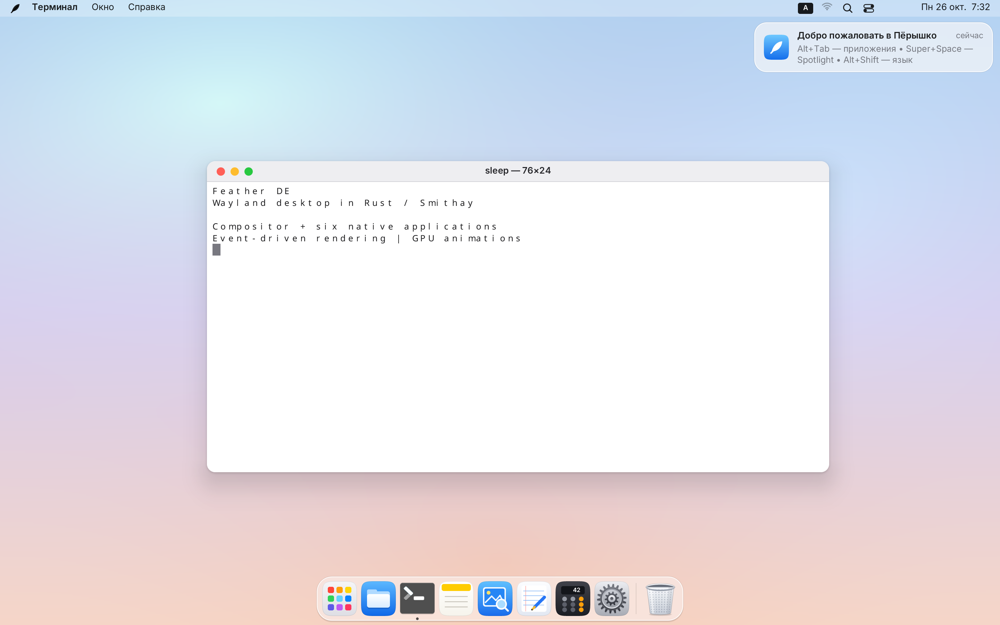
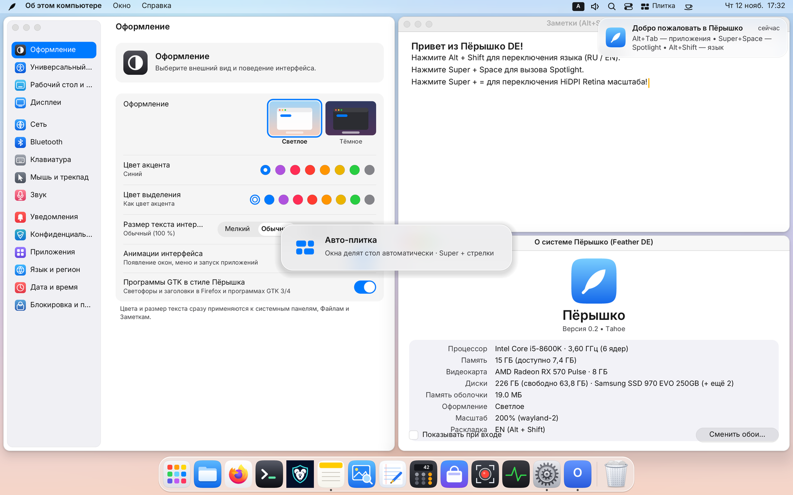
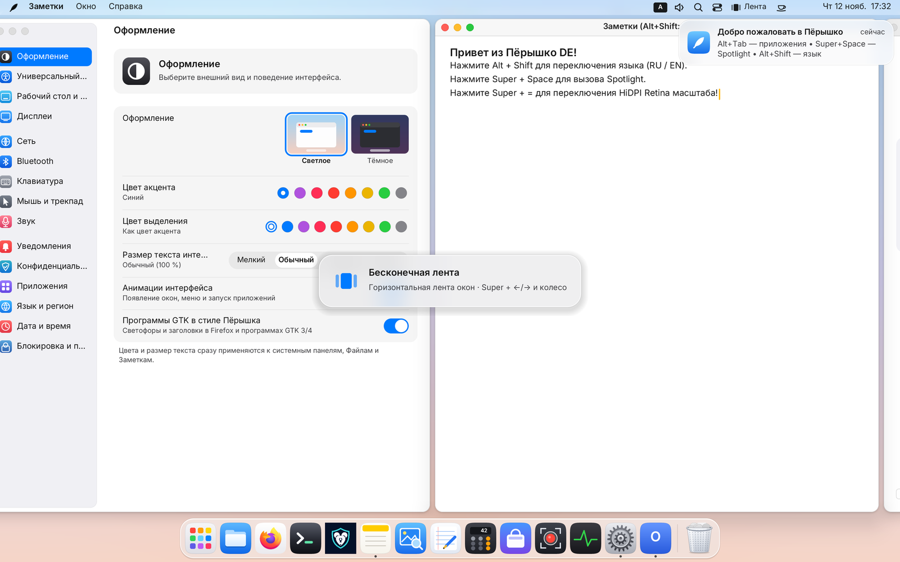
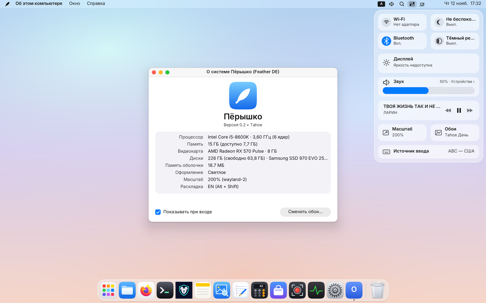
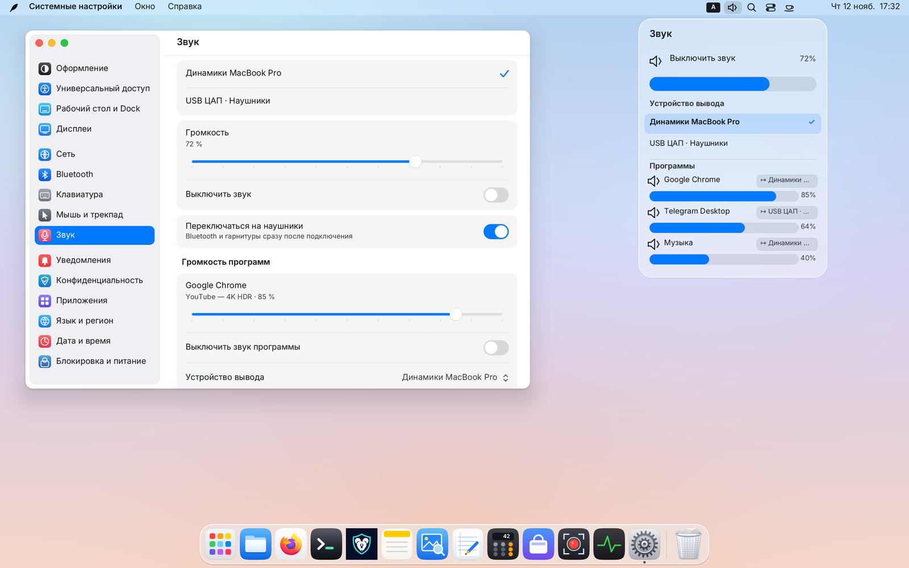
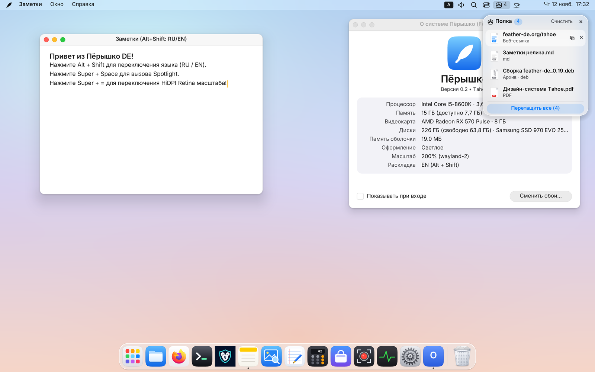
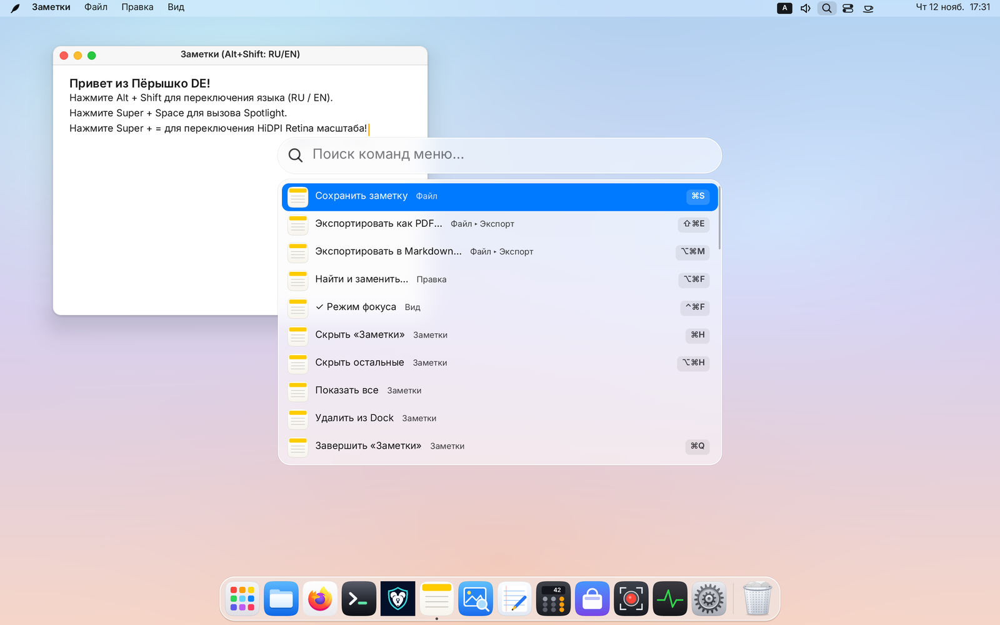

# Пёрышко · Feather DE

**Лёгкое окружение рабочего стола для Linux: собственный Wayland-композитор, живое стекло `Liquid Glass`, три режима раскладки столов (плавающие окна, авто-плитка и бесконечная скролл-лента) и восемь приложений на Rust.**

[🇬🇧 English](README.en.md) · **[📖 Руководство пользователя (RU)](docs/USER_GUIDE.md)** · **[📖 User Guide (EN)](docs/USER_GUIDE.en.md)** · [Возможности](#возможности-оболочки) · [Установка](#сборка-и-установка) · [Горячие клавиши](#горячие-клавиши) · [Roadmap](docs/ROADMAP.md)



> ### 📖 Полное иллюстрированное руководство пользователя
> Подробный учебник по всем возможностям Пёрышка с живыми скриншотами, разбором верхней шторки Пункта управления и Центра уведомлений, шторки-Подложки (`Super+S`), Полки перетаскивания (`Drop Shelf`), авто-плитки, бесконечной ленты со скроллингом и всех горячих клавиш:
> - 🇷🇺 **[Открыть Руководство пользователя на русском (`docs/USER_GUIDE.md`)](docs/USER_GUIDE.md)**
> - 🇬🇧 **[Open the Illustrated User Guide in English (`docs/USER_GUIDE.en.md`)](docs/USER_GUIDE.en.md)**
>
> Быстрый переход по главам: [Верхняя панель и Menu HUD](docs/USER_GUIDE.md#2-верхняя-панель-глобальное-меню-и-поиск-menu-hud-super--) · [Окна и Призрачный PiP](docs/USER_GUIDE.md#4-окна-прилипание-к-краям-и-призрачный-pip-super--p) · [Авто-плитка и Бесконечная лента](docs/USER_GUIDE.md#5-рабочие-столы-авто-плитка-tile-и-бесконечная-лента-со-скроллингом-tape) · [Подложка и Полка перетаскивания](docs/USER_GUIDE.md#6-шторка-подложка-super--s-и-полка-перетаскивания-super--d) · [Шторка Пункта управления и Аудио-микшер](docs/USER_GUIDE.md#7-верхняя-шторка-пункт-управления-пооконный-аудио-микшер-и-уведомления) · [Шпаргалка клавиш](docs/USER_GUIDE.md#12-управление-из-терминала-featherctl-и-полная-шпаргалка-горячих-клавиш)

Пёрышко объединяет верхнюю строку меню, Dock, поиск, запуск приложений, обзор окон,
рабочие столы с тремя режимами раскладки, шторки управления и уведомлений и системные настройки.
Визуальный язык вдохновлён macOS Tahoe: светлые и тёмные поверхности, живое оптическое стекло
**Liquid Glass**, скругления, мягкие тени и пружинные анимации.
Под интерфейсом — собственный композитор на **Rust / Smithay 0.7**, событийная модель
и аппаратная сборка сцены через OpenGL/EGL.

Главная цель — быстрый отклик при минимальном потреблении ресурсов (`0 %` CPU в простое, `≤ 1 мс`
работы композитора на кадр, `≤ 60 МБ` приватной памяти). Перерисовка запускается строго
по изменениям; подготовка тяжёлых ресурсов и работа системных служб вынесены из цикла
ввода и отрисовки. Рядом с композитором развиваются собственные Файлы, Терминал, Заметки,
Просмотр, Текстовый редактор, Калькулятор, Мониторинг системы и Магазин программ.

**Ранняя тестовая стадия.** Готовые пакеты с обновлениями — для Ubuntu (APT) и Arch Linux
(pacman), см. [Сборка и установка](#сборка-и-установка). Полная проверка на разных видеокартах, ноутбуках и физических мониторах продолжается.
Пёрышко сейчас распространяется как окружение рабочего стола; установочного образа
отдельной операционной системы в этом репозитории пока нет.

## Что входит в проект

| Компонент | Назначение |
|---|---|
| `feather-de` | Wayland-композитор, управление окнами, оболочка, настройки и интеграция с Linux |
| `feather-files` | Файловый менеджер и диалоги открытия/сохранения файлов |
| `feather-terminal` | Терминал с собственным ядром DEC/ANSI/VT, вкладками и поиском |
| `feather-notes` | Текстовые заметки с поиском и автосохранением |
| `feather-preview` | Просмотр изображений, SVG и многостраничных PDF |
| `feather-textedit` | Текстовый редактор с вкладками, подсветкой и поиском/заменой |
| `feather-calc` | Обычный, инженерный и программистский калькулятор |
| `feather-monitor` | Мониторинг системы (`Ctrl+Alt+Del`): процессы, «Снять задачу», графики ЦП, памяти, диска и сети |
| `feather-store` | Магазин: каталог программ AppStream, установка и удаление через PackageKit |
| `featherctl` / `feather-api` | Утилита командной строки и D-Bus API (`org.feather.Shell1`) для управления окнами, столами, звуком и снимками |
| `feather-ui` | Общая библиотека рисования, текста, масштаба, локализации и элементов интерфейса |

Все компоненты находятся в одном Cargo workspace. Приложения — самостоятельные
Wayland-клиенты на `smithay-client-toolkit` и `tiny-skia`; интерфейс оболочки встроен
в композитор. Системные службы подключаются по мере доступности.

| Авто-плитка (`Tile`, BSP) | Бесконечная лента со скроллингом (`Tape`) |
|---|---|
|  |  |
| **Шторка Пункта управления и `Liquid Glass`** | **Пооконный аудио-микшер** |
|  |  |
| **Полка перетаскивания (`Drop Shelf`, `Super+D`)** | **Поиск по командам меню (`Menu HUD`, `Super+/`)** |
|  |  |

## Возможности оболочки

### Рабочий стол и живое оптическое стекло `Liquid Glass`

- Светлая и тёмная темы, цвет акцента и выделения, размер текста интерфейса и синхронизация темы GTK 3/4.
- Скругления клиентских окон на GPU, тени и кнопки управления в виде «светофора».
- **Живое оптическое стекло (`Liquid Glass`) на GPU**: панели, шторка Пункта управления, Центр уведомлений, Dock, меню, Spotlight, HUD-карточки и Полка перетаскивания в реальном времени размывают и преломляют живую картинку окон и обоев под собой (Dual-Kawase + SDF-фаска с дисперсией и каустикой) без перерасчёта на неподвижных кадрах (`0 %` CPU в простое).
- Пружинные анимации появления окон и панелей, сворачивания в Dock и восстановления.
- Отключение анимаций, уменьшение прозрачности, повышенный контраст и крупный текст.
- Значки файлов, папок и `.desktop`-ярлыков на рабочем столе, выделение рамкой,
  перетаскивание, контекстное меню и обмен файлами с файловым менеджером.
- Галерея оригинальных обоев «Рассвет», «Сияние», «Горное озеро» и выбор своих
  изображений PNG/JPEG/WebP со сменой по расписанию. Подготовка обоев выполняется вне основного цикла.
- Дробный масштаб интерфейса и поддержка HiDPI.

### Верхняя панель, глобальные меню и поиск `Menu HUD`

- Меню активного приложения, меню окон и справки, часы, переключатель режимов стола и переключение источников ввода.
- **Поиск по командам меню — `Menu HUD` (`Super+/`)**: мгновенно разворачивает дерево глобального меню активного окна и меню Пёрышка в поисковую палитру с хлебными крошками (`Файл ▸ Экспорт ▸ …`), галочками, бейджами клавиш и автоисправлением опечаток раскладки (`QWERTY ↔ ЙЦУКЕН`).
- Кофеин: чашка рядом с часами одним кликом запрещает сон и гашение экрана. Батарея с процентами на ноутбуках.
- Глобальное меню Qt/KDE через KDE Wayland AppMenu и DBusMenu.
- Глобальное меню GTK через `gtk_shell1`, `org.gtk.Menus` и `org.gtk.Actions`.
- Вложенные меню, галочки, радиопункты, недоступные действия и управление клавиатурой.
- Собственные меню оболочки для приложений, которые не экспортируют своё меню.
- Системный трей StatusNotifierItem: обычные и контекстные действия, меню, прокрутка,
  индикатор внимания и список переполнения при нехватке места.

Глобальное меню зависит от возможностей самого приложения. Наличие Qt, GTK или
Electron само по себе не гарантирует экспорт меню. Запрос клиентских декораций CSD
уважажается: композитор не навязывает дополнительную рамку поверх рамки приложения.

### Dock, Launchpad, Spotlight и Кольцо программ (`Cmd`)

- Закреплённые и запущенные приложения, индикаторы работы и группировка окон.
- Увеличение при наведении, отскок при запуске, изменение размера значков,
  автоскрытие и положение снизу, слева или справа.
- Перестановка и закрепление перетаскиванием, контекстное меню и блокировка
  перетаскивания. Положение и закрепления сохраняются между запусками.
- Повторный клик по активному приложению сворачивает его окно; клик по свёрнутому
  восстанавливает, по фоновому — поднимает окно.
- Корзина с состояниями «пусто/полно», перетаскиванием файлов и подтверждением очистки.
- **Кольцо программ по короткому нажатию `Super` (`Cmd`)**: радиальный переключатель вокруг курсора с выбором движением мыши, стрелками, `Tab` или первой буквой; двойное нажатие «Cmd, Cmd» мгновенно возвращает к прошлому окну.
- Сетка приложений Launchpad (`Super+A`): поиск, страницы, прокрутка и перенос приложения в Dock.
- Поиск Spotlight (`Super+Space`): программы, открытые окна, разделы настроек, заметки, файлы домашней папки и
  мгновенное вычисление выражений, без индекса и фоновой работы.
- История буфера обмена в памяти (`Super+Shift+V`) и панель эмодзи (`Super+.`). Подробнее: [Spotlight](docs/SPOTLIGHT.md).
- Поиск установленных программ по `.desktop`, сопоставление окон по `app_id`,
  `StartupWMClass` и известным идентификаторам, загрузка значков из системных тем.

### Окна, три режима рабочих столов (`Free` / `Tile` / `Tape`), шторка-Подложка и Полка перетаскивания

- **Три независимых режима раскладки для каждого рабочего стола (`Ctrl+Alt+M`)**, сохраняемые между сеансами:
  1. **Свободные окна (`Free`)** — классические плавающие окна macOS Tahoe с прилипанием к половинам и четвертям экрана у краёв, в меню зелёной кнопки и по `Ctrl+Super+стрелкам`.
  2. **Авто-плитка (`Tile`)** — по-столовая BSP-сетка в духе Hyprland / COSMIC: окна сами делят рабочую область с живым перетаскиванием разделителей, обменом окон и поворотом оси разбиения (`Super+стрелки`, `Super+Shift+стрелки`, `Ctrl+Super+стрелки`, `Super+0`, `Super+F`).
  3. **Бесконечная лента со скроллингом (`Tape`)** — горизонтальная лента полноразмерных колонок в духе Niri / PaperWM: плавный скроллинг с аналитической GPU-пружиной по **`Super+колёсику мыши`** или **`Super+трекпаду`**, выглядывающие края соседних окон (`28 px`), пресеты ширины колонки по **`Super+R`** (`50 % → 67 % → 100 % → 33 %`), навигация `Super+←/→` и `Super+Home/End`.
- **До 16 рабочих столов (`Super+1…9` и `Ctrl+Alt+←/→`)**: прямое переключение по номеру `Cmd+1…9` с созданием столов на лету и автоудалением пустых хвостовых столов, мгновенный перенос активного окна на нужный стол по `Cmd+Shift+1…9` и **центральная стеклянная HUD-табличка** с номером и режимом стола при каждом переключении.
- **Шторка-Подложка (`Super+S` / `Super+Shift+S`)**: выдвижной слой быстрых окон поверх всех столов — одно окно открывается во весь экран, а два и более складываются в живую тайловую сетку.
- **Полка перетаскивания (`Drop Shelf`, `Super+D` или встряхивание курсора во время drag-and-drop)**: стеклянная полка для временного сбора файлов, папок, картинок из браузера, ссылок и текста при переносе между окнами и рабочими столами.
- **«Картинка в картинке» и Призрачный PiP (`Super+P` / `Super+Alt+P`)**: закрепление любого окна в углу экрана поверх всех столов и режим «Сквозь курсор», пропускающий все клики и прокрутку сквозь полупрозрачное окно (удержание `Super` возвращает захват для переноса).
- Память окон: программа открывается на прежнем месте, при входе возвращается прошлый сеанс.
- `Alt+Tab` / `Super+Tab` в порядке последнего использования и переключение окон одной программы через `` Alt+` `` / `` Super+` ``.
- **Mission Control (`Ctrl+Alt+↑`)**: обзор окон, полоса столов с миниатюрами и переключателями режима раскладки, создание/удаление столов и перенос окон мышью.
- **Встроенные снимки (`Print` / `Shift+Print` / `Alt+Print`) и Запись видео с экрана (`Super+Alt+5` / `Ctrl+Shift+Print`)** в MP4/WebM со звуком.
- Настраиваемые активные углы и жесты трекпада 3–4 пальцами (столы, Mission Control и Launchpad).

Подробнее: [Руководство пользователя](docs/USER_GUIDE.md), [окна и столы](docs/WINDOWS.md),
[переключатель](docs/SWITCHER.md), [сочетания клавиш](docs/KEYBOARD.md).

### Верхние шторки: Пункт управления, Пооконный аудио-микшер и Уведомления

- **Шторка Пункта управления (`Super+N`)**: быстрые переключатели Wi-Fi (с выбором сетей и VPN), Bluetooth, «Не беспокоить», Ночного режима, ползунки яркости и звука.
- **Пооконный аудио-микшер** (в панели динамика строки меню, Пункте управления и «Системных настройках → Звук»): индивидуальный ползунок громкости, `Mute` и выбор устройства вывода (`↦` колонки / наушники / HDMI) отдельно для каждой звучащей программы.
- **Боковая шторка Центра уведомлений** (клик по часам): сервер `org.freedesktop.Notifications` с баннерами, группировкой по программам, кнопками действий, историей сеанса и расписанием «Не беспокоить».
- Общий проигрыватель системных звуков: уведомления, предупреждения/BEL, снимок экрана и отклик громкости.

Обычный вложенный запуск не захватывает сервер уведомлений основной сессии.
Подробности: [уведомления](docs/NOTIFICATIONS.md), [звуки](docs/SYSTEM_SOUNDS.md).

## Системные настройки

В одном окне объединены **15 разделов**. Настройки сохраняются в
`$XDG_CONFIG_HOME/feather-de/settings.conf`, обычно `~/.config/feather-de/settings.conf`.

| Раздел | Что можно настроить |
|---|---|
| Оформление | Светлая/тёмная тема, акцент, выделение, размер текста и анимации |
| Универсальный доступ | Крупный текст, контраст, прозрачность и залипание клавиш |
| Язык и регион | Русский, английский, испанский, немецкий, французский и упрощённый китайский; региональные форматы |
| Сеть | Wi-Fi, сохранённые подключения, Ethernet, VPN и WireGuard через NetworkManager |
| Bluetooth | Питание адаптера, поиск, сопряжение/подключение, отключение и удаление устройств через BlueZ |
| Клавиатура | Раскладки, переключение языка, Caps Lock, задержка/скорость повтора и свои сочетания действий |
| Мышь и трекпад | Скорость, прокрутка, нажатия, параметры курсора; доступность зависит от режима запуска |
| Дисплеи | Масштаб, разрешение/частота основного экрана, расположение/основной монитор и ночной режим |
| Рабочий стол и Dock | Обои, размер/положение/автоскрытие Dock, увеличение значков и активные углы |
| Приложения | Браузер и терминал по умолчанию, выбор программ для автозапуска |
| Конфиденциальность | Сохранённые политики доступа портала к захвату экрана; текущие ограничения описаны ниже |
| Дата и время | Часовой пояс, NTP, формат времени и ручная установка через systemd-timedated |
| Блокировка и питание | Блокировка, гашение экрана и сон по простою |
| Уведомления | Настройки приложений, баннеры, звуки и расписание «Не беспокоить» |
| Звук | Выходы, микрофоны, уровни, mute и системные сигналы |

Окно «Об этом компьютере» показывает процессор, память, видеокарту и диски,
а также параметры текущего сеанса. Приложение «Мониторинг системы» (`Ctrl+Alt+Del`)
показывает процессы, нагрузку ЦП, память, диск и сеть и позволяет завершать зависшие задачи.
Для снимков экрана можно выбрать папку и формат сохранения.

### Сеть, Bluetooth и звук

**Сеть:** включение Wi-Fi, поиск точек, подключение к открытым и сохранённым сетям,
ввод пароля WPA2/WPA3, автоподключение и удаление сохранённых профилей. Ethernet
показывает состояние линии и скорость, позволяет подключать/отключать адаптер.
Профили VPN/WireGuard включаются через NetworkManager. Для сложных сценариев,
включая 802.1X, предусмотрен переход во внешний редактор подключений.

**Bluetooth:** поиск устройств, подключение и отключение, сопряжение, доверие и
«Забыть», состояние и заряд батареи при поддержке аксессуаром. Доступен переход
в расширенный диспетчер Bluetooth; сценарии с PIN/подтверждением на конкретных
устройствах требуют аппаратной проверки.

**Звук:** управление через PulseAudio-совместимый интерфейс (`pactl`), в том числе
PipeWire Pulse. Выбор выхода и микрофона по умолчанию, громкость, усиление записи,
mute и перевод соответствующих потоков при смене устройства. Уровень микрофона —
настройка усиления; постоянного прослушивания и записи интерфейс не ведёт.
Медиаклавиши меняют громкость, включают mute и показывают индикатор.

Пункт управления даёт быстрый доступ к основным регуляторам. Отсутствующие службы
показываются как недоступные. Операции D-Bus, запуск команд и ожидания происходят
на фоновых потоках. Подробнее: [сеть](docs/NETWORK.md), [Bluetooth](docs/BLUETOOTH.md),
[микрофон и звук](docs/MICROPHONE.md), [Пункт управления](docs/CONTROL_CENTER.md).

## Собственные приложения

### Файлы — `feather-files`

Файловый менеджер с боковой панелью избранного, пользовательскими папками,
подключёнными томами и Корзиной. Есть виды значками и списком, история переходов,
ввод пути, поиск-фильтр, скрытые файлы и выбор нескольких объектов.

- Открытие через системные ассоциации, создание папок, переименование и свойства.
- Копирование/вырезание/вставка файлов, Wayland drag-and-drop и взаимодействие со столом.
- Перемещение в Корзину, восстановление и очистка с подтверждением.
- Быстрый просмотр по Пробелу: изображения, текст и сведения о других файлах;
  стрелки переключают соседние объекты.
- Режим системного диалога: открыть, сохранить, выбрать папку, несколько файлов,
  MIME/glob-фильтры и подтверждение замены.
- Светлая/тёмная тема и дробный масштаб. Изменения открытой папки отслеживаются через inotify.

Полноценная сетка миниатюр и прогресс длительного копирования ещё требуют развития.
[Подробности](docs/FILES.md) · [Быстрый просмотр](docs/QUICK_LOOK.md) · [Корзина](docs/TRASH.md).

### Терминал — `feather-terminal`

Терминал с собственным ядром эмуляции DEC/ANSI/VT, PTY и вкладками.
Поддерживает 16/256 цветов и TrueColor, альтернативный экран, приложения TUI,
bracketed paste, mouse reporting и synchronized output.

- История до 10 000 строк, поиск по экрану и истории с переходом по совпадениям.
- Выделение мышью, слов и строк, копирование/вставка в Wayland clipboard.
- Shift+выделение для копирования, когда TUI захватывает мышь.
- OSC52 для записи текста в буфер, вставка перетащенных файлов как путей в кавычках.
- Unicode, широкие и комбинируемые символы, процедурное рисование рамок TUI.
- Новые окна/вкладки, настройка размера шрифта, светлая и тёмная палитры.
- Построчная перерисовка изменённых участков вместо полного кадра на каждый символ.

Переразбивка истории при изменении ширины и ряд расширенных функций терминалов
пока не реализованы. [Подробности и сочетания](docs/TERMINAL.md).

### Заметки — `feather-notes`

Простые текстовые заметки с боковым списком, поиском, датой изменения и
автосохранением после паузы в наборе. Первая строка используется как заголовок.

Есть выделение, перенос строк, буфер обмена, отмена/повтор и удаление в Корзину.
Заметки хранятся обычными файлами в `$XDG_DATA_HOME/feather-notes/`
(обычно `~/.local/share/feather-notes/`). Папки, вложения и форматированный текст
в текущую версию не входят. [Подробности](docs/NOTES.md).

### Просмотр — `feather-preview`

Просмотр PNG, JPEG, WebP, SVG и многостраничных PDF: боковые миниатюры страниц,
переключение страниц, подгонка под окно, масштаб 100 %, ручной зум, перемещение
изображения, поворот и сведения о документе. Поддерживается открытие перетаскиванием.

Для полного рендеринга PDF используется `pdftoppm` из Poppler, если он установлен.
Есть ограниченный встроенный PDF-рендерер на Rust с поддержкой части текстовых и
векторных операций. Текущие лимиты загрузчика: 48 МиБ для изображений,
64 МиБ и до 64 страниц для PDF. Это просмотрщик; редактирования PDF здесь нет.

### Текстовый редактор — `feather-textedit`

Редактор текста и исходного кода с вкладками, открытием и сохранением файлов,
индикацией изменений, номерами строк, переносом строк и масштабом шрифта.
Есть выделение, буфер обмена, отмена/повтор, поиск и замена.

Подсветка выбирается по типу файла: Markdown, Rust, TOML/INI, JSON/YAML,
скрипты shell/Python, C-подобные языки и HTML/XML. Это лёгкая подсветка;
LSP, отладчик и функции полноценной IDE не реализованы.

### Калькулятор — `feather-calc`

- Обычный режим: арифметика, проценты, смена знака и память.
- Инженерный: скобки, степени, корни, логарифмы, тригонометрические и гиперболические
  функции, константы, радианы/градусы.
- Программистский: двоичная, восьмеричная, десятичная и шестнадцатеричная системы,
  побитовые операции и разрядность 8/16/32/64 бита.
- История вычислений, работа с клавиатуры и буфер обмена.

### Мониторинг системы — `feather-monitor`

- Открывается по Ctrl+Alt+Del, как диспетчер задач Windows; повторное нажатие поднимает уже
  открытое окно.
- «Процессы»: ЦП, память и PID, сортировка по столбцам, поиск, процессы всех пользователей.
- «Снять задачу» (Delete) просит процесс завершиться и через 3 секунды завершает его
  принудительно; с Shift — сразу. Для системных процессов сначала спрашивает.
- «Производительность»: графики ЦП, памяти, диска и сети за 60 секунд.

## Сессия, безопасность и интеграция с Linux

### Запуск и блокировка

Композитор работает в двух основных режимах: **вложенное окно** в существующем
графическом сеансе и **прямой DRM/KMS** с libinput и управлением seat через libseat/logind.
Для установленной системы предусмотрена Wayland-сессия на экране входа.

Встроенная блокировка использует PAM, поддерживает `ext-session-lock-v1`,
автоматическую блокировку, гашение экрана и сон по простою через logind.
Внешний клиент блокировки может предоставлять свои поверхности. Видимые приложения
могут откладывать засыпание через idle-inhibit. Во вложенном режиме монитор хоста
не гасится и компьютер не отправляется в сон.

Есть заставка `--boot-splash` и экран начальной блокировки `--login` / `--greeter`.
Проверка пароля относится к уже запущенной учётной записи. Эти флаги и пример greetd
не являются универсальным менеджером выбора пользователей и открытия новых сеансов.
Конфигурацию greetd нужно адаптировать под свою систему; установщик не заменяет
существующий экран входа автоматически.

Мастер первого запуска помогает выбрать язык/регион, оформление и раскладки,
затем показывает краткую памятку. Доступен повторный запуск мастера из меню оболочки.
Собственный Polkit-агент показывает запросы административного подтверждения в её стиле.

Подробнее: [блокировка и питание](docs/LOCK_POWER.md), [Polkit](docs/POLKIT.md).

### Мониторы и графика

- Несколько выходов одной видеокарты, горячее подключение и выбор основного монитора.
- Размещение экранов, перенос окон с отключённого выхода и отдельный damage для каждого выхода.
- Выбор режима основного монитора, общий масштаб интерфейса.
- Ночной режим через гамма-таблицы DRM: ручной выбор и расписание.
- Яркость ноутбука через logind/backlight, внешнего монитора — через DDC/CI и `ddcutil`.
- VRR при поддержке выхода, direct scanout подходящих поверхностей и explicit sync
  `wp_linux_drm_syncobj_v1` при поддержке DRM-устройством.

Физические hotplug/KMS/VT и разные частоты требуют проверки на оборудовании.
Отдельный масштаб каждого монитора, поворот, зеркалирование и несколько GPU
пока не поддерживаются. [Мониторы](docs/MONITORS.md) · [Яркость и ночной режим](docs/DISPLAY_COLOR.md).

### Приложения и протоколы

Работают базовые Wayland-протоколы поверхностей, ввода и окон: `xdg-shell`,
`xdg-decoration`, `xdg-activation`, SHM, linux-dmabuf с feedback, selection/clipboard,
primary selection, viewporter, fractional scale, cursor shape и xdg-output.
Также реализованы session-lock, idle-notify, idle-inhibit и system-bell. Для чужих панелей и методов
ввода есть layer-shell, foreign-toplevel, text-input, input-method и virtual-keyboard:
[протоколы и их ограничения](docs/PROTOCOLS.md).
X11-приложения запускаются через **xwayland-satellite** по требованию.

GTK-тема сессии помогает согласовать оформление GTK 3/4 и части приложений с CSD.
Поддержка глобального меню и тем зависит от приложения. Совместимость не означает
полную реализацию всех расширений Wayland. waybar, rofi, fcitx5 и ibus пока не проверялись
на настоящих программах, `security-context` для песочниц не реализован.

**Порталы:** `FileChooser` использует настоящие диалоги «Файлов» и поддерживает
OpenFile/SaveFile/SaveFiles. `ScreenCast` отдаёт настоящий поток PipeWire с монитором
(под курсором) для OBS, браузеров и звонков: кадры снимаются только при изменении экрана,
не чаще 60 в секунду, курсор по выбору программы; под блокировкой в поток идёт экран
блокировки. Захвата отдельного окна и окна выбора монитора пока нет. `Screenshot` и
`Access` экспериментальны: Screenshot возвращает тестовое изображение 1×1, политика
«спрашивать» ещё не показывает полноценный диалог разрешения.
**Встроенные снимки по Print / Shift+Print / Alt+Print работают отдельно:**
весь экран, область или окно, сохранение в файл и буфер обмена, PNG/JPEG/WebP.

[Глобальное меню](docs/APPMENU.md) · [XWayland](docs/XWAYLAND.md) · [GTK-тема](docs/GTK_THEME.md).

## Производительность

Бюджеты определяют направление разработки и проверяются измерениями:

| Метрика композитора | Цель |
|---|---|
| Простой | 0 тиков CPU за 5 секунд |
| Работа над кадром: сцена + GL | ≤ 1 мс |
| Перерисовка CPU-интерфейса | ≤ 4 мс |
| Установившаяся приватная память `RssAnon` | ≤ 60 МБ |
| Холодный старт до первого кадра | ≤ 300 мс |
| Анимации клиентов | Частота экрана |

В проверке тестового архива 26 октября 2026 года, вложенное окно 2880×1800 ×2,
получены **0 тиков CPU/5 с**, **34,03 МиБ RssAnon** в простое и **48,50 МиБ** с
открытым Launchpad. Ввод хоста был отключён; память снимка экрана в эти значения
не включена. Это отдельный сценарий на конкретном оборудовании, а не гарантия для
всех машин. Общий RSS включает также отображённые библиотеки и драйверы и отличается
от приватной памяти; память отдельных приложений в бюджет композитора не входит.

На нагрузочном сценарии со всеми панелями настройки malloc снизили память с 50 до 30 МиБ при
прежнем времени кадра.

Пики при снимках и первых кадрах рассматриваются отдельно. Финальная приёмка всех
бюджетов в реальной DRM-сессии остаётся открытой ([чек-лист](docs/DRM_CHECKLIST.md)). Методика и история измерений:
[SPEC](docs/SPEC.md), [память](docs/MEMORY_CHECKS.md), [растеризация](docs/RASTER_CHECKS.md),
[UI](docs/UI_CHECKS.md), [CHANGELOG](CHANGELOG.md).

## Сборка и установка

### Arch Linux

Пёрышко ставится **ещё одним сеансом** рядом с вашим рабочим столом (KDE, GNOME, Hyprland и
любым другим): нынешний рабочий стол, его настройки и экран входа не меняются, выбирать между
ними можно при каждом входе.

**Одной командой** (x86_64, обычным пользователем — sudo скрипт спросит сам):

```bash
curl -fsSL https://zumka1991.github.io/feather-de/arch/install.sh | bash
```

Скрипт ([packaging/get-arch.sh](packaging/get-arch.sh)) подключает репозиторий `[feather-de]`
и ключ подписи, ставит пакет `feather-de` и то, что оживляет Центр управления: PipeWire
(звук), NetworkManager (Wi-Fi), BlueZ, эмодзи, xdg-desktop-portal, Poppler. NetworkManager
включается, только если сетью ещё ничто не управляет (systemd-networkd, iwd, dhcpcd и
connman не трогаются). `| bash -s -- --minimal` ставит только Пёрышко.

**Репозиторий вручную.** Пакеты подписаны тем же ключом, что и APT-репозиторий (отпечаток
`D5E6 C262 8719 EF1D 6068 5758 C7F9 44C1 485C 5FC4`):

```bash
curl -fsSL https://zumka1991.github.io/feather-de/feather-de.asc | sudo pacman-key --add -
sudo pacman-key --lsign-key D5E6C2628719EF1D60685758C7F944C1485C5FC4
```

Добавьте в конец `/etc/pacman.conf`:

```ini
[feather-de]
SigLevel = Required
Server = https://zumka1991.github.io/feather-de/arch/$arch
```

```bash
sudo pacman -Syu feather-de
```

**Обновления** приходят вместе с системой: `sudo pacman -Syu`. Новая версия начинает работать
после выхода из сеанса Пёрышка и нового входа. Репозиторий обновляет CI при каждом выпуске
(`.github/workflows/release.yml`, задание `arch` собирает пакет в контейнере Arch); в нём
лежит только текущая версия, предыдущая остаётся в кэше pacman
(`sudo pacman -U /var/cache/pacman/pkg/feather-de-…`).

#### Как запустить Пёрышко вторым рабочим столом

Пакет кладёт сеанс `/usr/share/wayland-sessions/feather-de-drm.desktop`, и любой экран входа
показывает его рядом с вашим рабочим столом. Подсказку pacman печатает и сразу после установки.

1. Выйдите из текущего сеанса (меню выхода вашего рабочего стола) или перезагрузитесь.
2. На экране входа выберите сеанс **«Пёрышко (прямой вывод DRM/KMS)»**:

   | Экран входа | Где выбрать сеанс |
   |---|---|
   | SDDM (KDE Plasma) | список «Сеанс» внизу слева |
   | GDM (GNOME) | выберите пользователя → шестерёнка внизу справа |
   | LightDM | значок или список сеансов в углу экрана |
   | ly | строка сеанса над логином, стрелки ←/→ |
   | greetd + tuigreet | F3 — выбор сеанса (`--sessions /usr/share/wayland-sessions`) |

3. Введите пароль как обычно. Экран входа запоминает последний сеанс: чтобы вернуться в
   прежний рабочий стол, выйдите из Пёрышка (меню  в левом верхнем углу → «Выйти из Пёрышка…») и выберите его снова.

- **Без экрана входа** (Arch без DM): на свободной консоли (Ctrl+Alt+F3) войдите своим
  пользователем и наберите `feather-session`. Выход из Пёрышка вернёт в консоль.
- **Попробовать, не выходя из сеанса:** `feather-de --windowed` откроет Пёрышко окном внутри
  текущего рабочего стола (сочетания клавиш хоста могут перехватываться).
- **Не через sudo:** композитор и `feather-session` запускаются от обычного пользователя;
  доступ к видеокарте и вводу даёт systemd-logind, группы `video`/`input` не нужны.
- **Аварийный выход** — Ctrl+Alt+Backspace, консоли — Ctrl+Alt+F1…F12. Если сеанс сразу
  закрылся, причина в `~/.local/state/feather-de/drm.log`.
- **NVIDIA:** нужен проприетарный драйвер с KMS (`nvidia-drm.modeset=1`; в драйверах 560+
  включено по умолчанию) или nouveau.

**Удаление:** `sudo pacman -Rns feather-de`, затем уберите секцию `[feather-de]` из
`/etc/pacman.conf`. Настройки Пёрышка остаются в `~/.config/feather-de`.

#### Сборка пакета из исходников

```bash
sudo pacman -S --needed base-devel git rust clang
git clone https://github.com/Zumka1991/feather-de.git
cd feather-de/packaging
makepkg -si
```

[PKGBUILD](packaging/PKGBUILD) собирает текущее дерево исходников, версию берёт из
`Cargo.toml`; зависимости ставит сам `makepkg -s`. Обновить такую установку:
`git pull && makepkg -si` в том же каталоге.

### Ubuntu

Готовым пакетом, одной командой (Ubuntu 24.04 и новее, amd64; и обычная Ubuntu, и Ubuntu
Server без рабочего стола):

```bash
curl -fsSL https://zumka1991.github.io/feather-de/install.sh | bash
```

Скрипт ([packaging/get.sh](packaging/get.sh)) подключает репозиторий APT (см. ниже), ставит
метапакет `feather-desktop` — Пёрышко и набор программ, как в Ubuntu Desktop
([packaging/desktop-set.list](packaging/desktop-set.list): LibreOffice, видео, музыка, камера,
магазин приложений со Snap, печать и сканер, диски, хранилище паролей, кодеки, драйверы) — и
запускает `setup-desktop`: экран входа, локали и сеть, как описано ниже для сборки из
исходников. Параметры: `| bash -s -- --minimal` (только Пёрышко), `--tuigreet`, `--greetd`,
`--no-greetd`. Уже установленному Пёрышку набор добавляет `sudo apt install feather-desktop`.
Удаление: `sudo apt purge feather-de feather-desktop`. Другой путь — скачать
[feather-de_amd64.deb](https://github.com/Zumka1991/feather-de/releases/latest/download/feather-de_amd64.deb)
и открыть: пакет сам подключит репозиторий (как Chrome), отключить — `Enabled: no` в
`/etc/apt/sources.list.d/feather-de.sources`.

Из исходников: скрипт ставит зависимости через apt и Rust через rustup, а потом собирает
Пёрышко:

```bash
git clone https://github.com/Zumka1991/feather-de.git
cd feather-de
./packaging/install-ubuntu.sh
```

Запускайте обычным пользователем, sudo скрипт запросит сам.

- **Без рабочего стола** (экрана входа нет): ставится greetd, который сразу открывает экран
  входа самого Пёрышка (заставка, пароль; выход из сеанса возвращает на него), и включается
  графическая загрузка. Сеть передаётся NetworkManager, чтобы Wi-Fi работал из Центра
  управления; это вступает в силу после перезагрузки, прежний файл greetd сохраняется как
  `config.toml.before-feather`. После `sudo reboot` остаётся ввести пароль. Для нескольких
  пользователей есть текстовый экран входа: `--tuigreet`.
- Шрифты (Inter, JetBrains Mono) и иконки своих программ Пёрышко носит с собой; скрипт
  добавляет системные шрифты Noto для остальных программ, домашние папки («Документы»,
  «Загрузки»…) и локали языков интерфейса. Программы из Snap и Flatpak видны в Launchpad.
- **С GNOME/GDM**: GDM не трогается. Выйдите из сеанса и выберите «Пёрышко (прямой вывод
  DRM/KMS)» под шестерёнкой; GNOME остаётся запасным сеансом.

Флаги: `--no-optional` пропускает звук, Wi-Fi, Bluetooth, порталы и X11, `--greetd` /
`--no-greetd` принудительно ставят экран входа или отказываются от него. Повторный запуск
обновляет уже установленное Пёрышко. xwayland-satellite
(X11-программы), если его нет в репозиториях (Ubuntu 26.04), собирается из исходников
(в пакет `.deb` он входит готовым). Экран входа, локали и сеть настраивает общий с пакетом
[packaging/setup-desktop.sh](packaging/setup-desktop.sh).
Удаление: `sudo ./packaging/uninstall.sh`.

### Репозиторий APT и выпуск версий

Пакет `feather-de` публикуется в собственный APT-репозиторий на GitHub Pages
(`https://zumka1991.github.io/feather-de`, подпись GPG), и установленное Пёрышко обновляется
вместе с системой (`sudo apt upgrade`). Подключение вручную на Ubuntu 24.04 и новее:

```bash
sudo install -d -m 755 /etc/apt/keyrings
curl -fsSL https://zumka1991.github.io/feather-de/feather-de.asc | sudo tee /etc/apt/keyrings/feather-de.asc >/dev/null
echo 'deb [signed-by=/etc/apt/keyrings/feather-de.asc] https://zumka1991.github.io/feather-de stable main' | sudo tee /etc/apt/sources.list.d/feather-de.list
sudo apt-get update && sudo apt-get install feather-de
```

Выпуск новой версии: поднять `version` в `Cargo.toml`, закоммитить и отправить тег
`v<версия>` — GitHub Actions (`.github/workflows/release.yml`) соберёт пакет, проверит, что
тег совпадает с `Cargo.toml`, опубликует его в репозиторий (хранятся три последние версии),
вместе с `install.sh` и страницей установки, и в GitHub Release. Пошагово (для агентов —
скилл `/release`): [.claude/skills/release/SKILL.md](.claude/skills/release/SKILL.md).

```bash
git tag -a v0.3.1 -m "Пёрышко 0.3.1" && git push origin master v0.3.1
```

Локально: `packaging/build-deb.sh` собирает `dist/feather-de_<версия>_amd64.deb` (вне тега —
`+git<дата>.<коммит>`), `packaging/publish-apt.sh` раскладывает и подписывает репозиторий,
`packaging/test-install-chroot.sh пакет.deb` проверяет пакет и `get.sh` в чистой Ubuntu
(без root, через mmdebstrap).

### Сборка из исходников

```bash
cargo build --release --locked --workspace
# Эквивалентная команда проекта:
make build
```

Потребуются заголовки и библиотеки графического стека, libinput, libudev,
libxkbcommon, libseat, Wayland, PipeWire (`libpipewire-0.3-dev`), clang и `pkg-config`, а также fontconfig и шрифты во время
запуска. Используйте Rust toolchain, совместимый с зависимостями из Cargo.lock.
Для X11-программ (Steam, Wine, старые приложения) нужен `xwayland-satellite` и `xwayland`
(`sudo apt install xwayland-satellite xwayland`; если пакета нет, его собирает
`packaging/install-ubuntu.sh`). Без него Пёрышко после входа покажет уведомление.

```bash
# Установка уже собранных файлов в систему:
sudo ./packaging/install.sh --no-build

# Локальная установка в ~/.local без системной сессии и PAM:
./packaging/install.sh --user --no-build

# Подготовка архива в dist/:
make release
```

Установщик поддерживает `PREFIX`, `DESTDIR`, `SYSCONFDIR` и другой каталог бинарников.
Удаление пакета Arch: `sudo pacman -Rns feather-de`; для файловой установки
используйте соответствующий `packaging/uninstall.sh` (`--user` для локальной).

### Тестовый архив без установки

Если у вас есть собранный `feather-de-0.1.0-arch-linux-x86_64.tar.gz`, распакуйте его
и из полученного каталога выполните:

```bash
./run-demo.sh --check
./run-demo.sh
```

Демо работает внутри существующего Wayland/X11-сеанса, использует отдельные
каталоги настроек/данных и D-Bus. Обычные файлы пользователя остаются доступны:
это не песочница. Системные библиотеки в архив не включены. Подробная
[памятка тестировщику](packaging/README-TEST.md) описывает зависимости и проверку SHA-256.
Бинарные архивы находятся в локальном `dist/` после сборки и не хранятся в Git.

### Дополнительные компоненты

| Возможность | Зависимость |
|---|---|
| Сеть | NetworkManager; `nm-connection-editor` / `nmtui` для расширенных настроек |
| Bluetooth | BlueZ; `blueman-manager` как дополнительный диспетчер |
| Звук | PulseAudio-совместимый сервер, например PipeWire + pipewire-pulse, и `pactl` из libpulse |
| Звуковые сигналы | `pw-play`, `paplay` или `canberra-gtk-play` |
| X11-приложения | xwayland-satellite |
| Полный просмотр PDF | Poppler (`pdftoppm`) |
| Внешняя яркость | ddcutil и доступ к I²C |
| Портальные диалоги | xdg-desktop-portal |

## Запуск

**В окне**, после сборки:

```bash
target/release/feather-de --windowed

# С собственным терминалом:
target/release/feather-de --windowed --autostart 'target/release/feather-terminal'
```

**Полная сессия**, после системной установки: выберите «Пёрышко (прямой вывод DRM/KMS)»
на экране входа. Или войдите в свободную TTY и запустите `feather-session` от обычного
пользователя. Не запускайте композитор через sudo.

Из исходного дерева для ручной DRM-проверки служит `session/start-feather-drm.sh`.
Переключение консолей — Ctrl+Alt+F1…F12, аварийный выход — Ctrl+Alt+Backspace.
Лог установленной DRM-сессии: `~/.local/state/feather-de/drm.log`.

Вложенный режим ограничен возможностями хоста: его сочетания могут перехватывать
клавиши, а экземпляры Firefox/Telegram и других однопроцессных программ могут открыть
окно в уже работающей внешней сессии. Это учитывается при тестировании.

## Горячие клавиши

`Super` (`Cmd`) — обычно клавиша Windows / Command. Все буквенные и цифровые сочетания работают независимо от раскладки клавиатуры; большинство действий переназначается в «Системных настройках → Клавиатура». Полный справочник с примерами — в **[Руководстве пользователя](docs/USER_GUIDE.md#12-управление-из-терминала-featherctl-и-полная-шпаргалка-горячих-клавиш)**.

| Сочетание | Действие |
|---|---|
| `Super` *(короткое нажатие)* | Радиальное Кольцо программ (`Super, Super` — назад к прошлому окну) |
| `Super+Space` | Поиск Spotlight (программы, окна, файлы, настройки, вычисления) |
| `Super+/` | **Menu HUD** — мгновенный поиск по командам меню активного окна |
| `Super+A` | Сетка приложений Launchpad |
| `Super+Enter` / `Super+T` | Терминал |
| `Super+E` | Файлы |
| `Super+N` | Верхняя шторка Пункта управления |
| `Super+D` *(или встряхивание курсора при drag)* | Стеклянная Полка перетаскивания (`Drop Shelf`) |
| `Alt+Tab` / `Super+Tab` | Переключение приложений |
| <kbd>Alt+&#96;</kbd> / <kbd>Super+&#96;</kbd> | Окна активной программы |
| `Super+W` / `Super+Q` | Закрыть окно / завершить программу |
| `Super+M` / `Super+F` | Свернуть / развернуть окно (или развернуть плитку/колонку) |
| `Ctrl+Super+стрелки` | Окно на половину или четверть экрана (в `Tile`/`Tape` — размер плитки/колонки) |
| `Super+P` / `Super+Alt+P` | «Картинка в картинке» (PiP) / Призрачный режим «Сквозь курсор» |
| `Super+S` / `Super+Shift+S` | Шторка-Подложка / окно на Подложку и обратно |
| `Super+Shift+V` | История буфера обмена |
| `Super+.` | Панель эмодзи |
| `Super+H` / `Super+Alt+H` | Скрыть программу / остальные программы |
| **`Super+1…9`** / **`Super+Shift+1…9`** | Прямой переход на стол `1…9` / перенести активное окно на стол `1…9` |
| `Ctrl+Alt+← / →` | Предыдущий / следующий стол |
| `Ctrl+Alt+Shift+← / →` | Перенести окно на соседний стол |
| `Ctrl+Alt+↑ / ↓` | Обзор окон и столов Mission Control / закрыть обзор |
| **`Ctrl+Alt+M`** | Переключить режим стола: **Свободные окна → Авто-плитка → Бесконечная лента** |
| **`Super+колёсико / трекпад`** *(в `Tape`)* | Плавный горизонтальный скроллинг Бесконечной ленты |
| **`Super+R`** *(в `Tape`)* | Ширина колонки ленты по кругу: `50 % → 67 % → 100 % → 33 %` |
| `Ctrl+Alt+Del` | Мониторинг системы (диспетчер задач) |
| `Super+L` | Блокировка экрана |
| `Print` / `Shift+Print` / `Alt+Print` | Снимок экрана / области / окна |
| **`Super+Alt+5`** (`⌥⌘5`) / `Ctrl+Shift+Print` | Панель записи видео с экрана (MP4/WebM со звуком) |

### Управление тайлингом (`Tile`), Бесконечной лентой (`Tape`) и Подложкой (`Super+S`)

| Действие | Клавиши / скроллинг / мышь |
|---|---|
| Перевести фокус на соседнюю плитку или колонку | `Super+← / → / ↑ / ↓` (в ленте `Super+Home / End` — к краям) |
| Поменять местами (или повернуть ось разбиения «лево/право ↔ верх/низ» в `Tile` и на Подложке) | `Super+Shift+← / → / ↑ / ↓` или перетаскивание за заголовок / `Super+ЛКМ` |
| Скроллинг Бесконечной ленты (`Tape`) | `Super+колёсико мыши`, `Super+трекпад` или клик по выглядывающему краю соседней колонки |
| Пресет ширины колонки в `Tape` (`50 % → 67 % → 100 % → 33 %`) | `Super+R` |
| Плавно растянуть / сжать плитку или колонку | `Ctrl+Super+← / → / ↑ / ↓`, `Alt+Super+← / → / ↑ / ↓`, перетаскивание перегородки ЛКМ или `Super+ПКМ` |
| Выровнять все пропорции обратно `50 / 50` | `Super+0` (`Ctrl+Super+0`) или двойной щелчок по перегородке |
| Временно развернуть активную плитку/колонку на весь стол и вернуть сетку | `Super+F` или зелёная кнопка окна |
| Спрятать Подложку | `Super+S` или щелчок по матовому фону у края экрана |

В «Файлах»: Пробел — быстрый просмотр, Ctrl+L — путь, Ctrl+H — скрытые,
F2 — переименование, Ctrl+Shift+N — новая папка. В Терминале: Ctrl+Shift+C/V —
буфер обмена, Ctrl+Shift+T — вкладка, Ctrl+Shift+F — поиск. В Заметках:
Ctrl+N — новая заметка, Ctrl+F — поиск, Ctrl+Z — отмена.

## Устройство проекта

```text
src/                 Композитор, оболочка, настройки и системные workers
crates/feather-ui/    Общие текст, рисование, темы, ввод, масштаб и локализация
files/               Файлы
terminal/            Терминал и собственное ядро VT
notes/               Заметки
preview/             Просмотр изображений и PDF
textedit/            Текстовый редактор
calc/                Калькулятор
protocols/           Дополнительные описания протоколов
assets/              Обои и GTK CSS
session/             Сессионные обёртки, PAM и пример greetd
packaging/           Установка, архив, PKGBUILD и desktop/portal-файлы
bench/               Функциональные сценарии и измерения
docs/                Спецификация, отчёты и дорожная карта
```

Главный `calloop` обслуживает Wayland, ввод, готовые кадры и сообщения workers.
Операции D-Bus, диска, поиска/декодирования значков, обоев и растеризации панелей
выполняются вне критического пути. Очереди ограничены; устаревшие результаты
отбрасываются. GPU/Wayland-объекты остаются на основном потоке.

Анимации используют преобразования готовых буферов. Damage tracking ограничивает
отрисовку изменившимися областями. Шрифтовые таблицы отображаются через mmap;
растеризуются только нужные глифы, кэши ограничены. Подробная архитектура и
правила разработки — в [SPEC](docs/SPEC.md) и [AGENTS.md](AGENTS.md).

## Проверка и участие

```bash
# Сборка:
cargo build --release --locked --workspace

# Тесты на отдельной пользовательской D-Bus шине:
dbus-run-session -- cargo test --release --locked --workspace -- --include-ignored

# Профилирование своего тестового экземпляра:
FEATHER_PROFILE=1 target/release/feather-de --windowed
```

В `bench/` есть отдельные сценарии проверки окон, клавиатуры, блокировки, мониторов,
звука, сети, Bluetooth и портала. Они используют собственные экземпляры и временные
конфигурации; аппаратную DRM-сессию проверяет пользователь. Не останавливайте
работающий композитор по имени процесса: в нём могут находиться ваши окна.

Для сообщения об ошибке приложите шаги воспроизведения, режим запуска, дистрибутив,
GPU/драйвер, масштаб, версию/коммит и соответствующий лог. Скриншоты должны показывать
только данные, которые вы готовы опубликовать. Полезны проверки реального железа,
исправления совместимости, переводы и измерения с описанными условиями.

## Состояние проекта и ограничения

Базовая оболочка, приложения и значительная часть интеграции реализованы.
Отметка в Roadmap описывает проверенный этап; она не гарантирует работу любого
оборудования или приложения. Основные открытые направления:

- Физические мониторы, KMS/hotplug, VT, несколько частот, VRR и синхронизация на разных GPU.
- Настоящие PAM, suspend/resume, Fn-клавиши, Bluetooth-аксессуары и слышимый звук.
- Финальная приёмка времени кадра, старта и памяти в полной DRM-сессии.
- Настоящий захват экрана через портал/PipeWire и диалог разрешений.
- Проверка протоколов и методов ввода на настоящих waybar, rofi, fcitx5 и ibus.
- Доработка отдельных функций своих приложений и упаковка для других дистрибутивов.

Актуальные задачи: [ROADMAP](docs/ROADMAP.md). История: [CHANGELOG](CHANGELOG.md).
Подробные отчёты в `docs/` датированы; более ранние ограничения могут быть уточнены
поздними изменениями. Для текущего состояния сверяйтесь с кодом и последними записями.

## Поддержать проект

Пёрышко бесплатное и открытое. Если оно вам нравится, проект можно поддержать:

- [Подписка на Boosty](https://boosty.to/featheros) — ежемесячная поддержка и новости разработки;
- [Разовый донат через CloudTips](https://pay.cloudtips.ru/p/235b60f7) — любая сумма картой любого банка.

## Лицензия

Пёрышко — свободная программа: её можно использовать, изучать, изменять и распространять
на условиях [GNU General Public License версии 3](LICENSE) или (по вашему выбору) любой
более поздней версии (`GPL-3.0-or-later`). Изменённые версии, которые вы распространяете,
тоже должны оставаться открытыми под той же лицензией. Программа поставляется без каких-либо
гарантий.

Лицензия распространяется на код всех компонентов из этого репозитория и на собственные
ресурсы проекта (обои, значки). Свои лицензии сохраняют шрифты в `assets/fonts`
(OFL-1.1 или Apache-2.0, см. файлы `*.copyright`), xwayland-satellite в пакете (MPL-2.0)
и библиотеки-зависимости (MIT, Apache-2.0, BSD, Zlib и другие разрешительные лицензии,
совместимые с GPL-3.0).
