# Feather DE User Guide

**[🇷🇺 Читать на русском](USER_GUIDE.md)** · **[← Back to README](../README.en.md)** · **[Changelog](../CHANGELOG.md)**

Welcome to **Feather DE (Пёрышко)** — an ultra-lightweight, responsive Linux desktop environment inspired by macOS Tahoe, powered by its own Wayland compositor, real-time GPU **Liquid Glass**, three independent per-desktop layout modes (floating windows, automatic BSP tiling, and a scrollable horizontal ribbon), and eight native Rust applications.

> **About the `Super` (`Cmd` / `⌘`) key:** throughout Feather DE, `Super` (the `Cmd`, `⌘`, or `Windows` key on standard PC keyboards) serves as the primary system modifier. This leaves `Ctrl + C / V / T / W` and `Ctrl + 1…9` completely free inside terminals, code editors, and web browsers without conflicts. Every letter and digit shortcut matches physical keys / Latin keysyms, so shortcuts keep working seamlessly regardless of your active keyboard layout.

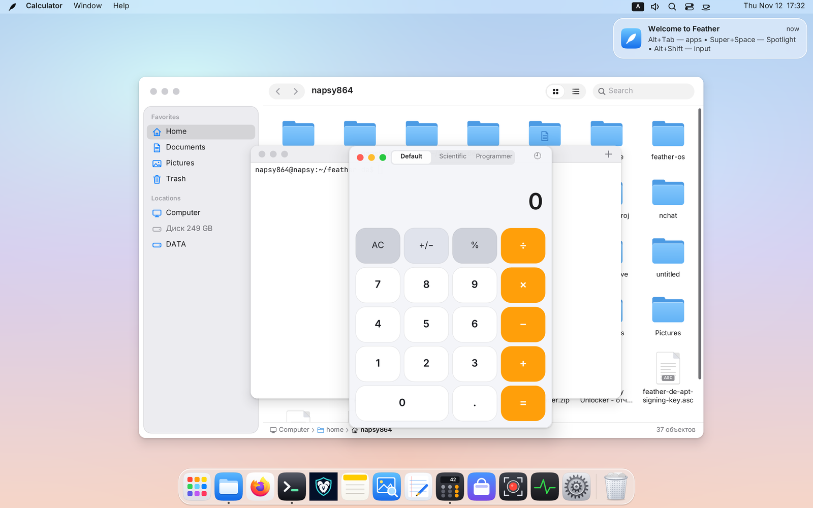

---

## Table of Contents

1. [Getting Started & First Login](#1-getting-started--first-login)
2. [Top Menu Bar, Global Menus & Menu HUD (`Super + /`)](#2-top-menu-bar-global-menus--menu-hud-super--)
3. [Dock, Launchpad, Spotlight & the App Ring (`Cmd`)](#3-dock-launchpad-spotlight--the-app-ring-cmd)
4. [Windows, Edge Snapping & Ghost PiP (`Super + P`)](#4-windows-edge-snapping--ghost-pip-super--p)
5. [Workspaces, Auto-Tiling (`Tile`) & Scrollable Ribbon (`Tape`)](#5-workspaces-auto-tiling-tile--scrollable-ribbon-tape)
6. [Scratchpad Drawer (`Super + S`) & Drop Shelf (`Super + D`)](#6-scratchpad-drawer-super--s--drop-shelf-super--d)
7. [Top Drawers: Control Center, Per-App Audio Mixer & Notifications](#7-top-drawers-control-center-per-app-audio-mixer--notifications)
8. [Screenshots & Screen Recording (`Print`, `Super + Alt + 5`)](#8-screenshots--screen-recording-print-super--alt--5)
9. [Native Feather Applications](#9-native-feather-applications)
10. [System Settings (All 15 Sections)](#10-system-settings-all-15-sections)
11. [Running Linux, X11 & Windows Apps (Wine / Proton / Gaming)](#11-running-linux-x11--windows-apps-wine--proton--gaming)
12. [CLI Automation (`featherctl`) & Complete Keyboard Shortcut Reference](#12-cli-automation-featherctl--complete-keyboard-shortcut-reference)

---

## 1. Getting Started & First Login

On your first login, the **Welcome Setup Assistant** walks you through choosing your interface language (English, Russian, Spanish, German, French, or Simplified Chinese), Light or Dark appearance, accent color, and keyboard layouts. You can reopen this assistant anytime from the **🪶 Feather** menu in the top-left corner.

The Feather desktop is organized into four main areas:

- **Top Menu Bar** — the `🪶 Feather` system menu, the active application's global menu, StatusNotifierItem tray icons, keyboard layout switcher, speaker/per-app mixer icon, Spotlight search, Control Center toggles, current desktop layout pill, Caffeine cup, and the clock (which opens Notification Center).
- **Desktop Canvas** — supports files, folders, and `.desktop` launchers directly on the wallpaper with rubber-band selection, drag-and-drop to and from *Files*, right-click menus, and moving items to Trash.
- **Dock** — pinned and running applications with smooth hover magnification, window indicators, and the Trash icon on the end.
- **Real-Time GPU `Liquid Glass`** — panels, drawers, menus, the Dock, and HUD cards refract and blur live windows and wallpaper beneath them on the GPU (Dual-Kawase + SDF bevel with dispersion and caustics) while skipping work on static frames (`0%` idle CPU). You can reduce transparency anytime in *System Settings → Accessibility*.

---

## 2. Top Menu Bar, Global Menus & Menu HUD (`Super + /`)

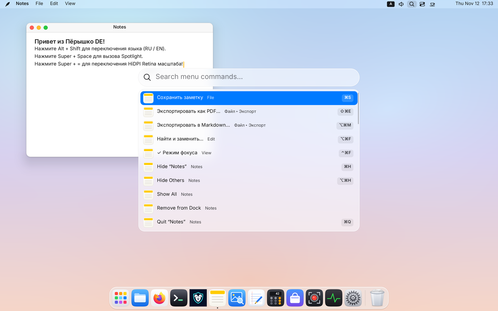

### The `🪶` Menu & Global Application Menus
- On the far left, the **🪶** menu gives instant access to *About This Computer*, *System Settings…*, *App Store…*, *Activity Monitor…*, and session controls — *Sleep*, *Restart…*, *Shut Down…*, *Lock Screen* (`Super + L`), and *Log Out…*.
- Next to it, Feather displays the **active window's global menu** (supporting Qt/KDE apps via `DBusMenu` and GTK apps via `org.gtk.Menus`). For apps that do not export a menu, Feather provides built-in **Window** and **Help** menus.
- Open menus can be navigated with the mouse or with `← / → / ↑ / ↓` and `Enter`.

### Instant Menu Command Search — Menu HUD (`Super + /`)
Never hunt through nested submenus for a buried command again:
1. Press **`Super + /`** (or choose *Help → Search Menus…*).
2. Start typing what you want to do — Feather flattens the active app's entire menu tree and shell menus into a searchable command palette with breadcrumbs (`File ▸ Export ▸ Export as PDF…`), checkmarks, and shortcut badges on the right.
3. **Cross-layout typo tolerance:** even if your keyboard is left in another layout (e.g. `QWERTY ↔ ЙЦУКЕН`), Menu HUD automatically matches your query across layouts!

### System Tray & Caffeine
- Background apps (Telegram, Steam, VPN clients, etc.) place icons in the right side of the menu bar via `StatusNotifierItem`; extra icons fold neatly into an overflow popup when space is tight.
- **Caffeine Cup:** click the cup icon next to the clock to prevent screen blanking and automatic sleep during presentations, reading, or long downloads — confirmed by a centered glass HUD card.

---

## 3. Dock, Launchpad, Spotlight & the App Ring (`Cmd`)

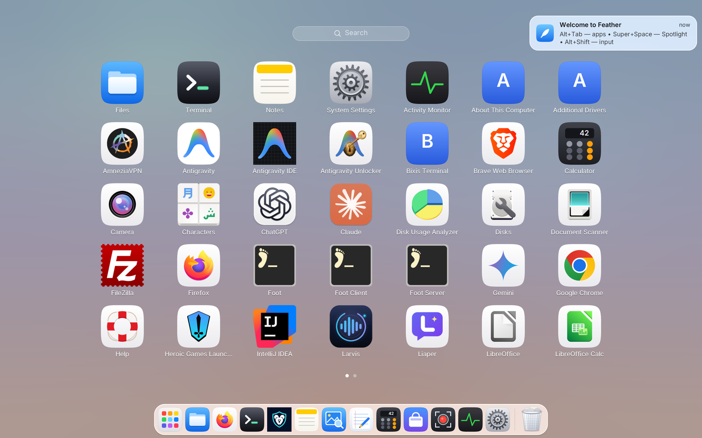

### The Dock
- **Left-click** an icon to launch the app or bring its windows forward; clicking an already active app minimizes its window into the Dock, and clicking a minimized app restores it.
- **Right-click** an icon to pick a specific window, pin/unpin the app, or quit it.
- **Drag & customize:** reorder or pin icons by dragging (or lock Dock icons against accidental drags in *System Settings → Desktop & Dock*), adjust icon size, place the Dock on the **bottom, left, or right** edge, and enable auto-hide.
- **Trash:** drag files onto the Trash icon to delete them, or right-click → *Empty Trash…*.

### Launchpad (`Super + A`)
Opens a full-screen grid of all installed applications (including Flatpak and Snap packages):
- Just start typing to filter apps live.
- Flip pages with the mouse wheel, a 3/4-finger horizontal trackpad swipe, or `← / →`; pinch 4 fingers in on a trackpad to open Launchpad, spread 4 fingers out to close it.
- Drag any app straight from Launchpad onto the Dock to pin it.

### Spotlight Search (`Super + Space`), Clipboard History & Emoji
One fast search bar with zero background indexing daemons:
- **`Super + Space`** — searches installed apps, open windows across all desktops, System Settings pages, Notes, files in your home folder, menu commands, and **evaluates math expressions live** (e.g. `1920 * 1080 / 1024`).
- **`Super + Shift + V`** — opens **Clipboard History** (kept strictly in RAM for the current session; password-manager entries are automatically ignored). Selecting an item pastes it straight into the active window.
- **`Super + .`** — opens the **Emoji Picker** with keyword search.

### Radial App Ring (Tap `Super` / `Cmd`)
A signature fast-switching gesture in Feather DE:
- Tap and release the **`Super` (`Cmd`)** key on its own without pressing any other key — a radial ring of running and pinned apps opens right around your pointer.
- Flick the mouse toward a sector and click (or use arrows / `Tab` / the app's first letter).
- Double-tap **“Cmd, Cmd”** to bounce straight back to your previously focused window! (Can be toggled in *System Settings → Keyboard*.)

---

## 4. Windows, Edge Snapping & Ghost PiP (`Super + P`)

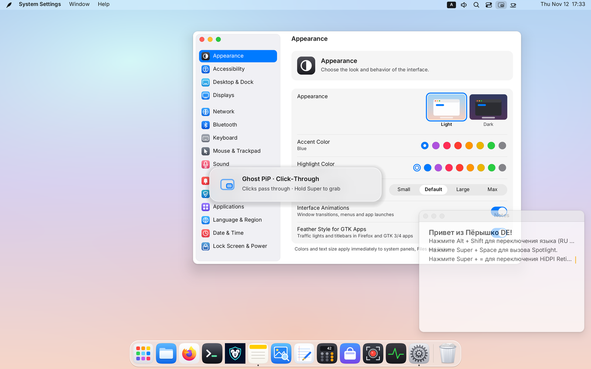

### Title Bars, Traffic Lights & Effortless Resizing
- Windows feature macOS-style traffic-light controls on the top left:
  - 🔴 **Red** — close window (`Super + W`);
  - 🟡 **Yellow** — minimize to Dock (`Super + M`);
  - 🟢 **Green** — maximize (`Super + F`), or hover over it for `0.45 s` to open the half/quarter tile menu.
- Apps requesting client-side decorations (Chrome, Firefox, Telegram, etc.) keep their own native headerbar with GPU-rounded corners — Feather never forces a duplicate titlebar.
- **Generous resize borders:** an invisible outer grab halo around edges and corners makes resizing effortless on HiDPI displays. You can also hold **`Super`** at any time to move a window with **`Super + Left-Drag`** or resize it from inside with **`Super + Right-Drag`**.

### Classic Edge Snapping (in *Free Windows* Mode)
- **With the mouse:** drag a window to the left or right screen edge to snap to half the screen, into any of the four corners for a quarter tile, or to the top bar to maximize.
- **With the keyboard (`Ctrl + Super + Arrows`):**
  - `Ctrl + Super + ← / →` — snap to the left or right half;
  - press `Ctrl + Super + ↑` or `↓` right after — fold into the top or bottom quarter of that side!
  - `Ctrl + Super + ↑` — maximize; `Ctrl + Super + ↓` — restore previous floating size.

### Picture-in-Picture & Ghost Click-Through Mode (`Super + P`)
Pin any window (a video stream, reference doc, note, or system graph) above all workspaces:
- **`Super + P`** — toggles **Picture-in-Picture (PiP)**: the window scales cleanly while respecting aspect ratio, snaps magnetically to the nearest screen corner, and stays visible across every desktop and above fullscreen apps. Drag it and let go — a GPU spring glides it into any of the four corners.
- **`Super + Alt + P`** — toggles **Ghost Mode (*Click-Through*)**: the PiP window turns translucent (`68%` opacity) and **passes every mouse click, hover, and scroll wheel event straight through to the window underneath**! You can code, browse, or game right through a floating video.
- **Moving a ghosted window:** simply hold **`Super`** — while `Super` is held, the ghost window temporarily captures pointer input again so you can drag or resize it.

---

## 5. Workspaces, Auto-Tiling (`Tile`) & Scrollable Ribbon (`Tape`)

Feather supports up to **16 workspaces (Spaces)**, and **each desktop has its own independent layout mode**, persisted across sessions! For example, Desktop 1 can run classic floating windows, Desktop 2 can run automatic BSP tiling for terminals, and Desktop 3 can run a scrollable horizontal ribbon for coding and browsing.

### Switching Workspaces & the Centered Desktop HUD Card

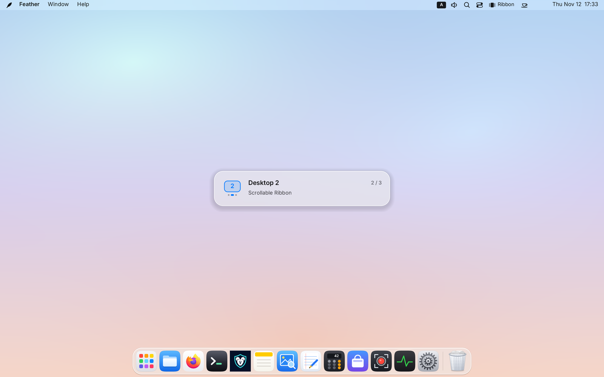

- **Direct jump by number (`Super + 1…9` / `Cmd + 1…9`):** jumps straight to Desktop `1…9` (works with both the top number row and `NumPad`, regardless of keyboard layout). If that desktop doesn't exist yet, Feather **creates it on the fly**, and empty trailing desktops automatically prune themselves when you leave!
- **Carry window by number (`Super + Shift + 1…9`):** moves the active window (including detaching a window from the Scratchpad) directly to Desktop `1…9` and switches there with it.
- **Adjacent desktops:** **`Ctrl + Alt + ← / →`** (or a 3-finger horizontal trackpad swipe) steps left/right between desktops; **`Ctrl + Alt + Shift + ← / →`** carries the active window along.
- **Centered Liquid Glass HUD Card:** whenever you switch desktops via hotkeys or trackpad swipe, a centered glass card appears for `1.2 s` showing the desktop badge number, page-indicator dots, `N / M` counter, and layout mode (or *"Window moved to this desktop"*), so you always know which desktop you landed on — even when switching between empty desktops.

---

### Cycling the Three Desktop Modes (`Ctrl + Alt + M`)

Switch the current desktop's layout mode anytime via:
- **`Ctrl + Alt + M`**;
- clicking the **mode pill in the top-right menu bar** (`Free` / `Tile` / `Ribbon`);
- clicking the mode pill directly under any desktop thumbnail inside **Mission Control**;
- *Window → Workspace Mode*, Spotlight, or `featherctl space-mode`.

Switching back to **Free Windows (`Free`)** restores every window's original floating position and size!

---

### Mode 2: Auto-Tiling (`Tile` — Smart BSP Grid)

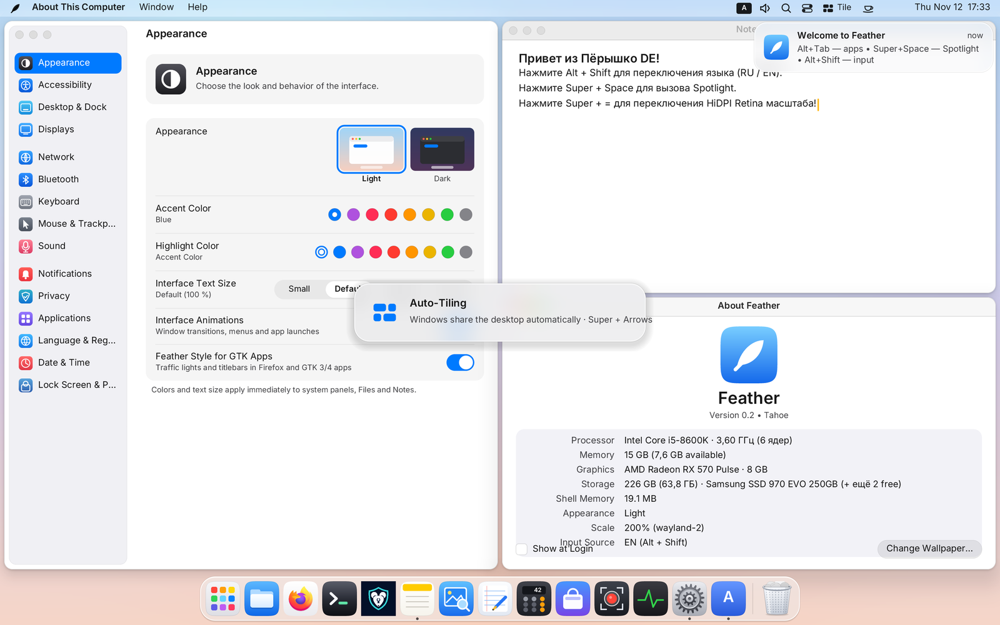

In **Auto-Tiling** mode, regular windows on that desktop automatically partition the work area between the menu bar and Dock with crisp `6 px` gaps (dialogs and PiP windows stay floating):

| Action in *Auto-Tiling* (`Tile`) | Shortcut / Mouse |
|---|---|
| Move focus to an adjacent tile | `Super + ← / → / ↑ / ↓` |
| Swap windows (or **rotate split axis** horizontal ↔ vertical when pushing against an outer edge) | `Super + Shift + ← / → / ↑ / ↓` or drag titlebar / `Super + Left-Drag` onto another tile |
| Resize internal split divider (supports key repeat when held) | `Ctrl + Super + ← / → / ↑ / ↓` or `Alt + Super + ← / → / ↑ / ↓`, or drag the gap between tiles / `Super + Right-Drag` |
| Reset all split ratios to 50 / 50 | `Super + 0` or double-click any split divider |
| Temporarily zoom the focused tile to fill the desktop and restore | `Super + F` or the green window button |

---

### Mode 3: Scrollable Ribbon (`Tape` — Niri / PaperWM Style)

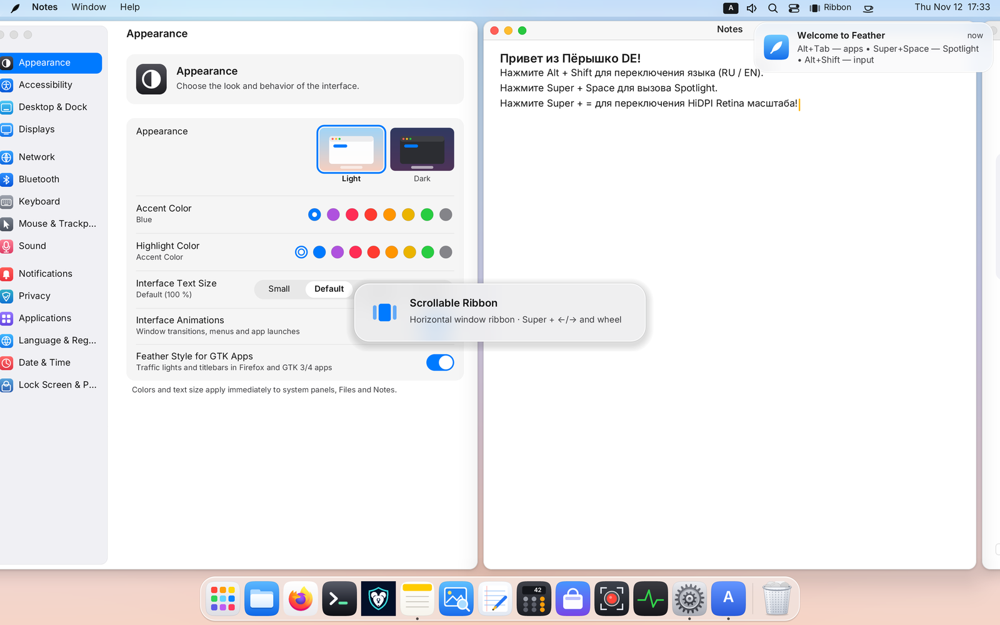

In **Scrollable Ribbon** mode, windows never get squished into tiny slivers no matter how many you open! Every window becomes a full-height column arranged along an infinite horizontal strip:
- Neighboring columns gently peek in at the left and right edges (`28 px` peek) — giving visual context and letting you click a peeking edge with the mouse to glide straight to that window.
- Scrolling is driven by an analytic GPU spring: client buffers are never re-rasterized while gliding, keeping motion locked to your monitor's refresh rate (`60 / 120 / 144+ Hz`).

| Action in *Scrollable Ribbon* (`Tape`) | Shortcut / Scrolling / Mouse |
|---|---|
| **Smoothly scroll the ribbon left / right** | **`Super + Mouse Wheel`** (vertical or horizontal) or **`Super + two-finger trackpad scroll`** |
| Focus the column to the left / right (auto-scrolls into view) | `Super + ← / →` or click a peeking neighbor column edge |
| Jump to the very first / very last column | `Super + Home` / `Super + End` |
| Reorder (swap) the active column left / right | `Super + Shift + ← / →` or drag titlebar / `Super + Left-Drag` |
| **Cycle column width presets (`50% → 67% → 100% → 33%`)** | **`Super + R`** |
| Smoothly resize the active column's width | `Ctrl + Super + ← / →`, `Alt + Super + ← / →`, drag column border, or `Super + Right-Drag` |
| Reset all columns in the ribbon to `50%` width | `Super + 0` or double-click a border between columns |
| Temporarily expand column to `100%` width and restore | `Super + F` |

---

### Window & Workspace Overview — Mission Control (`Ctrl + Alt + ↑`)

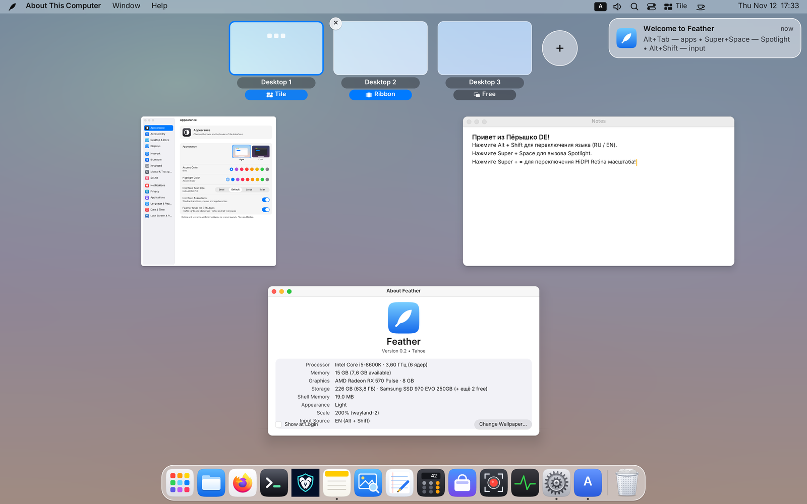

Press **`Ctrl + Alt + ↑`** (or swipe 3/4 fingers up on a trackpad):
- Windows on the current desktop spread into a clean non-overlapping grid — click any window (or hover and press `Enter`) to focus it.
- Along the top sits the **Workspace Strip** with live window thumbnails, a **`+`** button to add a new desktop, and a hover **`×`** button to close a desktop (its windows move safely to the neighboring desktop).
- **Drag any window** onto another desktop tile — or drop it onto **`+`** to spin up a brand-new desktop for it!
- Click the **mode pill** (`Free` / `Tile` / `Ribbon`) under any desktop tile to change its layout mode right inside Mission Control.

---

## 6. Scratchpad Drawer (`Super + S`) & Drop Shelf (`Super + D`)

### The Scratchpad Drawer (`Super + S`)

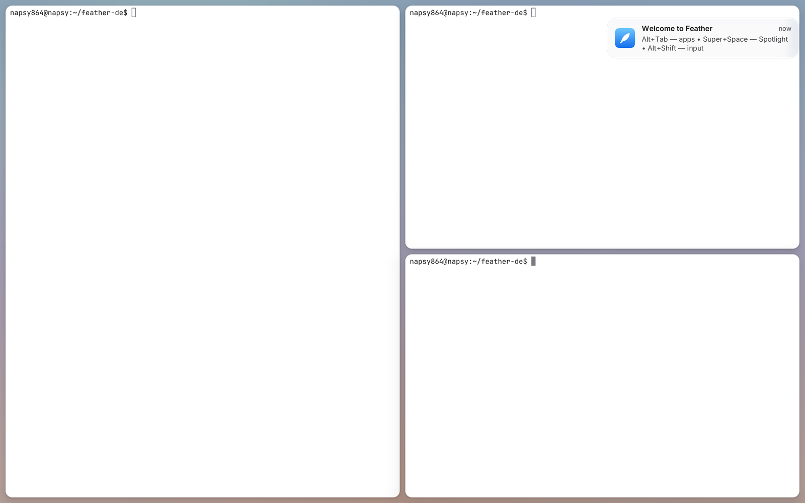

The **Scratchpad** is an instant pull-down overlay layer for tools you want one keystroke away on **every** desktop (a terminal, notes, chat app, music player, or calculator):
1. Focus any window and press **`Super + Shift + S`** — the window moves off the regular desktop onto the Scratchpad, and a counter badge appears in the menu bar.
2. Press **`Super + S`** from anywhere to slide your Scratchpad windows in over the current desktop! Press **`Super + S`** again (or click the frosted margin near the screen edge) to tuck it away.
3. **Smart Tiling Inside the Scratchpad:**
   - **One window** fills the entire screen cleanly.
   - **Two or more windows** automatically form a live tiled grid!
   - All tiling shortcuts work inside an open Scratchpad: **`Super + Arrows`** (focus), **`Super + Shift + Arrows`** (swap tiles or rotate split axis), **`Ctrl + Super + Arrows`** or mouse-dragging dividers (resize), **`Super + 0`** (equalize 50/50), and **`Super + F`** (zoom active tile).
   - Press **`Super + Shift + S`** to return the focused window to the current desktop — or **`Super + Shift + 1…9`** to send it straight to a numbered desktop!

---

### Glass Drop Shelf (`Super + D` / Shake Pointer While Dragging)

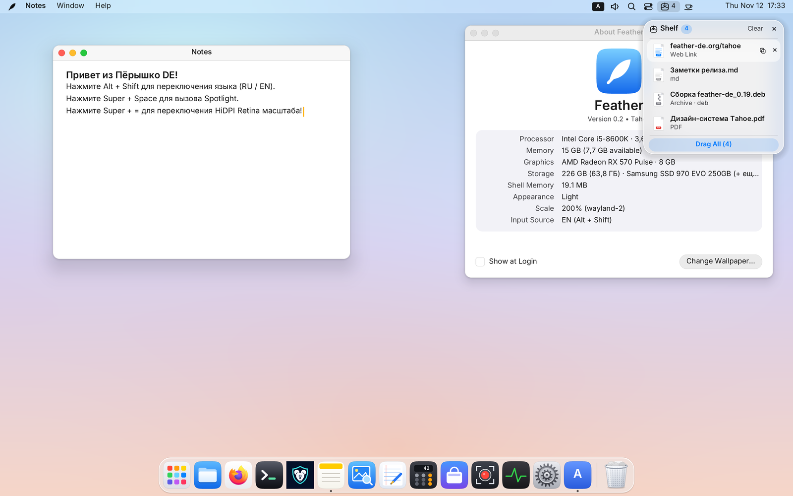

Ever started dragging a file or image only to realize the destination window is buried or sitting on another workspace? **Drop Shelf** solves multi-step drag-and-drop effortlessly:
- **How to summon:** simply **shake the mouse pointer left-right** while dragging a file, image, or text selection (or touch the left/right screen edge while dragging, or press **`Super + D`** anytime).
- Drop up to 24 items onto the floating Liquid Glass shelf: local files, folders, web images dragged straight out of a browser, URLs, and text snippets.
- Switch to another workspace (`Super + 1…9`), open your target folder or chat app, and **drag individual cards — or the entire batch at once — right off the shelf**!
- Closing the shelf (`Super + D` or `×`) keeps your stashed items accessible from a compact counter pill in the menu bar until you click *Clear*.

---

## 7. Top Drawers: Control Center, Per-App Audio Mixer & Notifications

Two quick glass drawers live at the right end of the top menu bar:

### Control Center Drawer (`Super + N` or Switches Icon)

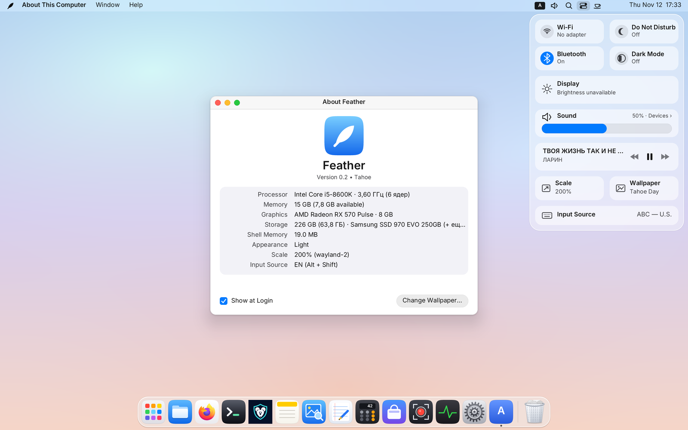

Click the switches icon in the top bar or press **`Super + N`**:
- **Wi-Fi & Network Tile** — toggle Wi-Fi in one click or open the nested Wi-Fi picker (with WPA2/WPA3 password entry) and VPN / WireGuard toggles.
- **Bluetooth Tile** — toggle the adapter and connect/disconnect headphones, mice, and speakers with battery indicators.
- **Do Not Disturb & Night Shift** — silence notification banners/sounds or warm up display color temperature for evening work.
- **Display Brightness Slider** — controls laptop backlights and external monitors via `DDC/CI`.
- **Master Volume Slider & Quick Output Switcher.**

---

### Per-App Audio Mixer (Speaker Icon in Menu Bar)

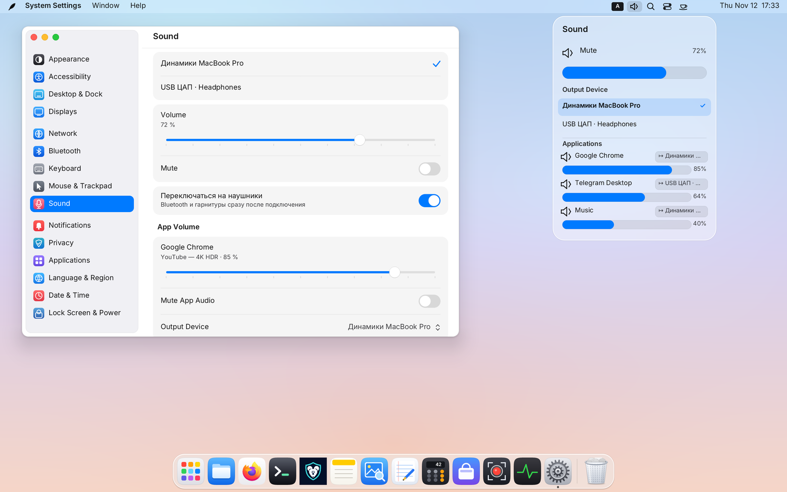

Click the **speaker icon** in the menu bar (or open *Sound* in Control Center / *System Settings → Sound*):
- Switch your **default output device** at the top (built-in speakers, HDMI display, USB DAC, or Bluetooth headset).
- Under **Applications**, every currently playing app (browser tab, Telegram voice chat, music player, game) gets:
  - its own **independent volume slider (`0–100%`)** and **Mute** button;
  - a **route button (`↦`)** that moves **only that specific app** to a different output device (for example, keep music on speakers while routing voice chat exclusively to your headset!).

---

### Notification Center Drawer (Click the Clock)

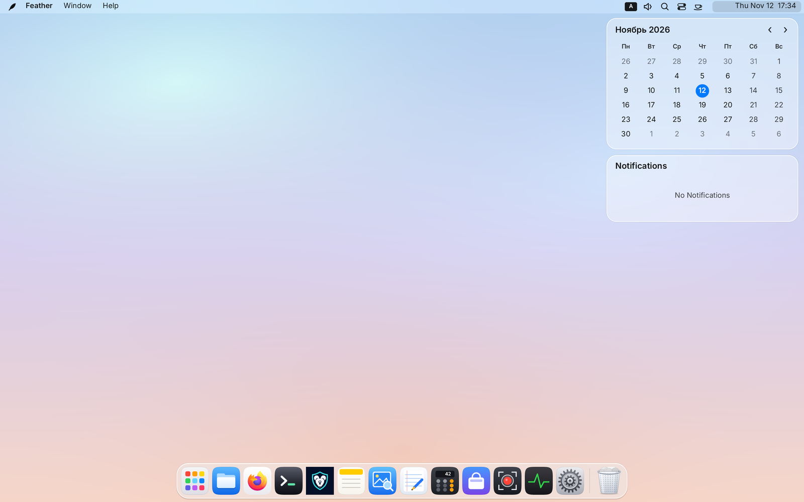

Click the **date & time** in the top-right corner to slide out **Notification Center**:
- Toggle **Do Not Disturb** at the top (also supports automatic night schedules in System Settings).
- Notifications are grouped cleanly by application, support interactive action buttons, and can be dismissed individually or cleared all at once.

---

## 8. Screenshots & Screen Recording (`Print`, `Super + Alt + 5`)

Fast capture tools are built right into the compositor — no external utilities required:

| Task | Shortcut | Behavior |
|---|---|---|
| **Capture full screen** | `Print` | Saves to disk (*Pictures* or *Desktop*) **and** copies to clipboard |
| **Capture selected region** | `Shift + Print` | Drag a selection rectangle (`Esc` cancels) |
| **Capture active window** | `Alt + Print` | Cleanly captures the focused window |
| **Screen Recorder HUD** | **`Super + Alt + 5`** (`⌥⌘5`) or `Ctrl + Shift + Print` | Opens the recording bar: choose **Full Screen / Region**, **MP4 / WebM**, system audio, microphone, and cursor visibility |

- While recording, a red timer pill appears in the menu bar — click it (or press `Super + Alt + 5` again) to finish and save the video.
- Image format (`PNG`, `JPEG`, `WebP`) and save folder are configurable in *System Settings → Desktop & Dock*.
- OBS Studio, browser screen-sharing, and video calls work out of the box via Feather's built-in PipeWire `xdg-desktop-portal` (`ScreenCast`).

---

## 9. Native Feather Applications

Feather ships **eight native Wayland applications written in Rust**, sharing a unified look, light/dark themes, and near-instant cold startup:

1. **📁 Files (`feather-files`, `Super + E`)**
   - Icon and sortable list views (by name, kind, date, size), sidebar favorites, mounted drives, and Trash.
   - **Quick Look (`Space`):** select any file (image, PDF, code, text, archive) and press `Space` for an instant preview; use `↑ / ↓ / ← / →` to browse neighboring files without closing the preview!
   - **Full Archive Support:** extracts `ZIP` (including legacy Windows Cyrillic encodings), `7z`, `TAR.GZ / XZ / BZ2 / ZST`, and **`RAR4 / RAR5`** (including multi-part and password-encrypted archives) with a progress card and cancel button.
   - Shortcuts: `Space` — Quick Look, `Ctrl + L` — path bar, `Ctrl + H` — hidden files, `F2` — rename, `Ctrl + Shift + N` — new folder.
2. **⌨️ Terminal (`feather-terminal`, `Super + Enter` or `Super + T`)**
   - Custom DEC/ANSI/VT engine with TrueColor, tabs (`Ctrl + Shift + T`), 10,000-line scrollback search (`Ctrl + Shift + F`), clipboard (`Ctrl + Shift + C / V`), full TUI support (`htop`, `nvim`, `zellij`, `mc`), and drag-and-drop path quoting.
3. **📝 Notes (`feather-notes`)**
   - Instant plain-text notes with search and autosave stored in `~/.local/share/feather-notes/` (`Ctrl + N` — new, `Ctrl + F` — find, `Ctrl + Z` — undo), plus a built-in *Quick Notes* window in the shell.
4. **🖼️ Preview (`feather-preview`)**
   - Fast viewer for `PNG`, `JPEG`, `WebP`, `SVG`, and multipage `PDF` documents with page thumbnails, zoom, rotation, and panning.
5. **📄 Text Editor (`feather-textedit`)**
   - Tabbed code and text editor with line numbers, find & replace, and syntax highlighting (`Rust`, `Markdown`, `Python`, `Shell`, `JSON/YAML/TOML`, `C/C++`, `HTML/XML`).
6. **🧮 Calculator (`feather-calc`)**
   - **Basic**, **Scientific**, and **Programmer** (`BIN / OCT / DEC / HEX`, bitwise ops `8/16/32/64-bit`) modes with calculation history.
7. **📈 Activity Monitor (`feather-monitor`, `Ctrl + Alt + Del`)**
   - Opens with **`Ctrl + Alt + Del`**: inspect CPU/memory per process, search, **End Task** (`Delete`, or `Shift + Delete` to force-kill immediately), and watch live 60-second CPU, memory, disk, and network charts.
8. **🛍️ App Store (`feather-store`)**
   - Unified catalog combining system packages (`PackageKit`) and **Flathub (`Flatpak`)**: one-click Flathub setup right from the Home or Search view, **`System Package / Flathub`** source selector on app pages, and unified system + Flatpak updates.

---

## 10. System Settings (All 15 Sections)

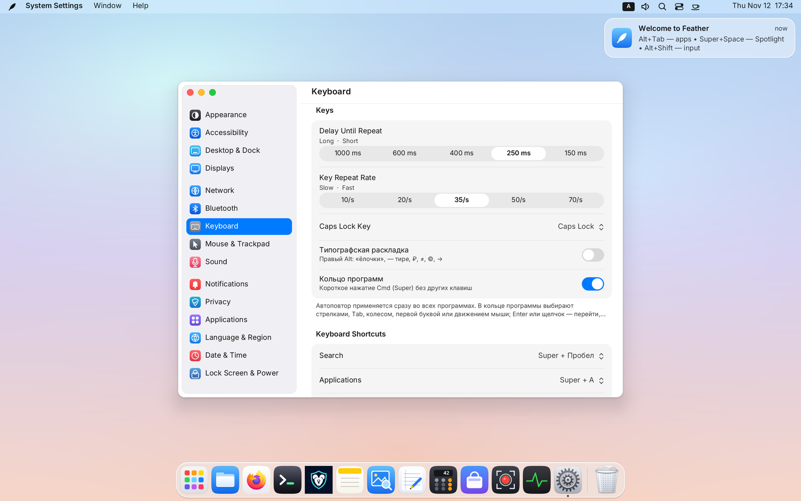

All desktop settings live in one unified window and save immediately to `~/.config/feather-de/settings.conf`:

1. **Appearance** — Light & Dark themes, accent and highlight colors, UI text size, GTK app styling sync, and spring animations.
2. **Accessibility** — Large text, high contrast, reduced transparency, and Sticky Keys.
3. **Language & Region** — Live UI language switching (`EN`, `RU`, `ES`, `DE`, `FR`, `ZH`), 24-hour clock, first day of week, and measurement units.
4. **Network** — Wi-Fi networks, saved profiles, Ethernet, and VPN / WireGuard tunnels.
5. **Bluetooth** — Device discovery, pairing, connection, and battery status.
6. **Keyboard** — Input layouts, layout-switch shortcut (`Alt + Shift`, `Caps Lock`, `Ctrl + Shift`, `Win + Space`), `Caps Lock` behavior, repeat delay/rate, `Cmd` App Ring toggle, and **customizable system keyboard shortcuts**.
7. **Mouse & Trackpad** — Pointer speed, independent natural scrolling for mouse and trackpad, tap-to-click, left-handed buttons, cursor theme, and size.
8. **Displays** — Fractional & HiDPI scaling (`100% … 250%`, also cycled with `Super + =` / `Super + -`), resolution & refresh rate, multi-monitor arrangement, primary display, XWayland/Wine HiDPI toggle, and scheduled Night Shift.
9. **Desktop & Dock** — Built-in & custom wallpapers (with timed rotation), Dock size, screen edge, auto-hide, screenshot folder/format, session window restore, and **Hot Corners**.
10. **Applications** — Default browser, terminal, and file manager + **Login Startup Apps**.
11. **Privacy** — Per-application screen-capture portal permissions.
12. **Date & Time** — Searchable time zone picker and automatic `NTP` sync.
13. **Lock Screen & Power** — Separate idle timers for screen lock (`Super + L`), display blanking (`DPMS`), and system sleep.
14. **Notifications** — Per-app notification delivery policies and Do Not Disturb schedules.
15. **Sound** — Output & input devices, mic gain, per-app audio mixer, alert tones, and automatic headphone switching.

---

## 11. Running Linux, X11 & Windows Apps (Wine / Proton / Gaming)

- **Native Wayland, Flatpak, and Snap apps** appear automatically in Launchpad, Spotlight, and the Dock as soon as they are installed.
- **X11 applications (Steam, Discord, legacy tools)** run seamlessly on demand via `xwayland-satellite` — zero X11 overhead when no X11 apps are open.
- **Windows games & apps (Wine / Steam Proton):**
  - Full support for relative pointer motion and pointer lock/confine (`wp_pointer_constraints` / `wp_relative_pointer`), smooth right-click MMO/FPS camera rotation, **Variable Refresh Rate (`VRR` / FreeSync)**, explicit GPU sync (`wp_linux_drm_syncobj_v1`), and **Direct Scanout** for fullscreen games.
  - Toggle dedicated **XWayland HiDPI scaling** in *System Settings → Displays* for crisp rendering in Wine/Proton titles on Retina/4K screens.

---

## 12. CLI Automation (`featherctl`) & Complete Keyboard Shortcut Reference

### `featherctl` Command-Line Control
Control workspaces, windows, audio streams, panels, and screenshots from scripts or terminals with `featherctl` (pass `--json` for structured output):

```bash
featherctl status                      # System summary
featherctl windows                     # List open windows across all desktops
featherctl spaces                      # List workspaces
featherctl space 3                     # Switch to Desktop 3
featherctl space-mode 0 tape           # Set current desktop to Scrollable Ribbon (free | tile | tape | next)
featherctl window pip 0 on ghost       # Pin active window in Ghost PiP (click-through)
featherctl menu-hud toggle             # Toggle Menu HUD command search
featherctl shelf add ~/Report.pdf      # Stash a file on the Glass Drop Shelf
featherctl audio streams               # List playing app audio streams
featherctl audio app-volume 41 60      # Set stream #41 volume to 60%
featherctl display dark toggle         # Toggle Dark / Light mode
featherctl screenshot screen           # Take a full-screen screenshot and print the file path
```

See [docs/API.md](API.md) for the full `org.feather.Shell1` D-Bus specification.

---

### Complete Keyboard Shortcut Cheat Sheet

> **Built-in Cheat Sheet inside the OS:** press **`Super + Shift + /`** (`Super + ?`) or **`Super + F1`** (or open **`🪶 Feather → Keyboard Shortcuts…`** / **`Help → Feather Keyboard Shortcuts`**) at any time to open the interactive cheat sheet window with category tabs and instant search.

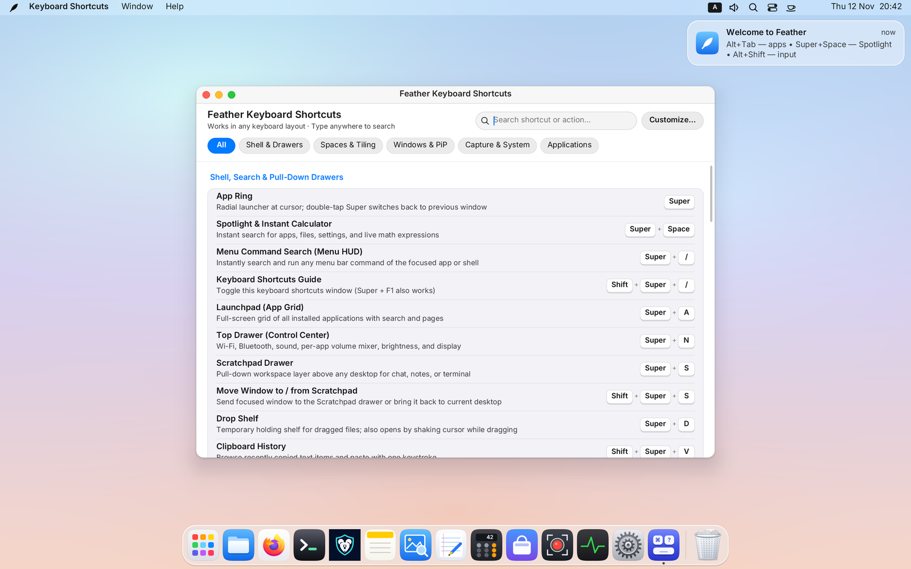

#### Shell, Search & Drawers
| Shortcut | Action |
|---|---|
| `Super` *(single short tap)* | Open radial **App Ring** (`Super, Super` switches back to previous window) |
| `Super + Space` | **Spotlight** search (apps, windows, files, settings, live calculator) |
| `Super + /` | **Menu HUD** — instant search across active window menu commands |
| `Super + Shift + /` / `Super + F1` | **Keyboard Shortcuts Guide** — interactive cheat sheet window with live search |
| `Super + A` | **Launchpad** application grid |
| `Super + N` | **Control Center** top drawer (Wi-Fi, Bluetooth, sound, brightness) |
| `Super + S` / `Super + Shift + S` | Toggle **Scratchpad** drawer / move focused window to or from Scratchpad |
| `Super + D` *(or shake pointer while dragging)* | Toggle **Glass Drop Shelf** |
| `Super + Shift + V` | Clipboard History picker |
| `Super + .` | Emoji picker |
| `Super + Enter` / `Super + T` | Open Terminal |
| `Super + E` | Open Files |
| `Ctrl + Alt + Del` | Open Activity Monitor |
| `Super + L` | Lock Screen |
| `Super + =` / `Super + -` | Cycle HiDPI display scale |

#### Windows & Ghost PiP
| Shortcut | Action |
|---|---|
| `Alt + Tab` / `Super + Tab` | Application switcher (MRU order) |
| `` Alt + ` `` / `` Super + ` `` | Cycle windows of the **active** application (`+ Shift` reverses) |
| `Super + W` / `Super + Q` | Close window / quit application |
| `Super + M` / `Super + F` | Minimize window / maximize (or zoom tile/column) |
| `Super + H` / `Super + Alt + H` | Hide active app / hide all other apps |
| `Ctrl + Super + ← / → / ↑ / ↓` | Snap floating window to screen halves or quarters |
| `Super + P` | Toggle **Picture-in-Picture (PiP)** corner pin across all desktops |
| `Super + Alt + P` | Toggle **Ghost PiP (*Click-Through*)** (hold `Super` to drag/resize) |
| `Super + Left-Drag` / `Super + Right-Drag` | Move window from anywhere / resize window |

#### Workspaces, Auto-Tiling (`Tile`) & Scrollable Ribbon (`Tape`)
| Shortcut | Action |
|---|---|
| **`Super + 1…9`** (`Cmd + 1…9`) | Jump directly to Desktop `1…9` (creates on the fly, prunes empty trailing desktops) |
| **`Super + Shift + 1…9`** | Carry active window directly to Desktop `1…9` and follow it |
| `Ctrl + Alt + ← / →` *(or 3-finger swipe)* | Previous / next workspace |
| `Ctrl + Alt + Shift + ← / →` | Carry active window to adjacent workspace |
| `Ctrl + Alt + ↑` / `Ctrl + Alt + ↓` | Open / close **Mission Control** overview |
| **`Ctrl + Alt + M`** | Cycle current desktop mode: **Free Windows → Auto-Tiling → Scrollable Ribbon** |
| `Super + ← / → / ↑ / ↓` *(in `Tile` / `Tape` / Scratchpad)* | Focus adjacent tile or ribbon column |
| `Super + Shift + ← / → / ↑ / ↓` | Swap tiles/columns (rotates split axis at outer edge in `Tile`) |
| `Ctrl + Super + ← / → / ↑ / ↓` *(or `Alt + Super + …`)* | Smoothly resize tile split or column width |
| **`Super + Mouse Wheel / Trackpad`** *(in `Tape`)* | Smooth horizontal scrolling of the Scrollable Ribbon |
| **`Super + R`** *(in `Tape`)* | Cycle ribbon column width preset: **`50% → 67% → 100% → 33%`** |
| `Super + Home` / `Super + End` *(in `Tape`)* | Jump to first / last column in the ribbon |
| `Super + 0` | Equalize all tile splits or ribbon column widths (`50 / 50`) |

#### Screenshots, Screen Recording & Session
| Shortcut | Action |
|---|---|
| `Print` / `Shift + Print` / `Alt + Print` | Screenshot full screen / region / active window |
| **`Super + Alt + 5`** (`⌥⌘5`) / `Ctrl + Shift + Print` | Open Screen Recorder HUD (MP4 / WebM with audio) |
| `Ctrl + Alt + F1…F12` | Switch Linux virtual terminals (TTYs) in DRM mode |
| `Ctrl + Alt + Backspace` | Emergency session exit |
