# Руководство пользователя Пёрышка (Feather DE)

**[🇬🇧 Read in English](USER_GUIDE.en.md)** · **[← На главную (README)](../README.md)** · **[История версий](../CHANGELOG.md)**

Добро пожаловать в **Пёрышко** — лёгкое и отзывчивое окружение рабочего стола для Linux в эстетике macOS Tahoe со своим Wayland-композитором, живым оптическим стеклом **Liquid Glass**, тремя режимами раскладки рабочих столов (плавающие окна, авто-плитка и бесконечная скролл-лента) и набором собственных быстрых приложений на Rust.

> **О клавише `Super` (`Cmd` / `⌘`):** во всём руководстве клавиша `Super` (она же `Cmd`, `⌘` или клавиша `Win` на обычной ПК-клавиатуре) используется как основной модификатор системы — так привычные сочетания `Ctrl + C / V / T / W` и `Ctrl + 1…9` внутри терминала, редакторов и браузеров остаются свободными и никогда не конфликтуют с оболочкой. Все буквенные и цифровые сочетания работают **независимо от раскладки клавиатуры** (в том числе в русской `ЙЦУКЕН`).

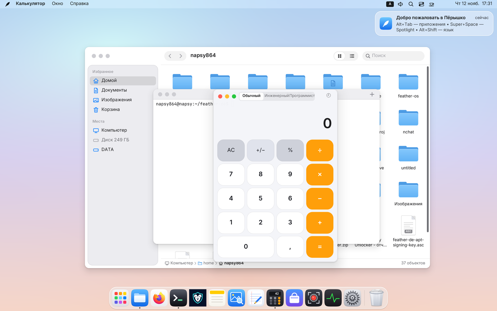

---

## Содержание

1. [Знакомство с рабочим столом и первый вход](#1-знакомство-с-рабочим-столом-и-первый-вход)
2. [Верхняя панель, глобальное меню и поиск Menu HUD (`Super + /`)](#2-верхняя-панель-глобальное-меню-и-поиск-menu-hud-super--)
3. [Dock, Launchpad, Spotlight и Кольцо программ (`Cmd`)](#3-dock-launchpad-spotlight-и-кольцо-программ-cmd)
4. [Окна, прилипание к краям и Призрачный PiP (`Super + P`)](#4-окна-прилипание-к-краям-и-призрачный-pip-super--p)
5. [Рабочие столы, Авто-плитка (`Tile`) и Бесконечная лента со скроллингом (`Tape`)](#5-рабочие-столы-авто-плитка-tile-и-бесконечная-лента-со-скроллингом-tape)
6. [Шторка-Подложка (`Super + S`) и Полка перетаскивания (`Super + D`)](#6-шторка-подложка-super--s-и-полка-перетаскивания-super--d)
7. [Верхняя шторка: Пункт управления, Пооконный аудио-микшер и Уведомления](#7-верхняя-шторка-пункт-управления-пооконный-аудио-микшер-и-уведомления)
8. [Снимки и запись экрана (`Print`, `Super + Alt + 5`)](#8-снимки-и-запись-экрана-print-super--alt--5)
9. [Встроенные приложения Пёрышка](#9-встроенные-приложения-пёрышка)
10. [Системные настройки (все 15 разделов)](#10-системные-настройки-все-15-разделов)
11. [Запуск Linux-, X11- и Windows-программ (Wine / Proton / Игры)](#11-запуск-linux--x11--и-windows-программ-wine--proton--игры)
12. [Управление из терминала (`featherctl`) и полная шпаргалка горячих клавиш](#12-управление-из-терминала-featherctl-и-полная-шпаргалка-горячих-клавиш)

---

## 1. Знакомство с рабочим столом и первый вход

При первом входе открывается **Мастер первого запуска**: он помогает за минуту выбрать язык интерфейса (русский, английский, испанский, немецкий, французский или китайский), светлую или тёмную тему, цвет акцента и раскладки клавиатуры. Позже этот мастер всегда можно открыть заново из меню **🪶 Пёрышко** в левом верхнем углу.

Экран Пёрышка состоит из четырёх главных зон:

- **Верхняя строка меню** — меню `🪶 Пёрышко`, глобальное меню активной программы, системный трей, индикатор раскладки, значок звука, лупа Spotlight, переключатели шторки Пункта управления, пилюля режима рабочего стола, чашка «Кофеина» и часы (открывающие шторку Центра уведомлений).
- **Рабочая область стола** — поддерживает значки файлов, папок и `.desktop`-ярлыков прямо на обоях: выделение резиновой рамкой, перетаскивание в «Файлы» и обратно, контекстное меню ПКМ и удаление в Корзину.
- **Панель Dock** — закреплённые и запущенные программы с плавным увеличением при наведении, индикаторами открытых окон и Корзиной справа.
- **Живое оптическое стекло (`Liquid Glass`)** — все панели, шторки, меню, Dock и карточки преломляют и размывают живое изображение окон и обоев под собой на GPU, не нагружая процессор на неподвижных кадрах (`0 %` ЦП в простое). В «Системных настройках → Универсальный доступ» прозрачность при желании можно уменьшить.

---

## 2. Верхняя панель, глобальное меню и поиск Menu HUD (`Super + /`)

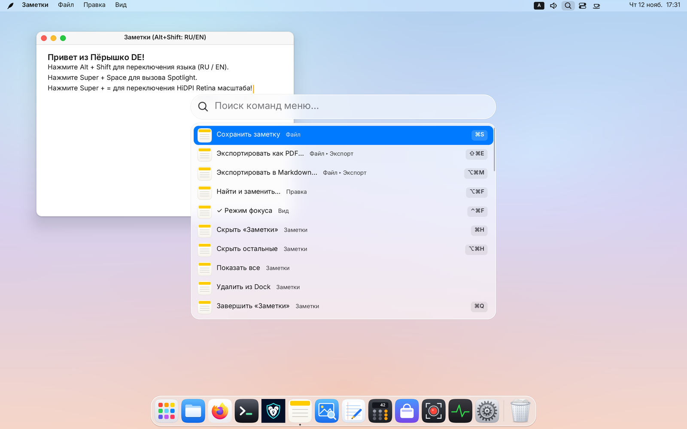

### Меню `🪶` и глобальное меню программ
- Слева расположено системное меню **🪶**: «Об этом компьютере», «Системные настройки…», «Магазин программ…», «Мониторинг системы…», а также управление сеансом — «Режим сна», «Перезагрузить…», «Выключить…», «Заблокировать экран» (`Super + L`) и «Выйти из Пёрышка…».
- Рядом автоматически появляется **глобальное меню активного окна** (для программ на Qt/KDE через `DBusMenu` и программ на GTK через `org.gtk.Menus`). Если программа не экспортирует собственное меню, Пёрышко показывает удобные системные меню **«Окно»** и **«Справка»**.
- Навигация по открытому меню работает как мышью, так и стрелками `← / → / ↑ / ↓` и `Enter`.

### Мгновенный поиск по командам меню — Menu HUD (`Super + /`)
Не нужно помнить, в каком подменю спрятана редкая команда редактора или графического пакета:
1. Нажмите **`Super + /`** (или откройте «Справка → Поиск по меню…»).
2. Начните печатать название действия — Пёрышко мгновенно разворачивает всё дерево меню активной программы и меню оболочки в плоский список с хлебными крошками (`Файл ▸ Экспорт ▸ Экспортировать как PDF…`), галочками состояния и подсказками горячих клавиш справа.
3. **Автоисправление раскладки:** если вы забыли переключить язык и набрали `cj[hfybnm` вместо `сохранить`, Menu HUD сам поймёт запрос и найдёт нужный пункт!

### Трей и «Кофеин»
- Значки фоновых программ (Telegram, Steam, VPN-клиенты и др.) отображаются справа в строке меню по протоколу `StatusNotifierItem`; если значков много, лишние аккуратно собираются в выпадающую кнопку переполнения.
- **Чашка «Кофеина»** рядом с часами одним кликом запрещает гашение экрана и автоматический уход компьютера в сон (например, на время чтения, презентации или долгой загрузки) и подтверждает переключение стеклянной карточкой по центру экрана.

---

## 3. Dock, Launchpad, Spotlight и Кольцо программ (`Cmd`)

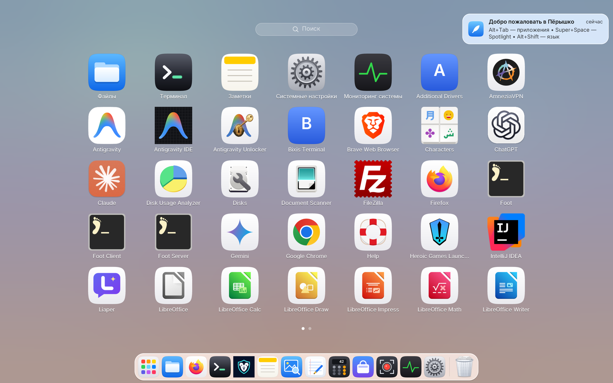

### Панель Dock
- **Левый клик** по значку запускает программу или поднимает её окна; повторный клик по уже активной программе сворачивает её окно в Dock, а клик по свёрнутой — возвращает обратно.
- **Правый клик (ПКМ)** открывает список всех окон этой программы, позволяет закрепить/открепить значок или завершить приложение.
- **Перетаскивание:** значки в Dock можно менять местами мышью (или заблокировать от случайного сдвига в «Системных настройках → Рабочий стол и Dock»), настраивать их размер, сторону экрана (**снизу, слева или справа**) и автоскрытие.
- **Корзина:** перетащите файл на значок Корзины в Dock, чтобы удалить его, или нажмите ПКМ → «Очистить Корзину…».

### Сетка приложений Launchpad (`Super + A`)
Открывает полноэкранную сетку всех установленных программ (включая пакеты Flatpak и Snap):
- Начните печатать прямо на открытом экране — список отфильтруется на лету.
- Страницы листаются колёсиком мыши, смахиванием тремя/четырьмя пальцами вбок или клавишами `← / →`; сведение четырёх пальцев на трекпаде открывает Launchpad, разведение — закрывает.
- Любой значок из Launchpad можно перетащить мышью прямо в Dock для закрепления.

### Поиск Spotlight (`Super + Пробел`), Буфер обмена и Эмодзи
Единая поисковая строка без фоновых индексаторов и лишнего расхода батареи:
- **`Super + Пробел`** — ищет установленные программы, уже открытые окна на всех рабочих столах, разделы Системных настроек, заметки, файлы домашней папки, команды меню и сразу **вычисляет математические выражения** (например, `1920 * 1080 / 1024`).
- **`Super + Shift + V`** — открывает **Историю буфера обмена** (хранится только в оперативной памяти текущего сеанса; пароли из менеджеров паролей игнорируются). Выбор записи сразу вставляет её в активное окно.
- **`Super + .`** — открывает **Панель эмодзи** с поиском по ключевым словам.

### Радиальное Кольцо программ (короткое нажатие `Super` / `Cmd`)
Фирменный жест быстрого переключения в Пёрышке:
- Нажмите и сразу отпустите одиночную клавишу **`Super` (`Cmd`)**, не нажимая других клавиш — вокруг курсора откроется кольцо запущенных и закреплённых программ.
- Сдвиньте мышь в сторону нужного сектора и кликните (либо выберите стрелками / `Tab` / первой буквой названия).
- Двойное короткое нажатие **«Cmd, Cmd»** мгновенно возвращает к предыдущему активному окну! (При желании кольцо отключается в «Системных настройках → Клавиатура».)

---

## 4. Окна, прилипание к краям и Призрачный PiP (`Super + P`)

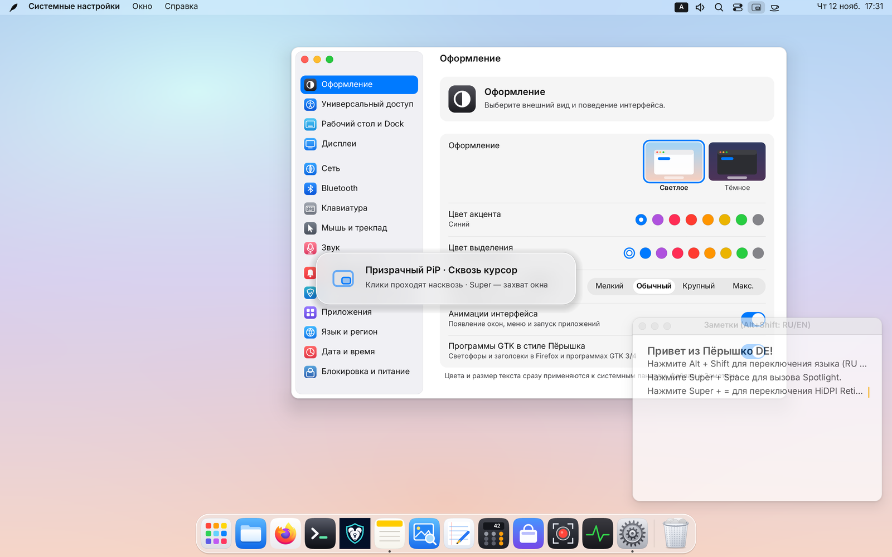

### Заголовки, «светофор» и изменение размера
- В левом верхнем углу окон расположены три кнопки «светофора»:
  - 🔴 **Красная** — закрыть окно (`Super + W`);
  - 🟡 **Жёлтая** — свернуть в Dock (`Super + M`);
  - 🟢 **Зелёная** — развернуть окно (`Super + F`), а если задержать на ней курсор на `0,45 с`, откроется меню раскладки окна по половинам и четвертям экрана.
- Программы со своими клиентскими заголовками (браузеры Chrome, Firefox, Telegram и др.) сохраняют родную шапку со скруглёнными на GPU углами — Пёрышко не навязывает им двойной заголовок.
- **Удобный ресайз:** невидимая зона захвата края окна расширена снаружи и на углах, поэтому потянуть за границу или угол легко даже на экране с высоким разрешением. Кроме того, зажав **`Super`**, любое окно можно перемещать за любую точку **`Super + ЛКМ`** и менять его размер **`Super + ПКМ`**.

### Классический тайлинг прилипанием (в режиме «Свободные окна»)
- **Мышью:** перетащите окно к левому или правому краю экрана — появится полупрозрачная подсветка половины экрана; в любой из четырёх углов — четверти экрана; к верхнему краю — разворот на весь рабочий стол.
- **С клавиатуры (`Ctrl + Super + стрелки`):**
  - `Ctrl + Super + ← / →` — левая / правая половина экрана;
  - нажмите следом `Ctrl + Super + ↑` или `↓` — окно сложится в верхнюю или нижнюю четверть этой стороны!
  - `Ctrl + Super + ↑` — развернуть окно; `Ctrl + Super + ↓` — вернуть прежний свободный размер.

### «Картинка в картинке» и Призрачный PiP «Сквозь курсор» (`Super + P`)
Любое окно (видеоплеер, трансляцию, шпаргалку, заметку или график мониторинга) можно закрепить поверх всех рабочих столов:
- **`Super + P`** — включает/выключает режим **«Картинка в картинке» (PiP)**: окно уменьшается до аккуратного размера с сохранением пропорций, примагничивается к ближайшему углу экрана и остаётся видимым при переключении столов и поверх полноэкранных программ. Перетащите его мышью — и оно с пружинной инерцией перелетит в другой угол.
- **`Super + Alt + P`** — включает **Призрачный режим («Сквозь курсор»)**: PiP-окно становится полупрозрачным (`68 %`) и **полностью пропускает сквозь себя все клики мыши, наведения и прокрутку колеса** в окно под ним! Вы можете писать код или играть прямо под полупрозрачным видео.
- **Как передвинуть призрачное окно:** просто зажмите клавишу **`Super`** — пока `Super` удерживается, призрачное окно временно перехватывает мышь, позволяя перетащить его в другой угол или изменить размер.

---

## 5. Рабочие столы, Авто-плитка (`Tile`) и Бесконечная лента со скроллингом (`Tape`)

В Пёрышке до **16 рабочих столов**, и **у каждого рабочего стола — свой собственный независимый режим раскладки окон**, который сохраняется между перезагрузками! Например, на Столе 1 у вас могут быть свободные плавающие окна, на Столе 2 — строгая тайловая BSP-сетка для терминалов, а на Столе 3 — бесконечная горизонтальная лента для кода и браузера.

### Переключение рабочих столов и центральная HUD-табличка

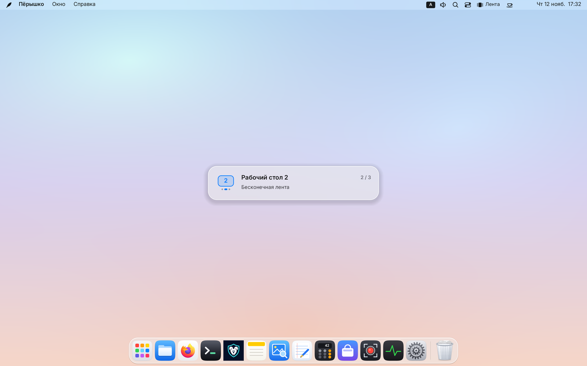

- **Прямой переход по номеру (`Super + 1…9` / `Cmd + 1…9`):** мгновенно переносит на рабочий стол `1…9` (работает и с верхним цифровым рядом, и с `NumPad`, в любой раскладке клавиатуры). Если стола с таким номером ещё нет, Пёрышко **создаёт его на лету**, а пустые хвостовые столы сами аккуратно исчезают, когда вы с них уходите!
- **Мгновенный перенос окна (`Super + Shift + 1…9`):** берёт активное окно (в том числе со шторки-Подложки), переносит его сразу на стол `1…9` и переходит туда вместе с ним.
- **Соседние столы:** **`Ctrl + Alt + ← / →`** (или смахивание тремя пальцами влево/вправо по трекпаду) листает столы по порядку, а **`Ctrl + Alt + Shift + ← / →`** переносит активное окно на соседний стол.
- **Центральная стеклянная табличка:** при любом переключении горячими клавишами или жестом по центру экрана на `1,2 с` появляется стеклянная карточка с номером стола, точками страниц, счётчиком `N / M` и подписью режима раскладки (или отметкой *«Окно перенесено на этот стол»*), чтобы даже на пустых столах всегда было понятно, где вы находитесь.

---

### Переключение трёх режимов стола (`Ctrl + Alt + M`)

Переключить режим текущего стола можно в любой момент:
- сочетанием **`Ctrl + Alt + M`**;
- кликом по **пилюле режима в правой части строки меню** (`Окна` / `Плитка` / `Лента`);
- кликом по пилюле прямо на миниатюре любого стола в **Mission Control**;
- через меню **«Окно → Режим рабочего стола»**, Spotlight или команду `featherctl space-mode`.

При возврате в режим **«Свободные окна» (`Free`)** все окна аккуратно вспоминают свои прежние плавающие координаты и размеры!

---

### Режим 2: Авто-плитка (`Tile` — умный BSP-тайлинг)

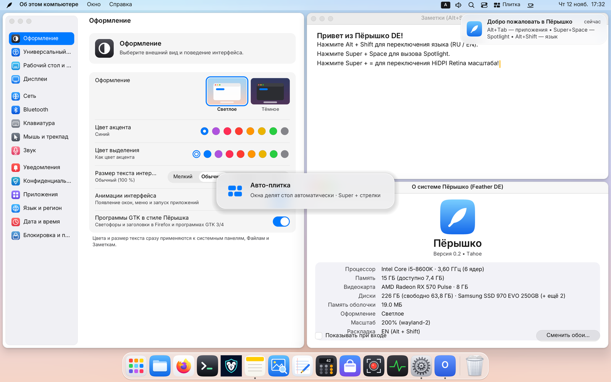

В режиме **«Авто-плитка»** все обычные окна на этом столе автоматически делят рабочую область между строкой меню и Dock без перекрытий с отступом `6 px` (диалоговые модальные окна и PiP остаются плавающими):

| Действие в режиме «Авто-плитка» | Сочетание клавиш / мышь |
|---|---|
| Перевести фокус на соседнюю плитку | `Super + ← / → / ↑ / ↓` |
| Поменять окна местами (а если соседа в эту сторону нет — **повернуть ось разбиения** «лево/право ↔ верх/низ») | `Super + Shift + ← / → / ↑ / ↓` или перетаскивание окна за заголовок / `Super + ЛКМ` |
| Сдвинуть внутреннюю перегородку (растянуть / сжать плитку) | `Ctrl + Super + ← / → / ↑ / ↓` или `Alt + Super + ← / → / ↑ / ↓`, либо перетаскивание зазора между окнами ЛКМ / `Super + ПКМ` |
| Сбросить все пропорции ровно 50 / 50 | `Super + 0` или двойной клик по перегородке между окнами |
| Временно развернуть активную плитку на весь стол и вернуть сетку | `Super + F` или зелёная кнопка окна |

---

### Режим 3: Бесконечная лента со скроллингом (`Tape` — в стиле Niri / PaperWM)

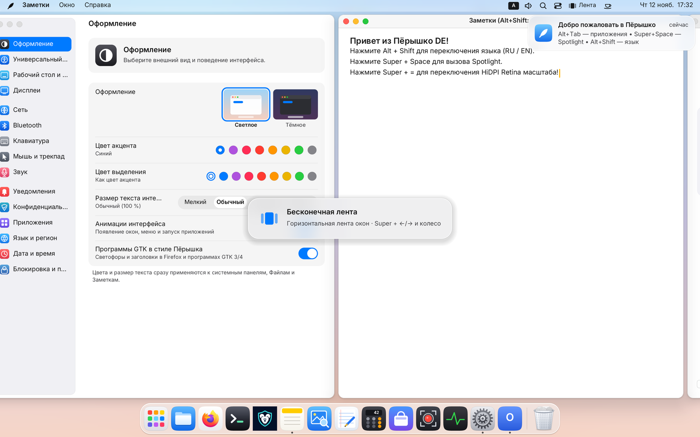

В режиме **«Бесконечная лента»** окна больше не сжимаются в узкие полоски, сколько бы вы их ни открыли! Каждое окно встаёт отдельной полноразмерной колонкой во всю высоту стола в бесконечную горизонтальную ленту:
- По краям экрана всегда слегка выглядывают соседние колонки (`28 px` peek) — вы видите контекст слева и справа и можете кликнуть мышью по выглядывающему краю, чтобы лента плавно подъехала к этому окну.
- Вся прокрутка работает через аналитическую GPU-пружину: буферы программ не перерисовываются во время скольжения, поэтому лента летит на полной частоте монитора (`60 / 120 / 144+ Гц`).

| Действие в режиме «Бесконечная лента» | Сочетание клавиш / скроллинг / мышь |
|---|---|
| **Плавный скроллинг ленты влево / вправо** | **`Super + колёсико мыши`** (вертикальное или горизонтальное) или **`Super + прокрутка двумя пальцами на трекпаде`** |
| Перейти к соседней колонке слева / справа (с автоскроллом) | `Super + ← / →` или клик мышью по выглядывающему краю соседнего окна |
| Прыгнуть в самое начало / в самый конец ленты | `Super + Home` / `Super + End` |
| Переставить активную колонку влево / вправо | `Super + Shift + ← / →` или перетаскивание за заголовок / `Super + ЛКМ` |
| **Переключить пресет ширины колонки по кругу (`50 % → 67 % → 100 % → 33 %`)** | **`Super + R`** |
| Плавно изменить ширину текущей колонки | `Ctrl + Super + ← / →`, `Alt + Super + ← / →`, перетаскивание края колонки мышью или `Super + ПКМ` |
| Сбросить ширину всех колонок ленты к `50 %` | `Super + 0` или двойной клик по границе между колонками |
| Временно развернуть колонку на `100 %` ширины и вернуть прежнюю | `Super + F` |

---

### Обзор окон и столов — Mission Control (`Ctrl + Alt + ↑`)

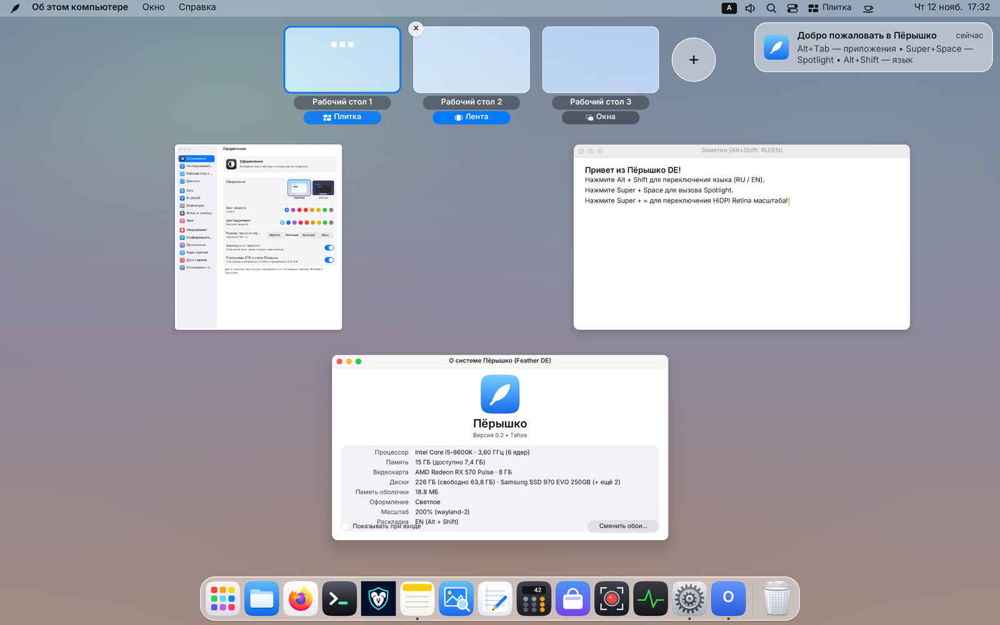

Нажмите **`Ctrl + Alt + ↑`** (или проведите тремя/четырьмя пальцами вверх по трекпаду):
- Все окна текущего стола раскладываются наглядной сеткой без перекрытий — кликните по нужному окну (или наведите и нажмите `Enter`), чтобы перейти к нему.
- Сверху расположена **полоса всех рабочих столов** с живыми миниатюрами их окон, кнопкой **`+`** для добавления нового стола и крестиком **`×`** при наведении для удаления стола (его окна бережно переедут на соседний стол).
- Любое окно из обзора можно **перетащить мышью на миниатюру другого стола** или прямо на кнопку **`+`**, чтобы выделить ему новый стол!
- На каждой миниатюре стола есть **пилюля его режима** (`Окна` / `Плитка` / `Лента`) — переключать режимы столов можно прямо не выходя из обзора.

---

## 6. Шторка-Подложка (`Super + S`) и Полка перетаскивания (`Super + D`)

### Быстрая шторка-Подложка (`Scratchpad`, `Super + S`)

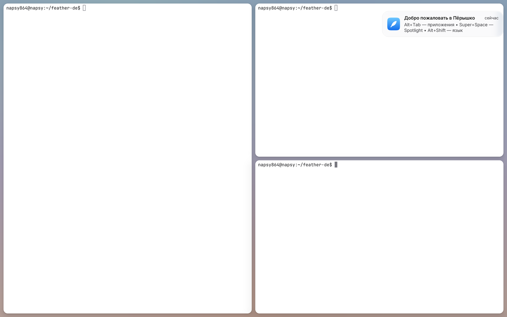

**Подложка** — это ваша персональная выдвижная «шторка» для программ, которые нужны под рукой в любую секунду на **любом** рабочем столе (терминал, заметки, мессенджер, музыка или калькулятор):
1. Откройте нужное окно и нажмите **`Super + Shift + S`** — окно уйдёт с обычного стола на Подложку, а в строке меню появится индикатор со счётчиком окон Подложки.
2. В любой момент и на любом рабочем столе нажмите **`Super + S`** — Подложка мгновенно выедет поверх текущих окон! Нажмите **`Super + S`** ещё раз (или кликните по матовому фону у края экрана), чтобы убрать её обратно.
3. **Умная сетка на Подложке:**
   - Если на Подложке **одно** окно — оно занимает экран целиком без лишних рамок.
   - Если окон **два и больше** — они автоматически складываются в живую тайловую сетку!
   - На открытой Подложке работают те же мгновенные клавиши тайлинга: **`Super + стрелки`** (фокус), **`Super + Shift + стрелки`** (обмен плиток и поворот оси разбиения), **`Ctrl + Super + стрелки`** и перетаскивание границ мышью (размер плиток), **`Super + 0`** (ровно 50/50) и **`Super + F`** (временный разворот одной плитки на весь экран).
   - Чтобы вернуть окно с Подложки на обычный стол, нажмите **`Super + Shift + S`** (или сразу отправьте его на конкретный стол по **`Super + Shift + 1…9`**!).

---

### Стеклянная Полка перетаскивания (`Drop Shelf`, `Super + D`)

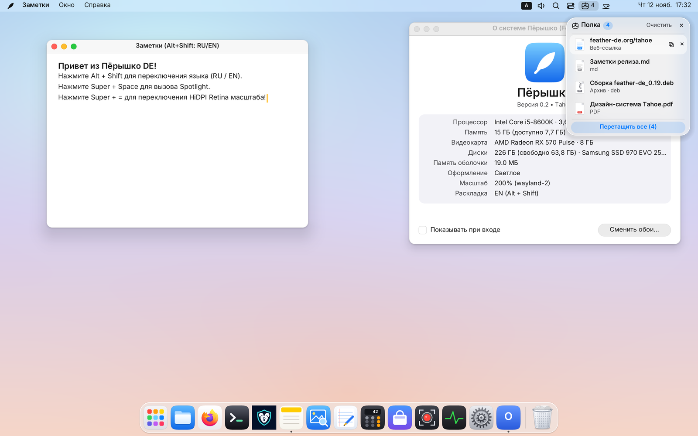

Знакомая проблема: вы начали тащить файл или картинку мышью, а нужное окно закрыто другими или вообще находится на третьем рабочем столе. **Полка перетаскивания** решает это в одно движение:
- **Как вызвать:** просто **слегка встряхните курсор мыши влево-вправо** прямо во время перетаскивания файла, картинки или выделенного текста (либо подведите перетаскиваемый объект к левому/правому краю экрана, либо нажмите **`Super + D`** в любое время).
- Бросьте на стеклянную Полку сколько угодно элементов (до 24 карточек: файлы, папки, изображения прямо из браузера, ссылки и фрагменты текста).
- Спокойно переключитесь на другой рабочий стол (`Super + 1…9`), откройте нужную папку или мессенджер и **вытащите карточку с Полки** (или все файлы сразу за заголовок группы) в целевое окно!
- При закрытии Полки (`Super + D` или кнопка `×`) собранные карточки сохраняются и отображаются компактной пилюлей со счётчиком в строке меню; кнопка «Очистить» освобождает полку.

---

## 7. Верхняя шторка: Пункт управления, Пооконный аудио-микшер и Уведомления

В правом верхнем углу строки меню живут две быстрые стеклянные шторки управления системой:

### Шторка Пункта управления (`Super + N` или значок переключателей)

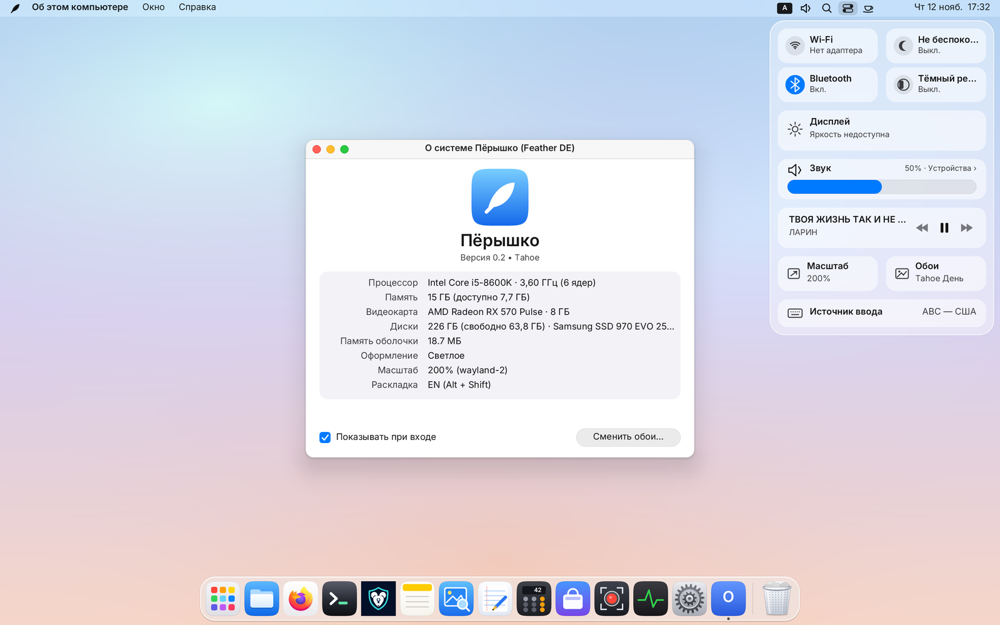

Открывается кликом по значку двух переключателей справа вверху или клавишами **`Super + N`**:
- **Плитка Wi-Fi и Сети** — включение/выключение Wi-Fi одним нажатием или переход на вложенную страницу выбора точки доступа (с вводом пароля WPA2/WPA3) и профилей VPN / WireGuard.
- **Плитка Bluetooth** — быстрое включение адаптера и список наушников, мышей и колонок с подключением в один клик и индикацией заряда аксессуаров.
- **Не беспокоить и Ночной режим** — мгновенное отключение всплывающих баннеров/звуков уведомлений и включение тёплой цветовой температуры экрана для вечерней работы.
- **Ползунок яркости** — управляет подсветкой экрана ноутбука (`backlight`) и яркостью внешних мониторов по протоколу `DDC/CI`.
- **Ползунок общей громкости и быстрый переход к звуковым устройствам.**

---

### Пооконный аудио-микшер (значок динамика в строке меню)

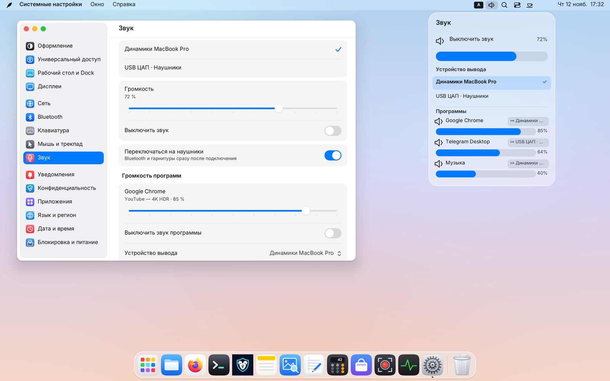

Кликните по **значку динамика** в строке меню (или раскройте раздел «Звук» в Пункте управления и «Системных настройках → Звук»):
- Сверху переключается **основное устройство вывода** (например, встроенные динамики, HDMI-монитор или USB-ЦАП / Bluetooth-наушники).
- В списке **«Программы»** отображается каждое приложение, которое сейчас воспроизводит звук (браузер с YouTube, голосовой чат в Telegram, музыкальный плеер, игра):
  - у каждой программы — **собственный ползунок громкости** (`0–100 %`) и кнопка **Mute**;
  - кнопка со стрелкой **`↦`** справа от названия программы позволяет **направить звук конкретной программы на другое устройство** (например, оставить музыку на колонках, а голосовой звонок вывести только в наушники!).

---

### Боковая шторка Центра уведомлений (клик по дате и времени)

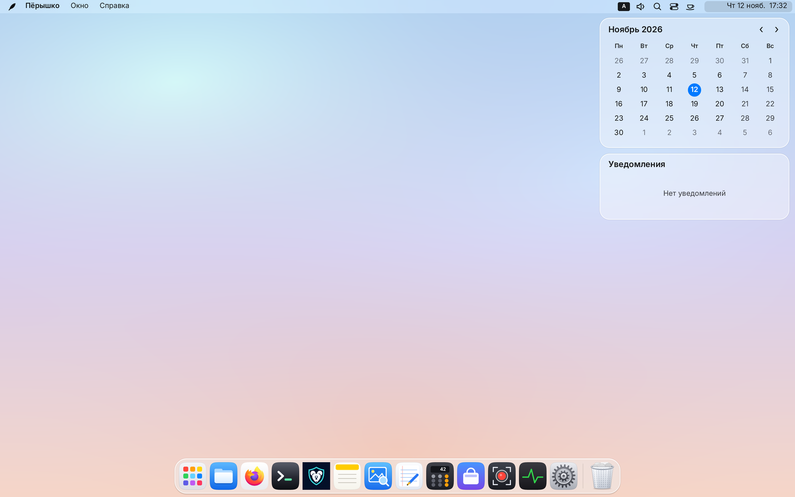

Клик по **часам и дате** в правом верхнем углу открывает шторку **Центра уведомлений**:
- Переключатель **«Не беспокоить»** сверху (также поддерживает автоматическое ночное расписание в настройках).
- Уведомления аккуратно группируются по программам, поддерживают кнопки быстрых действий (например, «Ответить» или «Открыть») и очистку как по одной карточке, так и всей истории сеанса сразу.

---

## 8. Снимки и запись экрана (`Print`, `Super + Alt + 5`)

В Пёрышко встроены собственные быстрые инструменты захвата экрана — сторонние программы не нужны:

| Задача | Горячие клавиши | Что происходит |
|---|---|---|
| **Снимок всего экрана** | `Print` | Мгновенно сохраняет снимок в папку («Изображения» или «Рабочий стол») **и** копирует в буфер обмена |
| **Снимок выбранной области** | `Shift + Print` | Позволяет выделить прямоугольную область мышью (`Esc` — отмена) |
| **Снимок активного окна** | `Alt + Print` | Делает чистый снимок активного окна |
| **Панель записи видео с экрана** | **`Super + Alt + 5`** (`⌥⌘5`) или `Ctrl + Shift + Print` | Открывает панель записи экрана: выбор **весь экран / область**, формат **MP4 / WebM**, включение системного звука и микрофона, показ курсора |

- Во время видеозаписи в правой части строки меню горит красная индикаторная кнопка с таймером — клик по ней (или повторное нажатие `Super + Alt + 5`) останавливает запись и сохраняет готовый видеофайл.
- Формат снимков (`PNG`, `JPEG` или `WebP`) и папка сохранения настраиваются в «Системных настройках → Рабочий стол и Dock».
- Для OBS Studio, веб-звонков в браузерах и Discord встроен портал `xdg-desktop-portal` (`ScreenCast` через PipeWire).

---

## 9. Встроенные приложения Пёрышка

Вместе с композитором поставляются **восемь нативных Wayland-приложений на Rust**, выполненных в едином дизайне, с поддержкой светлой/тёмной темы и мгновенным холодным стартом:

1. **📁 Файлы (`feather-files`, `Super + E`)**
   - Режимы значков и таблицы с сортировкой по имени, типу, дате и размеру; избранное, подключённые диски и Корзина в боковой панели.
   - **Быстрый просмотр по `Пробелу` (`Quick Look`):** выделите любой файл (картинку, PDF, код, текст, архив) и нажмите `Пробел` — откроется мгновенное превью, а стрелки `↑ / ↓ / ← / →` переключают соседние файлы без закрытия окна!
   - **Полная работа с архивами:** распаковка `ZIP` (включая русские имена из Windows), `7z`, `TAR.GZ / XZ / BZ2 / ZST`, а также **`RAR4 / RAR5`** (включая многотомные и защищённые паролем архивы) с карточкой прогресса и кнопкой отмены.
   - Сочетания: `Пробел` — быстрый просмотр, `Ctrl + L` — ввод пути, `Ctrl + H` — скрытые файлы, `F2` — переименование, `Ctrl + Shift + N` — новая папка.
2. **⌨️ Терминал (`feather-terminal`, `Super + Enter` или `Super + T`)**
   - Собственное быстрое VT-ядро с TrueColor, вкладками (`Ctrl + Shift + T`), поиском по истории на 10 000 строк (`Ctrl + Shift + F`), копированием/вставкой (`Ctrl + Shift + C / V`), поддержкой TUI-программ (`htop`, `nvim`, `zellij`, `mc`) и вставкой перетащенных файлов как экранированных путей.
3. **📝 Заметки (`feather-notes`)**
   - Мгновенные текстовые заметки с поиском, автосохранением и хранением обычными файлами в `~/.local/share/feather-notes/` (`Ctrl + N` — новая, `Ctrl + F` — поиск, `Ctrl + Z` — отмена). Также есть встроенные «Быстрые заметки» прямо в оболочке.
4. **🖼️ Просмотр (`feather-preview`)**
   - Просмотр изображений (`PNG`, `JPEG`, `WebP`, `SVG`) и многостраничных `PDF` с боковой лентой миниатюр страниц, масштабированием, поворотом и панорамированием мышью.
5. **📄 Текстовый редактор (`feather-textedit`)**
   - Лёгкий редактор кода и заметок с вкладками, номерами строк, поиском и заменой и подсветкой синтаксиса (`Rust`, `Markdown`, `Python`, `Shell`, `JSON/YAML/TOML`, `C/C++`, `HTML/XML`).
6. **🧮 Калькулятор (`feather-calc`)**
   - Три режима в одном окне: **Обычный**, **Инженерный** (тригонометрия, степени, логарифмы, скобки) и **Программистский** (`BIN / OCT / DEC / HEX`, побитовые операции `8/16/32/64 бит`), плюс журнал вычислений.
7. **📈 Мониторинг системы (`feather-monitor`, `Ctrl + Alt + Del`)**
   - Открывается по привычному **`Ctrl + Alt + Del`**: вкладка **«Процессы»** с поиском, сортировкой по ЦП/памяти и кнопкой «Снять задачу» (`Delete`, а с `Shift + Delete` — мгновенное принудительное завершение) и вкладка **«Производительность»** с живыми 60-секундными графиками процессора, памяти, диска и сети.
8. **🛍️ Магазин программ (`feather-store`)**
   - Каталог приложений Linux (AppStream) с поиском, категориями, описаниями и установкой/удалением в один клик через `PackageKit`.

---

## 10. Системные настройки (все 15 разделов)

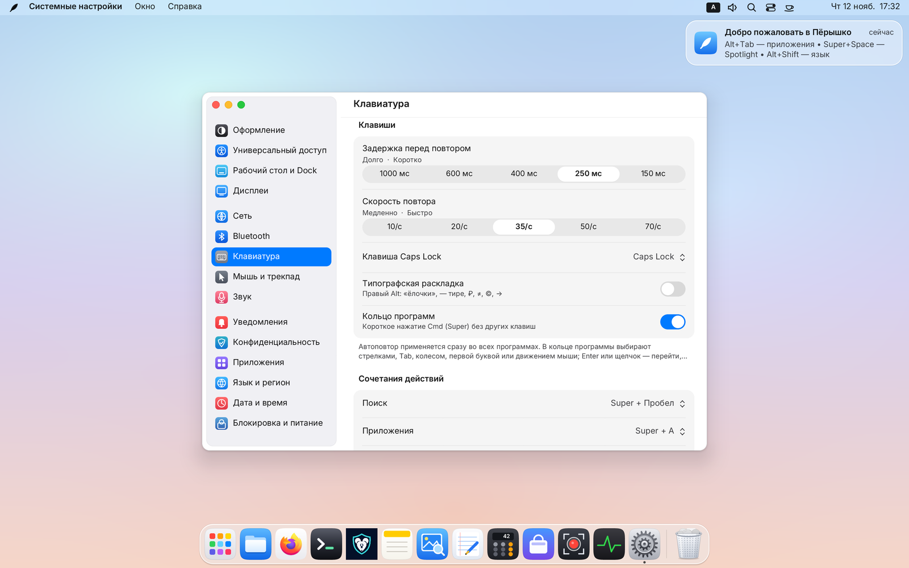

Все настройки собраны в едином окне и мгновенно сохраняются в `~/.config/feather-de/settings.conf`:

1. **Оформление** — светлая и тёмная темы, цвет акцента и выделения, размер шрифта интерфейса, синхронизация темы GTK-приложений и включение плавных пружинных анимаций.
2. **Универсальный доступ** — крупный текст, повышенный контраст, уменьшение прозрачности (отключение преломления стекла) и залипание модификаторов (`Sticky Keys`).
3. **Язык и регион** — мгновенное переключение языка всей оболочки (`RU`, `EN`, `ES`, `DE`, `FR`, `ZH`), формат времени (24/12 ч), первый день недели и метрические единицы.
4. **Сеть** — Wi-Fi, сохранённые сети, проводной Ethernet и туннели VPN / WireGuard.
5. **Bluetooth** — поиск, сопряжение, автоподключение и удаление беспроводных устройств.
6. **Клавиатура** — список раскладок, выбор клавиши смены языка (`Alt + Shift`, `Caps Lock`, `Ctrl + Shift`, `Win + Пробел`), поведение `Caps Lock`, скорость/задержка автоповтора, Кольцо программ по `Cmd` и **полная таблица переназначения горячих клавиш системы**.
7. **Мышь и трекпад** — скорость указателя, естественная прокрутка отдельно для мыши и трекпада, касание для клика (`Tap-to-click`), режим для левшей, тема и размер курсора.
8. **Дисплеи** — масштаб интерфейса HiDPI (`100 % … 250 %`, также быстро листается по `Super + =` / `Super + -`), разрешение и герцовка (`60 / 120 / 144 / 240 Гц`), взаимное расположение нескольких мониторов, выбор основного экрана, масштаб XWayland/Wine и Ночной режим по расписанию.
9. **Рабочий стол и Dock** — галерея встроенных и пользовательских обоев (со сменой по таймеру), размер, край экрана и автоскрытие Dock, папка/формат скриншотов, восстановление окон прошлого сеанса и **Активные углы экрана** (наведение мыши в угол может открывать Mission Control, Launchpad, Spotlight, Центр уведомлений, сворачивать окна или блокировать экран).
10. **Приложения** — выбор браузера, терминала и файлового менеджера по умолчанию + список программ **Автозапуска** при входе в сеанс.
11. **Конфиденциальность** — управление разрешениями программ на захват экрана через портал.
12. **Дата и время** — часовой пояс с быстрым поиском города и синхронизация времени по сети (`NTP`).
13. **Блокировка и питание** — раздельное время до автоблокировки экрана (`Super + L`), гашения монитора (`DPMS`) и перехода в режим сна.
14. **Уведомления** — индивидуальные правила доставки уведомлений (баннеры + звук, тихо в Центр или выключено) для каждой программы и расписание режима «Не беспокоить».
15. **Звук** — выбор выходов и микрофона, усиление записи, пооконный аудио-микшер всех запущенных программ, системные звуковые сигналы и автопереключение на наушники.

---

## 11. Запуск Linux-, X11- и Windows-программ (Wine / Proton / Игры)

- **Нативные Wayland-, Flatpak- и Snap-программы** автоматически появляются в Launchpad, Spotlight и Dock сразу после установки.
- **X11-программы (Steam, Discord, старые утилиты)** работают бесшовно и прозрачно через встроенную интеграцию с `xwayland-satellite` — он запускается по требованию только тогда, когда открыта хотя бы одна X11-программа.
- **Windows-игры и программы (Wine / Steam Proton):**
  - Поддерживаются захват и блокировка курсора для 3D-камер (`wp_pointer_constraints` и `wp_relative_pointer`), вращение камеры зажатой ПКМ в MMORPG/шутерах, переменная частота обновления **VRR (FreeSync / Adaptive-Sync)**, `explicit sync` и прямой вывод полноэкранного кадра на монитор в обход композитора (**Direct Scanout**) для минимальной задержки ввода.
  - Если на HiDPI-экране Windows-программа в Wine выглядит слишком мелкой или размытой, в **«Системных настройках → Дисплеи»** есть отдельный переключатель масштабирования XWayland/Wine.

---

## 12. Управление из терминала (`featherctl`) и полная шпаргалка горячих клавиш

### Командная утилита `featherctl`
Всеми возможностями Пёрышка можно управлять из скриптов, терминала или голосовых ассистентов через быструю утилиту `featherctl` (добавьте `--json` для машиночитаемого вывода):

```bash
featherctl status                      # Краткая сводка по системе
featherctl windows                     # Список открытых окон на всех столах
featherctl spaces                      # Список рабочих столов
featherctl space 3                     # Перейти на рабочий стол 3
featherctl space-mode 0 tape           # Включить «Бесконечную ленту» на текущем столе (free | tile | tape | next)
featherctl window pip 0 on ghost       # Закрепить активное окно в Призрачном PiP («Сквозь курсор»)
featherctl menu-hud toggle             # Открыть/закрыть поиск по командам меню (Menu HUD)
featherctl shelf add ~/Отчёт.pdf       # Положить файл на стеклянную Полку перетаскивания
featherctl audio streams               # Показать все звучащие программы и их громкость
featherctl audio app-volume 41 60      # Установить громкость потока #41 на 60%
featherctl display dark toggle         # Переключить светлую / тёмную тему
featherctl screenshot screen           # Сделать снимок экрана и вывести путь к файлу
```

Полная спецификация D-Bus интерфейса `org.feather.Shell1` приведена в [docs/API.md](API.md).

---

### Полная шпаргалка горячих клавиш Пёрышка

#### Оболочка, поиск и шторки
| Сочетание | Действие |
|---|---|
| `Super` *(короткое одиночное нажатие)* | Открыть радиальное **Кольцо программ** (`Super, Super` — вернуться к прошлому окну) |
| `Super + Пробел` | Поиск **Spotlight** (программы, окна, файлы, настройки, калькулятор) |
| `Super + /` | **Menu HUD** — мгновенный поиск по командам меню активного окна |
| `Super + A` | Сетка приложений **Launchpad** |
| `Super + N` | Верхняя шторка **Пункта управления** (Wi-Fi, Bluetooth, звук, яркость) |
| `Super + S` / `Super + Shift + S` | Показать/скрыть шторку **Подложки** / отправить активное окно на Подложку и обратно |
| `Super + D` *(или встряхивание мыши при drag)* | Открыть/скрыть стеклянную **Полку перетаскивания (`Drop Shelf`)** |
| `Super + Shift + V` | История буфера обмена с быстрой вставкой |
| `Super + .` | Панель эмодзи |
| `Super + Enter` / `Super + T` | Открыть Терминал |
| `Super + E` | Открыть Файлы |
| `Ctrl + Alt + Del` | Открыть Мониторинг системы (диспетчер задач) |
| `Super + L` | Заблокировать экран |
| `Super + =` / `Super + -` | Переключить масштаб интерфейса HiDPI |

#### Окна и Призрачный PiP
| Сочетание | Действие |
|---|---|
| `Alt + Tab` / `Super + Tab` | Переключатель приложений (в порядке последнего использования) |
| `` Alt + ` `` / `` Super + ` `` | Циклическое переключение окон **текущей** программы (`+ Shift` — в обратную сторону) |
| `Super + W` / `Super + Q` | Закрыть активное окно / завершить программу целиком |
| `Super + M` / `Super + F` | Свернуть окно в Dock / развернуть окно |
| `Super + H` / `Super + Alt + H` | Скрыть окна текущей программы / скрыть все остальные программы |
| `Ctrl + Super + ← / → / ↑ / ↓` | Прижать плавающее окно к половине или четверти экрана |
| `Super + P` | Закрепить окно в режиме **«Картинка в картинке» (PiP)** поверх всех столов |
| `Super + Alt + P` | Включить/выключить **Призрачный PiP («Сквозь курсор»)** (удержание `Super` позволяет перетащить окно) |
| `Super + ЛКМ` / `Super + ПКМ` | Переместить окно за любую точку / изменить размер окна |

#### Рабочие столы, Тайлинг (`Tile`) и Бесконечная лента (`Tape`)
| Сочетание | Действие |
|---|---|
| **`Super + 1…9`** (`Cmd + 1…9`) | Прямой переход на рабочий стол `1…9` (создаёт стол на лету, убирает пустые при уходе) |
| **`Super + Shift + 1…9`** | Перенести активное окно сразу на стол `1…9` и перейти за ним |
| `Ctrl + Alt + ← / →` *(или свайп 3 пальцами)* | Перейти на предыдущий / следующий рабочий стол |
| `Ctrl + Alt + Shift + ← / →` | Перенести активное окно на соседний рабочий стол |
| `Ctrl + Alt + ↑` / `Ctrl + Alt + ↓` | Открыть / закрыть обзор окон и столов **Mission Control** |
| **`Ctrl + Alt + M`** | Переключить режим раскладки текущего стола: **Свободные окна → Авто-плитка → Бесконечная лента** |
| `Super + ← / → / ↑ / ↓` *(в `Tile` / `Tape` / Подложке)* | Перевести фокус на соседнюю плитку или колонку ленты |
| `Super + Shift + ← / → / ↑ / ↓` | Поменять плитки/колонки местами (в `Tile` у края — повернуть ось разбиения) |
| `Ctrl + Super + ← / → / ↑ / ↓` *(или `Alt + Super + …`)* | Плавно изменить размер плитки или ширину колонки |
| **`Super + колёсико мыши / трекпад`** *(в `Tape`)* | Плавный горизонтальный скроллинг Бесконечной ленты |
| **`Super + R`** *(в `Tape`)* | Циклический пресет ширины колонки ленты: **`50 % → 67 % → 100 % → 33 %`** |
| `Super + Home` / `Super + End` *(в `Tape`)* | Перейти к первой / последней колонке ленты |
| `Super + 0` | Выровнять все пропорции плиток/колонок по умолчанию (`50 / 50`) |

#### Снимки экрана, видеозапись и сеанс
| Сочетание | Действие |
|---|---|
| `Print` / `Shift + Print` / `Alt + Print` | Снимок всего экрана / выбранной области / активного окна |
| **`Super + Alt + 5`** (`⌥⌘5`) / `Ctrl + Shift + Print` | Панель записи видео с экрана (MP4 / WebM со звуком) |
| `Ctrl + Alt + F1…F12` | Переключение виртуальных консолей Linux (TTY) в DRM-режиме |
| `Ctrl + Alt + Backspace` | Аварийное завершение графического сеанса |
